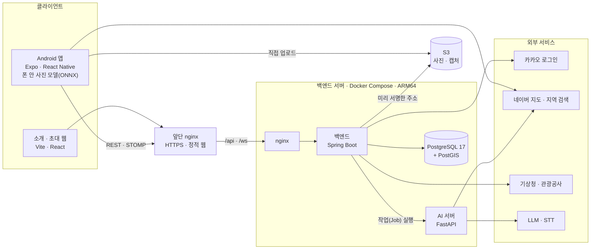
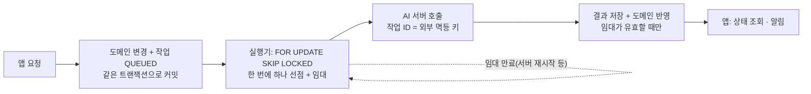

# 어디로그: 링크로 모으고 투표로 정해 함께 짜는 그룹 여행 앱

<p align="center">
  
</p>

> 6인 팀 프로젝트 · 2026.10 – 2026.11

친구들과 여행 한 번을 준비하면서 생기는 **장소 모으기, 여행지 정하기, 코스 짜기, 사진과 경비 정리**를 한 앱에서 끝내는 서비스입니다.

- **여행 만든 사람**: 여행을 만들고 링크 하나로 친구를 초대, 날짜와 여행지를 정함
- **동행**: 링크·캡처로 장소를 담고 투표하고, 누구나 코스를 고치고 적용함
- **여행이 끝나면**: 사진은 주제별로 정리되고, 누가 얼마를 냈는지 적으면 정산 금액이 나옴

---

## 1. Introduction

친구들과 여행을 준비하면 늘 같은 곳에서 막힙니다. 단톡방에 올린 맛집 링크는 대화에 묻히고, 다 좋다고 하는데 아무도 여행지를 정하지 않고, 일정표는 한 사람만 적고, 여행이 끝나면 사진은 흩어지고 정산은 몇 주째 미뤄집니다.

**어디로그**는 이 과정을 **모으기 → 정하기 → 짜기 → 남기기** 하나의 흐름으로 묶습니다. 링크와 캡처에서 장소를 찾아 지도에 담고, 투표로 정하고, 모은 장소로 코스를 추천받아 함께 고치고, 여행이 끝나면 사진과 경비를 정리합니다.

- 앱은 Android(Expo)이고, 소개·초대·카카오 로그인 콜백만 웹으로 둡니다.
- AI는 **무엇을 넣으면 무엇이 나오는지가 분명한 곳**에만 씁니다. 사실을 지어내거나 사용자가 확정한 데이터를 몰래 덮어쓰지 않습니다.

## 2. Key Features

| 도메인 | 설명 |
|---|---|
| 회원 / 인증 | 카카오 로그인(PKCE), JWT 인가, 프로필과 여행 취향 입력 |
| 여행 / 동행 | 여행 만들기, 카카오톡 초대 링크, 앱 안에서 맞팔 친구 초대, 나가기와 방장 위임 |
| **장소 모으기** | 영상·블로그 **링크와 캡처에서 장소를 찾아** 지도에 담기, 내 저장과 그룹 저장, 겹친 곳 모아 보기 |
| 투표 | 지역 투표와 장소 투표, 마감 시간에 자동 확정, 결과를 채팅방에 카드로 |
| **코스** | 모은 장소로 **날짜별 코스 자동 추천**, 직접 만들기, 구간별 이동 수단과 시간, 동행과 함께 고치기 |
| 코스 변경안 | 장소를 빼면 남은 일정을 AI가 다시 짜서 전후 비교, 적용 직후 한 번 되돌리기 |
| **말로 입력** | 날짜와 가고 싶은 곳을 쭉 말하면 **날마다 나뉜 여행 초안**, 여러 지출을 한 번에 말로 기록 |
| 여행 중 | 오늘 코스, 날씨와 날씨 대안, 준비물 체크, 근처 화장실·충전소 찾기, 다녀왔어요 기록 |
| **사진** | 업로드한 사진 주제 분류와 비슷한 사진 묶기, **폰 안에서 한국어 문장으로 사진 찾기** |
| 경비 / 정산 | 지출 입력, 나눌 사람 지정, 정산 금액 계산 |
| 기록 | 방문한 곳 별점과 한 줄 평, 타임라인, 여행 요약 카드, 친구에게 공개 |
| 홈 / 탐색 | 친구들이 다녀온 여행을 지역별로 보여 주는 지도, 요즘 뜨는 여행지 |
| 채팅 / 알림 | 여행마다 그룹 채팅, 투표·변경안·동행 참여 알림 |

## 3. Tech Stack

| 분류 | 기술 |
|---|---|
| Mobile |        |
| Web |   |
| Backend |       |
| AI |      |
| Database / Storage |    |
| Infra / CI-CD |      |
| External API | 카카오 로그인 · 네이버 지도 / 지역 검색 · 기상청 단기예보 · 한국관광공사 |

## 4. Usage

비밀 값은 저장소에 없습니다. 폴더마다 있는 `.env.example`을 복사해 `.env`를 만들고 값을 채웁니다.

```bash
# 앱 (frontend/)
cd frontend
npm ci
cp .env.example .env          # 서버 없이 화면만 보려면 EXPO_PUBLIC_DEV_MOCK=true
npm run build:android         # 처음 한 번: 개발 빌드 설치 (Expo Go 아님)
npm start

# 백엔드 (EodiLog/) — Java 25, Docker 필요
cd EodiLog
cp .env.example .env
docker compose up -d          # PostgreSQL 17 + PostGIS
./gradlew bootRun --args='--spring.profiles.active=local'

# AI 서버 (ai/) — Python 3.11, uv 필요
cd ai
cp .env.example .env
uv sync --group dev           # 사진 모델까지: uv sync --extra vision
uv run uvicorn app.main:app --reload
```

- Windows에서는 **짧은 영문 경로**(예: `C:\dev\eodilog`)에 클론합니다. 경로가 길거나 한글이 있으면 Android 네이티브 빌드가 260자 제한에 걸립니다.
- 운영 배포 순서는 [`deploy/README.md`](deploy/README.md)에 있습니다.

## 5. Directory Structure

```
eodilog/
├── frontend/                 # ⭐ Android 앱 (Expo + React Native)
│   ├── src/app/                # 화면 100개 (Expo Router, 파일 하나가 화면 하나)
│   ├── src/features/           # 기능별 폴더: trip, course, poll, chat, expense, photo, ondevice, voice-trip …
│   ├── src/api/                # API 클라이언트 + 서버 없이 도는 가짜 서버(dev-mock)
│   ├── plugins/                # Expo 설정 플러그인 (네이티브 빌드 보정)
│   └── specs/                  # 기능별 명세와 작업 목록
├── EodiLog/                  # ⭐ 백엔드 (Spring Boot)
│   ├── src/main/java/com/eodilog/
│   │   ├── trip/ invitation/     # 여행, 동행, 초대
│   │   ├── place/ region/        # 장소, 지역 (PostGIS)
│   │   ├── itinerary/ poll/      # 코스, 투표
│   │   ├── chat/ notification/   # 채팅(STOMP), 알림
│   │   ├── expense/ photo/       # 경비·정산, 사진
│   │   ├── job/                  # ⭐ PostgreSQL 기반 비동기 작업 큐
│   │   └── extraction/ recommendation/ voicetrip/ …  # AI 서버 연동
│   └── src/main/resources/db/  # Flyway 마이그레이션 59개
├── ai/                       # ⭐ AI 서버 (FastAPI)
│   ├── app/features/           # 장소 추출, 추천, 코스 제안, 사진 분류, 날씨 대안, 말로 입력 …
│   ├── scripts/ondevice/       # 폰용 사진 모델 학습·줄이기
│   ├── eval_data/              # 기능별 평가 세트
│   └── docs/reports/           # 평가 보고서
├── landing-src/              # 소개 · 초대 · 카카오 로그인 콜백 웹 (Vite)
├── landing/                  # 빌드된 정적 웹
├── deploy/                   # 운영 배포: Compose, nginx, Jenkins, 배포 스크립트
└── docs/                     # 기획, 화면 목록과 흐름, API 명세, ERD, 결정 기록
```

## 6. Architecture



- **앱 ↔ 서버**: 일반 요청은 REST, 채팅은 STOMP(WebSocket)로 받습니다. 실시간은 최선 노력이고 **REST가 기준**입니다. 끊겼다 붙으면 앱이 REST로 빈 구간을 다시 받습니다.
- **AI는 백엔드 뒤에 있습니다**: 앱은 AI 서버에 직접 닿지 않습니다. 백엔드가 권한을 확인하고, 허용된 데이터만 작업(Job)으로 넘깁니다.
- **사진은 앱이 S3에 바로 올립니다**: 백엔드는 미리 서명한 주소만 발급하고, 원본 바이트는 서버를 거치지 않습니다.
- 데이터 구조와 API는 [`docs/erd.dbml`](docs/erd.dbml), [`docs/api-spec.md`](docs/api-spec.md)를 참고하세요.

## 7. 폰 안 사진 AI — 서버로 보내지 않고 정리하고 찾는다

여행 기간에 찍은 내 폰 사진을 **폰에서** 주제별로 나누고, 비슷한 사진을 묶고, "해운대에서 먹은 회"처럼 **한국어 문장으로 찾습니다.**

### 7.1 왜 폰에서 하나

- **개인정보**: 여행 사진에는 얼굴, 위치, 영수증이 담깁니다. 분석하려고 서버로 보낼 이유가 없습니다.
- **여행지에는 와이파이가 없다**: 찍은 자리에서 인터넷 없이 바로 나누고 찾습니다. 비행기 모드에서도 분류와 검색이 됩니다.
- **전송량**: 4,000px 원본 50장은 약 118MB입니다. 폰에서 하면 분석 때문에 나가는 데이터는 0입니다.

### 7.2 큰 모델을 폰 크기로 — 성능은 그대로, 크기는 1/22

큰 선생 모델(SigLIP2 SO400M)을 먼저 분류와 한국어 설명 검색으로 학습하고, 폰 크기 모델(SigLIP2 B-32)이 선생의 판단과 문장-사진 유사도를 따라 하도록 함께 학습했습니다. 그다음 사진 모델은 8비트 흉내 학습 뒤 int8로, 문장 모델은 단어표를 21,975개로 줄인 뒤 4비트로 바꿨습니다.

| 단계 | 크기 | 주제 분류 | 문장 검색 (정답 5위 안) |
|---|---:|---:|---:|
| 큰 선생 SO400M | 4,334 MB | 97.77% | 78.5% |
| B-32 학습 후, 줄이기 전 | 1,438 MB | 97.31% | 79.0% |
| **폰용 최종** (사진 int8 + 문장 4비트) | **191 MB** | **97.41%** | **78.5%** |

> 평가 사진 1,931장(학습에 쓰지 않음). 학습 전 원본 모델은 분류 74.6%, 검색 52.1%였습니다. 정답 주제는 LLM이 두 번 판단해 일치한 것이고 사람 검토는 아닙니다.

### 7.3 폰 실측 — 2019년 폰에서

Galaxy S10 5G(Android 12), release 빌드 기준입니다.

| 항목 | 결과 |
|---|---|
| 모델 열기 | 1.3 ~ 1.4초 |
| 처음 정리 409장 | 124초, **장당 0.30초** |
| 다시 열기 414장 (저장한 결과 사용) | 0.1초 |
| 문장 검색 한 번 | 0.14 ~ 0.38초 |
| 비행기 모드 | 새로 찍은 사진 분류와 검색 모두 됨 |

- 모델은 설치 파일에 넣지 않고 **처음 쓸 때 받습니다**(4개 파일 약 200MB). 받기 전에 모바일 데이터면 묻고, 받은 파일은 크기로 확인합니다.
- 비슷한 사진 묶기 기준값은 **0.92**로 정했습니다. 같은 사진은 99.1% 묶고, 다른 사진이 잘못 묶이는 쌍은 1만 쌍에 0.46쌍입니다.
- 검색은 처음에 비슷한 순서로 60장을 채워 '바다'에 메뉴판이 섞였습니다. **1위 점수의 75%보다 낮은 사진을 빼도록** 고쳐 바다 사진만 남겼습니다.
- 사진 분류를 끈 사용자는 폰 정리를 시작하지 않습니다. 올린 사진의 결과만 서버에 보냅니다.

근거: [`ai/docs/reports/ondevice-photo-ai.md`](ai/docs/reports/ondevice-photo-ai.md)

## 8. 장소 찾기 AI — 지어내지 않는 것이 먼저

링크, 메모, 앱 화면 캡처에서 장소 이름을 찾아 네이버 지역 검색으로 위치를 맞춥니다. 사용자가 고른 것만 저장합니다.

### 8.1 평가

평가 세트를 먼저 정하고 실제 모델로 두 번씩 돌렸습니다.

| 기능 | 입력 | 결과 | 기준 |
|---|---|---|---|
| 링크 · 메모 | 17건 × 2회 | **17/17, 17/17** | 명세 통과 |
| 앱 화면 캡처 (지도앱, 블로그, SNS, 채팅) | 합성 50장 × 2회 | 재현율 **92.0%, 95.4%** · 장소 없는 캡처 6/6 | 85% 이상 |
| 캡처 지연 | 50장 | 중앙값 2.6초 · p90 3.4 ~ 3.7초 | - |
| 업로드 사진 주제 분류 (서버) | 77장 | **98.7%** (76/77) · 묶음 F1 0.980 | 90% 이상 |

### 8.2 찾은 문제와 고친 것

| 문제 | 원인 | 대응 |
|---|---|---|
| 광고에 나온 숙박업소를 장소로 냄 (2/2회) | 화면에 보이는 모든 상호를 후보로 봄 | 광고 영역 규칙 추가 → 재평가 2회 모두 안 냄 |
| 지운 '선크림'이 '자외선 차단제'로 다시 제안됨 | 같은 뜻 다른 말을 못 거름 | 지운 항목과 뜻이 같은 것도 제외 → 2/2회 통과 |
| LLM 장애 때 링크 제목이 장소 후보로 나옴 | 장애 시 대체 경로가 제목을 그대로 씀 | 대체 경로 수정, 단위 테스트로 고정 |
| 정확한 이름이 검색 5번째에 있어 잘림 | 검색 결과 앞쪽만 봄 | 5건을 받아 이름 일치로 다시 정렬 |
| 호텔 객실, 박물관 실내가 '풍경'으로 분류 | 실내 주제가 없음 | 실내는 '기타'로 → 76/77 |

> 평가 세트가 작습니다(기능당 17 ~ 92건). 몇 건 차이는 우열의 근거로 삼지 않습니다. 캡처는 직접 만든 합성 화면이고, 실제 사용자 캡처로 다시 재는 것이 남은 일입니다.

근거: [`ai/docs/reports/`](ai/docs/reports)

## 9. 함께 쓰는 여행 — 덮어쓰지 않고, 두 번 처리하지 않는다

여럿이 같은 여행을 고치는 앱이라 **동시에 고친 것**과 **같은 요청이 두 번 온 것**을 먼저 다뤘습니다.

### 9.1 버전으로 덮어쓰기를 막는다

코스, 투표, 경비, 정산, 설정처럼 함께 고치는 데이터는 저장할 때 `expectedVersion`을 보냅니다. 그사이 다른 사람이 저장했으면 서버는 덮어쓰지 않고 `409 VERSION_CONFLICT`를 돌려줍니다.

### 9.2 코스는 날짜 단위로 합친다

409를 받으면 앱이 최신 코스를 받아, **편집을 시작한 코스 / 내 초안 / 최신 코스** 셋을 일차 단위로 비교합니다.

| 상황 | 앱의 처리 |
|---|---|
| 서로 **다른 날**을 고쳤다 | 최신 코스에 내 날을 다시 얹고 알린다. 확인하고 저장하면 끝 |
| 내가 고친 게 없다 | 최신 코스로 조용히 바꾼다 |
| **같은 날**을 고쳤다 | "내 것으로 덮기 / 최신 코스 보기"를 묻는다. 덮어도 내가 고친 날만 덮는다 |

연결이 끊겼다 붙어도 같은 비교를 합니다. 저장하는 중이면 저장 결과(409)가 같은 비교를 하므로 건너뜁니다.

### 9.3 같은 요청은 한 번만

- **멱등 키**: 여행 만들기, 장소 찾기, 추천 요청처럼 다시 눌러도 하나만 생겨야 하는 요청은 `Idempotency-Key`를 보냅니다. 응답을 못 받고 다시 눌러도 같은 키로 보내 결과가 하나입니다.
- **채팅**: 메시지마다 앱이 만든 `clientMessageId`를 보내 재전송이 중복으로 쌓이지 않습니다. 방마다 `sequence`로 순서를 매기고, 다시 연결되면 **구독을 먼저 하고** 마지막으로 본 `sequence`까지 REST로 채워 빈 구간이 없게 합니다.

## 10. 비동기 작업 — PostgreSQL 하나로 만든 작업 큐

장소 찾기, 추천, 코스 제안, 사진 분류처럼 수 초 ~ 수십 초 걸리는 AI 일은 바로 응답하지 않고 **작업(Job)으로 접수**합니다. 앱은 `202`와 작업 ID를 받고 진행 상태를 봅니다. 별도 메시지 큐 없이 DB 하나로 만들었습니다.



| 위험 | 장치 |
|---|---|
| 요청은 저장됐는데 작업이 안 생김 | 작업 등록은 **호출한 도메인의 트랜잭션 안에서만** 가능하게 강제. 함께 커밋되고 함께 롤백 |
| 서버 두 대가 같은 작업을 잡음 | `FOR UPDATE SKIP LOCKED`로 하나씩 선점, 실행마다 임대 |
| 배포 중 실행이 끊김 | 실패로 확정하지 않고 남겨 두면 임대가 끝난 뒤 다른 실행기가 다시 잡음 |
| 다시 실행되어 외부 호출이 두 번 | 실행은 at-least-once. **작업 ID를 외부 공급자의 멱등 키**로 써서 중복을 막음 |
| 늦게 끝난 옛 실행이 결과를 덮음 | 결과 반영 전에 실행 ID와 임대 유효를 확인하고 작업 행을 잠금 |
| 다른 사람 작업 결과가 보임 | 종류마다 접수·실행·완료·조회 네 단계 권한 정책과 공개할 결과 필드 목록을 필수로 등록 |

근거: [`EodiLog/docs/plan/jobs-foundation.md`](EodiLog/docs/plan/jobs-foundation.md)

## 11. 배포 — 끊김 없이 바꾸고, 바로 되돌린다

dev에 병합되면 Jenkins가 백엔드 서버의 [`deploy/deploy.sh`](deploy/deploy.sh)를 실행합니다.

| 단계 | 하는 일 |
|---|---|
| 바뀐 것만 | dev로 맞춘 뒤 바뀐 서비스(백엔드 / AI / nginx)만 이미지를 빌드 |
| DB 백업 | **새 마이그레이션이 있을 때만** 교체 전에 DB를 백업 |
| 백엔드 교체 | **새 컨테이너를 먼저 띄우고 준비되면 옛 것을 내림.** 새 것이 못 뜨면 옛 것이 계속 서비스하고 배포는 실패로 끝남 |
| AI 교체 | 모델을 올리는 30 ~ 40초 동안 AI 기능만 실패하고, 비동기 작업은 백엔드가 다시 시도 |
| 되돌리기 | 이미지에 `latest`(방금 빌드) · `live`(지금 서비스) · `previous`(그 전) 이름표를 붙여 `deploy.sh rollback` 한 줄로 직전 이미지로 |

- 백엔드 서버는 ARM64입니다. x86 노트북에서 만든 이미지는 돌지 않아 서버에서 직접 빌드합니다. PostGIS도 ARM용 이미지를 씁니다.
- 백엔드 서버에서 밖으로 열린 포트는 443 하나이고, 앞단 서버에서 오는 요청만 받습니다.
- 사진 HEIC 변환을 위해 백엔드 이미지에 ImageMagick 7을 넣고, **빌드 중에 실제 HEIC 변환이 되는지 확인**합니다.

## 12. Testing

| 영역 | 방법 |
|---|---|
| 백엔드 (`EodiLog/`) | `./gradlew build` : JUnit 5 테스트 파일 109개. **Testcontainers로 실제 PostgreSQL + PostGIS를 띄워** 통합 테스트 |
| 앱 (`frontend/`) | `npm test` (Jest + React Native Testing Library, 테스트 파일 176개) · `npm run typecheck` · `npm run lint` |
| AI 서버 (`ai/`) | `uv run pytest` (테스트 파일 28개) |
| AI 품질 | `ai/eval_data/`의 평가 세트로 기능마다 실제 모델을 돌려 기준과 비교 ([`ai/docs/reports/`](ai/docs/reports)) |
| 서버 없이 화면 | 앱 안의 가짜 서버(`EXPO_PUBLIC_DEV_MOCK=true`)로 백엔드 없이 대부분의 화면과 흐름을 확인 |

## 13. Contributors

| **👑장수철** | **전성환** | **황승기** | **정인경** | **박세은** | **윤영광** |
|:---:|:---:|:---:|:---:|:---:|:---:|
| **AI** | **Backend** | **Backend / Infra** | **Frontend** | **Frontend** | **Frontend** |
