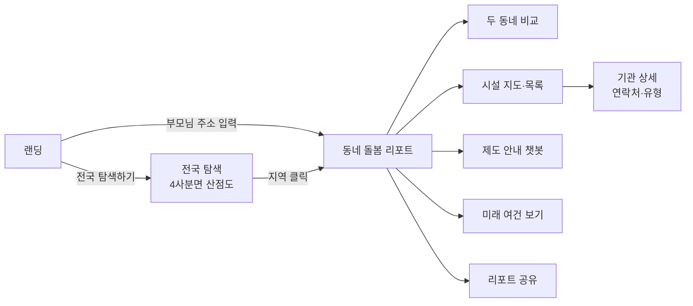
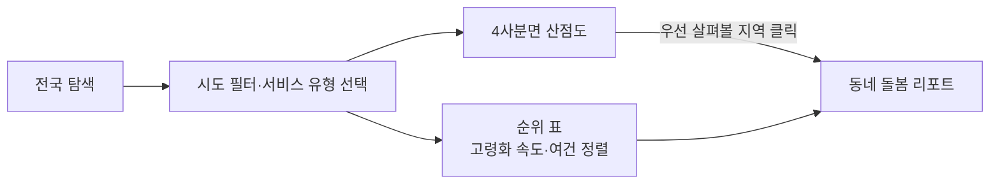
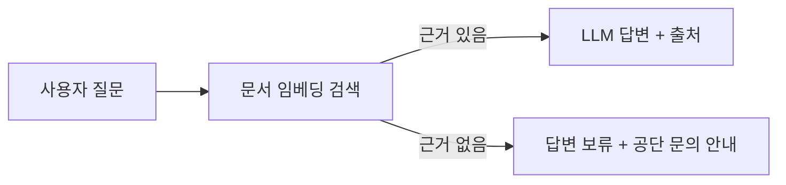
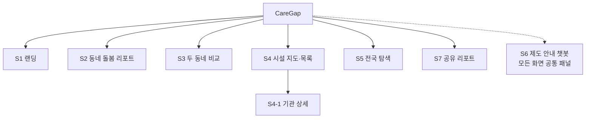

# CareGap 아이디어 문서 (초안)

> 부모님 동네의 돌봄 여건은 고령화 속도를 따라가고 있을까?

| 항목 | 내용 |
|------|------|
| 문서 상태 | 초안 (v0.1) |
| 작성일 | 2026-10-13 |
| 팀 | A204 · 장수철(팀장·AI), 전성환·황승기(BE), 정인경·박세은(FE) |
| 기간 | 6주 (자율 프로젝트) |

## 1. 한 줄 소개

AI로 추정한 장기요양 수요와 실제 시설 공급을 비교해, 부모님 동네의 돌봄 여건을 알려주는 **동네 돌봄 리포트** 서비스.

> **핵심 메시지:** 노인이 많은 동네와 돌봄을 더 살펴봐야 하는 동네는 다르다.

## 2. 문제 정의

부모님이 장기요양등급을 받으면 가족은 시설 이용, 이사, 모셔오기 같은 결정을 빠르게 내려야 한다. 하지만 지금 보호자가 할 수 있는 건 "근처에 어떤 시설이 있나"를 찾는 것뿐이다.

- 그 동네의 돌봄 수요에 비해 공급이 충분한지 알 수 없다.
- 기관 수가 많은 건지 적은 건지 판단할 비교 기준이 없다.
- 고령화가 빨라져도 앞으로 여건이 어떻게 변할지 알 수 없다.
- 방문요양·주야간보호·시설급여 차이 같은 제도가 어렵다.

> **문제:** 보호자는 부모님 동네의 장기요양 수요와 공급을 비교할 방법이 없어, 중요한 돌봄 결정을 감에 의존한다.

## 3. 타깃 사용자

### 주 사용자: 부모님 돌봄을 고민하는 자녀·보호자

**페르소나 (가상): 박준호, 45세, 서울 거주 회사원**

- 충남에 혼자 사는 어머니(79세)가 최근 장기요양 3등급을 받았다.
- 어머니 동네에서 주야간보호를 이용할지, 서울 근교로 모셔올지 고민 중이다.
- 두 동네 중 어디가 돌봄 여건이 나은지, 등급으로 어떤 서비스를 받을 수 있는지 모른다.
- 형제들과 같은 자료를 보며 논의하고 싶다.

### 보조 사용자: 지역 돌봄 인프라를 살펴보는 사람

복지 실무자, 연구자, 기관 운영자. 전국 탐색 모드에서 "추정 수요 대비 공급"으로 지역을 비교한다. 이 사용자를 위한 별도 기능은 만들지 않는다.

## 4. 핵심 기능

| # | 기능 | 설명 | 우선순위 |
|---|------|------|----------|
| F1 | 동네 돌봄 리포트 | 주소 → 시군구 변환, AI 예상 수요·유형별 공급·돌봄 여건 라벨·고령화 속도, LLM 설명 | 필수 |
| F2 | 시설 지도·목록 | 장기요양기관 유형별 위치·연락처, 병원 종별·진료과목 필터 | 필수 |
| F3 | 돌봄 여건 비교 (핵심 차별화) | 추정 수요 1,000명당 기관 수, 유사 동네 대비 백분위, "여유·보통·빠듯" 라벨 | 필수 |
| F4 | 두 동네 비교 | 부모님 동네 vs 내 동네를 같은 기준으로 나란히 비교 | 필수 |
| F5 | 전국 탐색 모드 | 고령화 속도 × 돌봄 여건 4사분면 산점도, 지역 선택 → 리포트 | 필수 |
| F6 | 미래 여건 시뮬레이션 | 시설이 현재 수준일 때 2030년 예상 수요 기준 여건 변화 | AI·차별화 |
| F7 | 제도 안내 챗봇 | 장기요양 안내 문서 기반 RAG, 출처와 함께 답변 | AI·차별화 |
| F8 | 리포트 공유 | 리포트·비교 결과를 링크로 가족에게 공유 | 후순위 |

## 5. AI 활용

AI가 핵심 지표를 만든다. 수요 추정 모델이 없으면 "돌봄 여건 지표" 자체가 성립하지 않는다.

| AI 기능 | 방법 | 결과 | 검증 |
|---------|------|------|------|
| ① 장기요양 수요 추정 | 65·75·85세 이상 인구, 독거노인·수급자 비율, 도농 유형 → 시군구별 장기요양 인정자 수 예측 (선형회귀 기준선 → XGBoost) | 현재·2030년 예상 수요 (돌봄 여건 지표의 분모) | 연도 분리 검증, 기준선 대비 오차 개선 |
| ② 유사 동네 군집 | 고령인구 규모·밀도·행정 유형·고령화 속도 표준화 후 k-means | 비교 기준 그룹, 그룹 내 백분위 | 실루엣 점수, 군집 특징 해석 |
| ③ LLM 동네 리포트 | ①·②의 계산 수치만 프롬프트에 넣고 문장 생성 | 보호자용 3~5문장 설명 | 출력 수치를 원본과 자동 대조 |
| ④ 제도 안내 RAG 챗봇 | 장기요양 안내 문서 임베딩(pgvector) 검색 + LLM 답변 | 출처가 붙은 답변, 근거 없으면 공단 문의 안내 | 질문 30개 평가셋 정답률 |

### 핵심 지표 정의

| 지표 | 정의 |
|------|------|
| 예상 수요 | 모델이 예측한 시군구별 장기요양 인정자 수 |
| 돌봄 여건 지표 | 유형별 기관 수 ÷ 예상 수요 × 1,000 |
| 유사 동네 대비 위치 | 같은 군집 안에서 돌봄 여건 지표의 백분위 → 여유(상위 1/3)·보통·빠듯(하위 1/3) |
| 고령화 속도 | 최근 5년 고령인구 증가율 |
| 미래 여건 | 현재 기관 수 ÷ 2030년 예상 수요 × 1,000 |

화면에는 '부족', '위험' 같은 판정 문구를 쓰지 않고, 항상 **"추정치"**와 **"비슷한 동네 대비"**를 함께 표시한다.

## 6. 기존 서비스와 차별점

| 기존 서비스 | 제공하는 것 | CareGap |
|-------------|-------------|---------|
| 건보공단 장기요양기관 검색 | 기관 목록·위치 | 그 동네 수요 대비 공급이 충분한지까지 보여줌 |
| KOSIS 지역 통계 | 고령화율·인구 수치 | 보호자 언어로 해석한 동네 리포트 |
| 민간 보호자 앱 (또하나의가족, 이로움돌봄) | 시설 검색·비교, 등급 예상 테스트 | 시설이 아니라 동네 단위로 돌봄 여건과 미래 변화를 비교 |

## 7. 사용자 흐름

### 7-1. 전체 흐름



### 7-2. 주 시나리오: 박준호의 하루

| 단계 | 사용자 행동 | 화면 | 시스템 동작 |
|------|-------------|------|-------------|
| 1 | 어머니의 충남 주소를 입력한다 | 랜딩 | 주소 → 시군구 코드 변환, 원본 주소 폐기 |
| 2 | 동네 리포트를 본다 | 리포트 | 예상 수요·공급·여건 라벨 조회, LLM 설명 생성(캐시) |
| 3 | "주야간보호 여건: 빠듯 (비슷한 동네 중 하위 20%)"을 확인한다 | 리포트 | 군집 내 백분위 표시 |
| 4 | 챗봇에 "3등급이면 주야간보호를 쓸 수 있어?"라고 묻는다 | 챗봇 패널 | RAG 검색 → 출처 붙은 답변 |
| 5 | 자기가 사는 경기 ○○시를 추가해 비교한다 | 두 동네 비교 | 두 시군구 지표 나란히 표시 |
| 6 | 두 동네의 주야간보호센터 목록을 확인한다 | 시설 지도 | 유형 필터, 기관 연락처 |
| 7 | 비교 결과를 형제 단톡방에 공유한다 | 공유 | 공유 링크 생성 |

### 7-3. 보조 흐름: 전국 탐색



### 7-4. 챗봇 흐름



## 8. 화면 설계 구조

### 8-1. 정보 구조 (IA)



### 8-2. 화면 목록

| ID | 화면 | 경로(안) | 주요 구성 | 관련 기능 | 우선순위 |
|----|------|----------|-----------|-----------|----------|
| S1 | 랜딩 | `/` | 주소 검색, 서비스 소개, 전국 탐색 진입 | F1, F5 | 필수 |
| S2 | 동네 돌봄 리포트 | `/report/{regionCode}` | 요약 카드, AI 설명, 유형별 여건, 고령화 추이, 미래 여건 | F1, F3, F6 | 필수 |
| S3 | 두 동네 비교 | `/compare?a={code}&b={code}` | 지표 나란히 비교, 차이 하이라이트 | F4 | 필수 |
| S4 | 시설 지도·목록 | `/facilities?region={code}` | 지도, 유형 필터, 기관 리스트 | F2 | 필수 |
| S4-1 | 기관 상세 | 시트/모달 | 주소·연락처·서비스 유형, 확인 필요 안내 | F2 | 필수 |
| S5 | 전국 탐색 | `/explore` | 필터, 4사분면 산점도, 순위 표, 단계구분도 | F5 | 필수 |
| S6 | 제도 안내 챗봇 | 우측 패널(모바일: 하단 시트) | 추천 질문, 대화, 출처 링크 | F7 | AI·차별화 |
| S7 | 공유 리포트 | `/share/{id}` | 읽기 전용 리포트·비교 | F8 | 후순위 |

### 8-3. 화면별 구성

#### S1. 랜딩

```
┌──────────────────────────────────────────────┐
│ CareGap 로고                        전국 탐색 │
├──────────────────────────────────────────────┤
│ 부모님 동네의 돌봄 여건, 지금 확인해보세요     │
│ ┌──────────────────────────────┐ ┌────────┐ │
│ │ 부모님 주소 입력 (도로명/동)  │ │리포트보기│ │
│ └──────────────────────────────┘ └────────┘ │
│ * 주소는 시군구로만 변환되고 저장되지 않아요   │
├──────────────────────────────────────────────┤
│ [이런 걸 알 수 있어요] 3단 카드                │
│  돌봄 여건 라벨 | 두 동네 비교 | 제도 질문     │
└──────────────────────────────────────────────┘
```

#### S2. 동네 돌봄 리포트 (핵심 화면)

```
┌──────────────────────────────────────────────┐
│ ← 충청남도 ○○군            [비교하기] [공유]  │
├──────────────────────────────────────────────┤
│ 요약 카드 3개                                  │
│ [AI 예상 돌봄 수요 약 1,840명]                 │
│ [고령화 속도 5년 +18%]                         │
│ [종합 여건: 빠듯 · 비슷한 동네 중 하위 20%]     │
├──────────────────────────────────────────────┤
│ AI 설명 (LLM)  * 추정치 기반                   │
│ "비슷한 군 지역보다 주야간보호 여건이 ..."       │
├──────────────────────────────────────────────┤
│ 서비스 유형별 여건 (방문요양/주야간보호/시설)   │
│ 유형 | 기관 수 | 수요 1,000명당 | 라벨 | 위치바 │
├──────────────────────────────────────────────┤
│ 고령인구 추이 차트 (과거 → 2030 추계)          │
├──────────────────────────────────────────────┤
│ 미래 여건: 지금 1.6곳 → 2030년 1.1곳 (시설 유지 시)│
├──────────────────────────────────────────────┤
│ [이 동네 시설 보기]                            │
└──────────────────────────────────────────────┘
                              [챗봇 열기 버튼]
```

(수치는 예시)

#### S3. 두 동네 비교

```
┌──────────────────────────────────────────────┐
│ [동네 A: 충남 ○○군 ▼]  vs  [동네 B: 경기 ○○시 ▼] │
├──────────────────────────────────────────────┤
│ 지표            │   A    │   B    │ 차이        │
│ 예상 돌봄 수요  │ 1,840  │ 6,200  │             │
│ 고령화 속도     │ +18%   │ +31%   │ B가 빠름    │
│ 주야간보호 여건 │ 빠듯   │ 보통   │ B가 나음    │
│ 방문요양 여건   │ 보통   │ 보통   │             │
│ 2030 여건       │ 빠듯   │ 빠듯   │             │
├──────────────────────────────────────────────┤
│ AI 비교 요약 (LLM)                            │
│ [두 동네 시설 보기] [공유]                     │
└──────────────────────────────────────────────┘
```

#### S4. 시설 지도·목록

- 상단: 지역 표시, 서비스 유형 필터(방문요양·주야간보호·시설급여·병원), 반경 선택
- 좌측(모바일: 상단): 카카오맵, 유형별 마커
- 우측(모바일: 하단 리스트): 기관 카드(이름, 유형, 주소, 연락처)
- 기관 상세(S4-1): 기본 정보 + "입소 가능 여부·비용은 기관에 직접 확인하세요" 안내

#### S5. 전국 탐색

- 필터 바: 시도, 서비스 유형, 지표 기준
- 메인: 4사분면 산점도 (X 고령화 속도, Y 돌봄 여건, 기준선 = 유사 동네 그룹 중앙값)
- 보조 탭: 단계구분도 지도 / 순위 표
- 점·행 클릭 → S2 리포트

#### S6. 제도 안내 챗봇

- 추천 질문 칩: "등급별로 받을 수 있는 서비스는?", "주야간보호와 방문요양 차이는?", "본인부담금은 얼마야?"
- 답변 하단에 출처 문서 링크
- 근거가 없으면 "공단(1577-1000)에 문의하세요" 안내

### 8-4. 공통 컴포넌트

| 컴포넌트 | 사용 화면 | 설명 |
|----------|-----------|------|
| 주소 검색 | S1, S3 | 주소 → 시군구 코드 변환 |
| 여건 라벨 배지 | S2, S3, S5 | 여유·보통·빠듯 + 백분위 툴팁 |
| 추정치 안내 | S2, S3, S5 | "AI 추정치, 기준연도, 출처" 표시 |
| 지표 카드 | S2, S3 | 수치 + 단위 + 설명 |
| 챗봇 패널 | 전 화면 | 우측 패널 / 모바일 하단 시트 |
| 출처 푸터 | 전 화면 | 데이터 출처·갱신 시점 |

### 8-5. 화면 상태

| 상태 | 처리 |
|------|------|
| 로딩 | 요약 카드 스켈레톤, LLM 설명은 별도 로딩 |
| 데이터 없음 | 장래추계 미제공 지역은 "이 지역은 2030년 추계가 제공되지 않아요" |
| LLM 실패 | AI 설명 영역만 숨기고 수치 리포트는 그대로 표시 |
| 주소 인식 실패 | 시군구 직접 선택 드롭다운 제공 |

## 9. 활용 데이터

| 데이터 | 출처 | 용도 | 확보 전망 |
|--------|------|------|-----------|
| 시군구별 장기요양 인정자 수 | 노인장기요양보험 통계연보 | 수요 모델 학습 정답 | 1주차 검증 |
| 연령별 인구·과거 추이 | KOSIS · 행안부 | 모델 입력, 고령화 속도 | 높음 |
| 독거노인가구·노인 수급자 비율 | KOSIS | 모델 입력 | 높음 |
| 지역별 장래인구추계 | KOSIS | 2030년 수요 | 지역·연도 확인 필요 |
| 장기요양기관 위치·유형 | 국민건강보험공단 API | 공급, 시설 지도 | 높음 |
| 병원 위치·진료과목 | 건강보험심사평가원 API | 시설 지도 | 높음 |
| 시군구 경계 | SGIS | 지도, 주소 변환 | 높음 |
| 장기요양 제도 안내 문서 | 국민건강보험공단 안내 자료 | 챗봇 근거 | 높음 (수집·정제 필요) |
| 기관 정원·현원 | 건보공단 기관 상세 | 정원 기준 공급 | 검증 필요 |

## 10. 리스크와 대응

| 리스크 | 대응 |
|--------|------|
| 시군구별 인정자 수를 구하지 못함 | 시도 단위 학습 후 시군구 적용, 화면에 제약 명시 |
| 보호자가 지표를 "부족 판정"으로 오해 | 판정 문구 금지, "비슷한 동네 대비"와 "추정치" 항상 표시 |
| 기관 수 ≠ 실제 정원·서비스 능력 | 정원 데이터 확보 시 반영, 없으면 "기관 수 기준" 명시 |
| LLM 수치 오류, 챗봇 제도 오답 | 계산 수치만 입력·출력 대조, 답변마다 출처, 근거 없으면 답하지 않음 |
| 부모님 주소(개인정보) | 시군구 변환 후 원본 미저장, 백엔드는 Private Subnet 배치 |
| 기존 보호자 앱과 비교됨 | 시설 단위가 아닌 동네 단위 비교와 미래 여건을 핵심으로 발표 |

> CareGap은 돌봄 결정을 대신하거나 시설 부족을 확정하지 않는다. 가족의 돌봄 결정에 필요한 **비교 근거**를 제공한다.

## 11. 기술 구성 (안)

| 영역 | 기술 |
|------|------|
| Frontend | React, TypeScript, 카카오맵, ECharts |
| Backend | Spring Boot, Spring Batch, Redis |
| AI·분석 | Python, FastAPI, scikit-learn, XGBoost, LLM API |
| DB | PostgreSQL + PostGIS + pgvector |
| Infra | AWS VPC (Public: Nginx / Private: Spring Boot·FastAPI), EC2, Docker, GitLab CI/CD, GPU 서버(모델 학습·추론 실험) |

## 12. MVP 범위

- **필수:** 동네 돌봄 리포트, 시설 지도·목록, 두 동네 비교, 전국 탐색 4사분면
- **AI·차별화:** 수요 추정 모델, 유사 동네 군집, LLM 동네 리포트, 제도 안내 RAG 챗봇, 미래 여건 시뮬레이션
- **후순위:** 리포트 공유·PDF, 격자 단위 접근성 분석
- **제외:** 실시간 입소 가능 여부, 시설 품질 평가

## 13. 열린 질문 (1주차에 결정)

- [ ] 시군구별 장기요양 인정자 수를 연도별로 확보할 수 있는가?
- [ ] 장래인구추계가 시군구 단위로 2030년까지 제공되는가?
- [ ] 장기요양기관 API에 정원·현원 필드가 있는가?
- [ ] 여건 라벨 기준(상위·하위 1/3)이 직관적인가? 보호자 2~3명에게 확인
- [ ] 챗봇 근거 문서 범위와 갱신 주기
