# 이어행 사용자 흐름

> **폐기된 PRD의 파생 문서 — 2026-10-22.** [새 어디로그 PRD](../../_bmad-output/planning-artifacts/prds/prd-EODI-2026-10-22/prd.md)를 기준으로 다시 작성해야 한다. 아래 화면 흐름·담당자 제안·기존 Jira 연결은 새 기획의 확정 설계가 아니다.

> 이어행 PRD v0.3의 핵심 사용자 흐름(§서비스 한눈에 보기, §6 UJ-1~4)과 기능 요구사항(IE-FR-01~22)을 화면 단위 흐름으로 정리한다.
> 화면 목록 확정(EODI-47)의 입력으로 쓴다.

**표기 규칙**

- `[A-N]`은 PRD의 가정(제안), `Q-N`은 PRD의 미정 결정이다. 흐름도에서 해당 분기는 확정이 아니다.
- 흐름은 화면 이동과 분기만 다룬다. 버튼 배치·화면 개수는 UX 설계에서 정한다(PRD §9).
- 실패·빈 상태는 PRD 검증 조건에 있는 것만 그렸다.

## 0. 전체 순환

여행마다 새 공간과 동행을 만들고, 개인 취향은 여행을 넘어 누적된다. 회상·결산의 다음 여행 추천은 새 여행 만들기로 다시 이어진다.

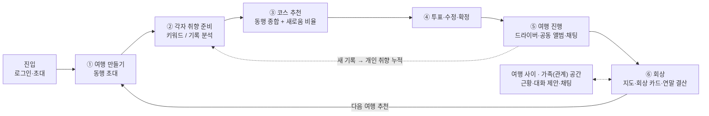

| 단계 | 관련 요구사항 | 관련 여정 |
| --- | --- | --- |
| 진입 | IE-FR-01 | 전체 |
| ① 여행 만들기 | IE-FR-02, 03 | UJ-1 |
| ② 취향 준비 | IE-FR-08, 09 | UJ-1 |
| ③ 코스 추천 | IE-FR-10, 11 | UJ-1 |
| ④ 투표·확정 | IE-FR-12 | UJ-1 |
| ⑤ 여행 진행 | IE-FR-04~07, 13, 14, 19 | UJ-2 |
| ⑥ 회상 | IE-FR-15, 18, 20 | UJ-3, UJ-4 |
| 여행 사이 | IE-FR-16, 17, 19 | UJ-3 |
| 설정·알림 | IE-FR-21, 22 | 전체 |

## 1. 진입: 로그인·초대 (IE-FR-01)

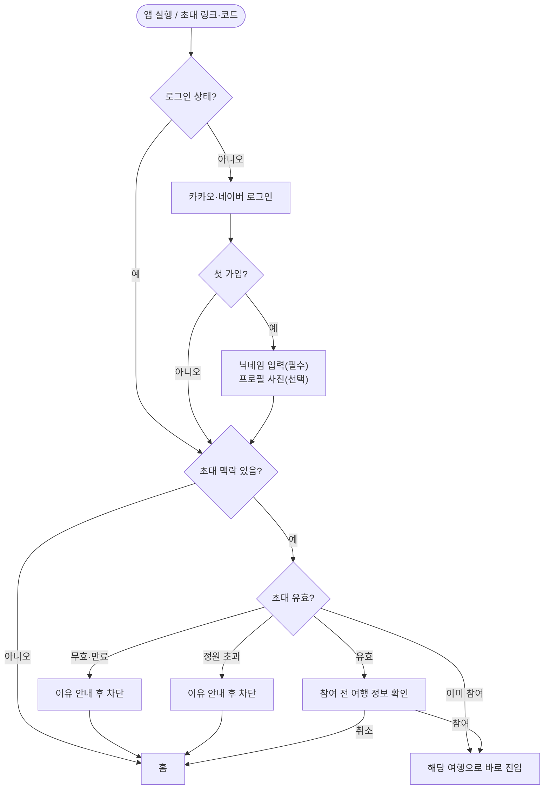

- 전화번호는 수집하지 않는다.
- 미정: 설치 직후 초대 맥락 복귀 방식, 초대 만료·재발급, 동일인 두 소셜 계정 연결 → **Q-2**.

## 2. 여행 준비: 만들기 → 취향 → 추천 → 확정 (UJ-1)

### 2.1 홈과 여행 만들기·초대 (IE-FR-02)

홈은 **여행 목록 + 캠핑카**를 중심으로 둔다(7.1). 여행 간 이동은 홈의 여행 카드에서 한다.

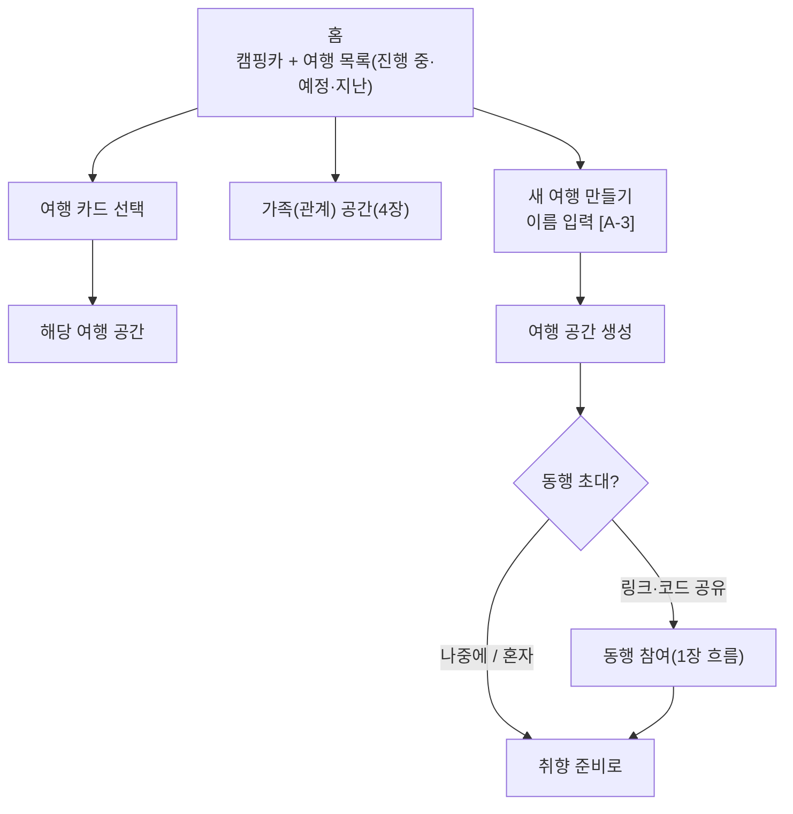

- 같은 사람과 다시 가도 새 여행은 별도 공간이다. 이전 여행 구성원은 자동 참여하지 않는다.
- 혼자 시작해도 사진 수집·추천·회상을 쓸 수 있다.
- 미정: 캠핑카를 여행별로 둘지 개인·별도 관계 공간에 누적할지 → **Q-1**, 성장·꾸미기 규칙 → **Q-3**.

### 2.2 각자의 취향 준비 (IE-FR-08)

구성원마다 따로 진행한다. 다른 구성원은 결과 중 **공개를 허용한 항목만** 본다.

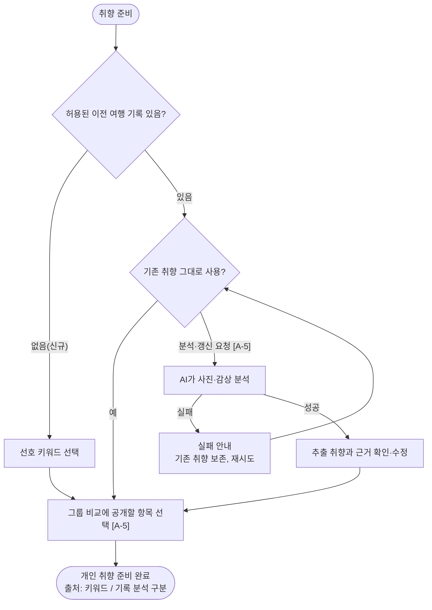

- 키워드 선택 결과를 기록 분석 결과로 표시하지 않는다.
- 사진에 함께 나왔다는 이유만으로 다른 사람의 취향으로 넣지 않는다.
- 미정: 키워드 목록, 최소 자료량, 새 기록·기존 취향·사용자 수정의 반영 규칙 → **Q-5**.

### 2.3 동행 비교 → 코스 추천 (IE-FR-09~11)

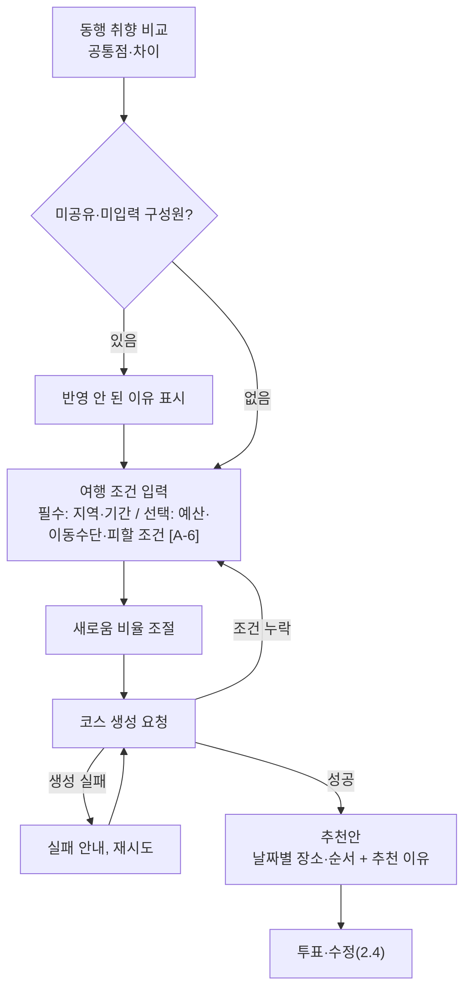

- 비교는 **이번 여행 구성원** 기준이다. 동행이 바뀌면 다시 종합한다.
- 한 사람의 선호를 모두의 합의처럼 표시하지 않는다. 비교를 평가·서열로 표현하지 않는다.
- 후보가 모자라면 새로움 비율을 충족한 것처럼 표시하지 않는다.
- 장소·이동·영업 정보를 확인하지 못했으면 '확인 필요'로 표시한다.
- 미정: 종합 가중치, 새로움 판정·산식·기본값 → **Q-5**.

### 2.4 투표·수정·확정 (IE-FR-12)

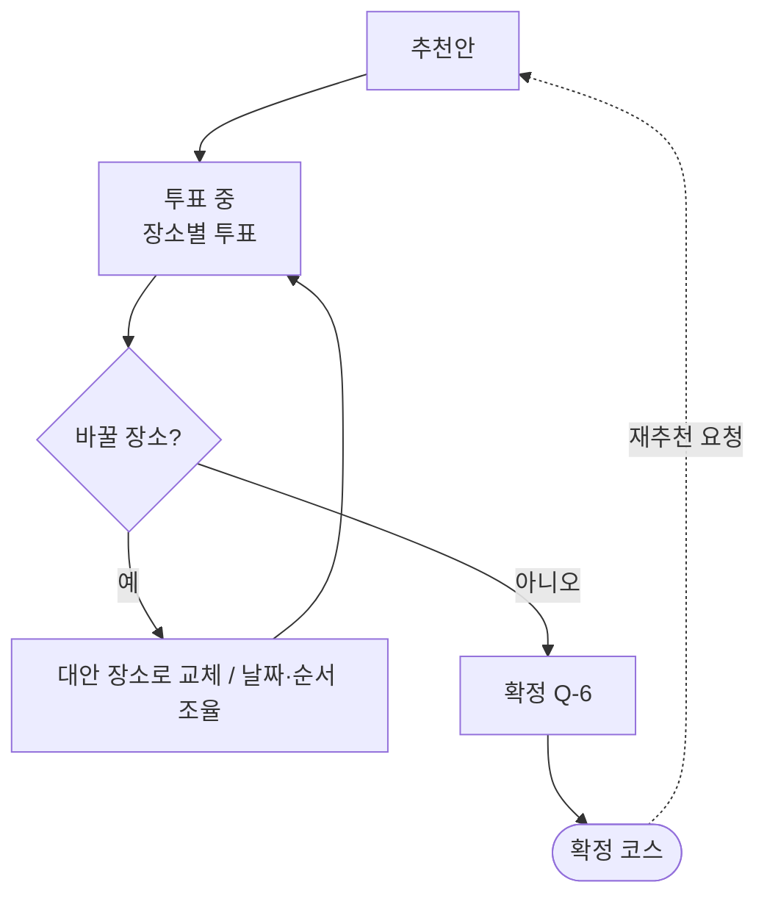

- 추천안 / 투표 중 / 확정본을 구분하고, 변경 사항을 구성원이 확인할 수 있다.
- 재추천에 실패해도 기존 확정본은 남는다. AI가 합의를 대신 처리하지 않는다.
- 미정 **(선행 결정)**: 투표 방식·동률·마감, 확정 권한, 동시 편집 충돌 → **Q-6**.

## 3. 여행 진행 (UJ-2)

### 3.1 드라이버 안내와 일정 변경 (IE-FR-13, 14)

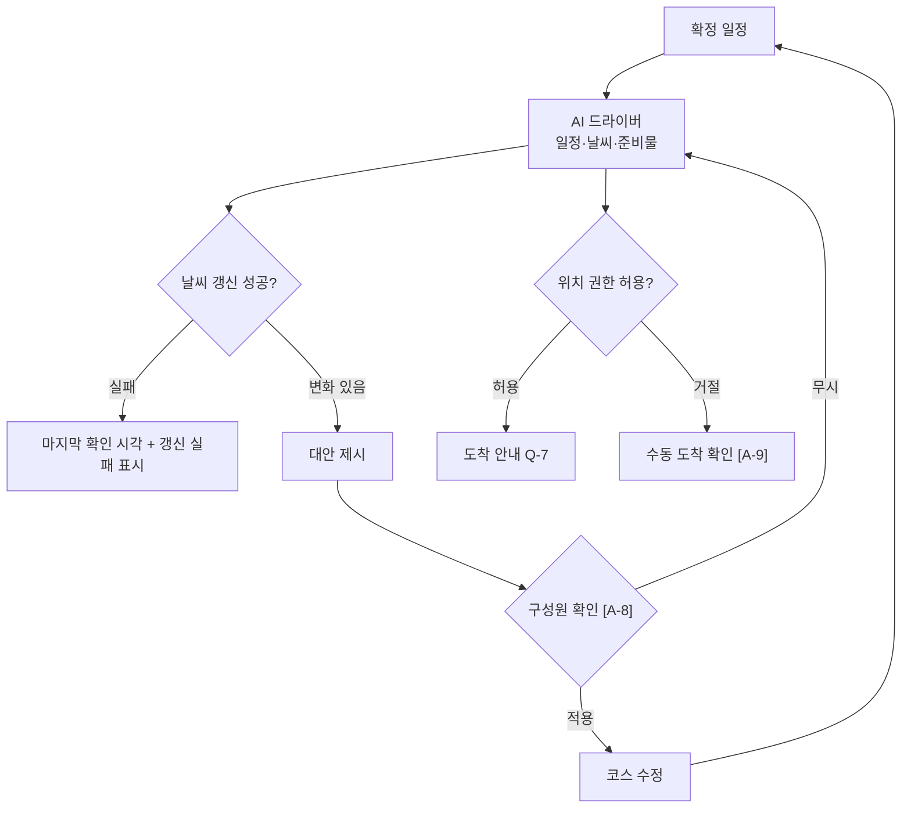

- 실시간 위치를 그룹에 공유하지 않는다. 현재 위치 권한과 사진 속 위치 정보는 따로 설명한다.
- 위치를 거절해도 일정 열람·사진 업로드는 막지 않는다.
- 확인 없이 '도착'·'방문 완료'로 기록하지 않는다.
- 미정: 날씨 공급자·갱신 주기·안내 시점, 자동 도착 감지 조건 → **Q-7**.

### 3.2 사진 업로드와 공동 앨범 (IE-FR-04~07)

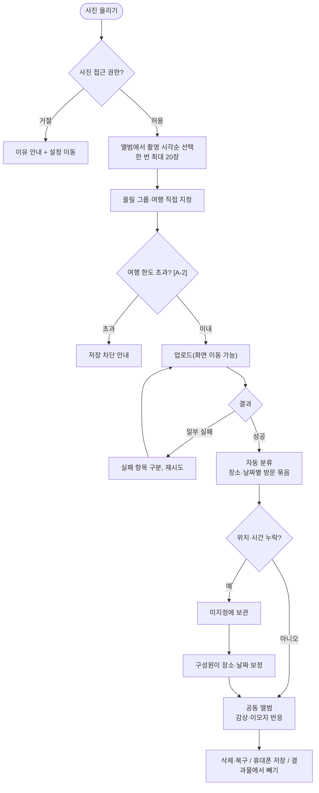

- 21번째 사진은 선택할 수 없다. 실패 항목을 성공으로 표시하지 않는다.
- 자정 기준으로 방문을 나누고, 촬영 시간이 없으면 업로드 시각으로 대신하지 않는다.
- 감상 없이 사진만 올려도 된다. 감상 수정·삭제는 작성자만 한다.
- 잘못 올린 사진은 삭제 후 다시 올린다(그룹 간 이동 없음).
- 미정: 시간대·중복 판정·파일 형식·삭제함 기간 → **Q-4**, 그룹 8명·여행 500장 → **A-2 / Q-1**.

### 3.3 그룹 채팅 (IE-FR-19)

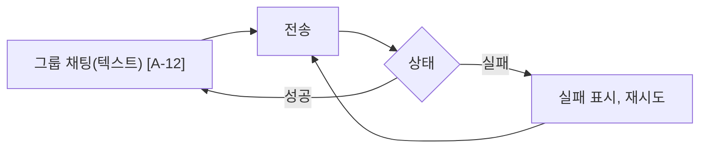

- 현재 그룹 구성원끼리만 대화하고, 나간 구성원은 새 메시지를 받지 않는다.
- 미정: 첨부·읽음·검색·삭제, 신규 참여자의 이전 대화 열람, 탈퇴 시 메시지 → **Q-9**.

## 4. 여행 사이: 근황과 회상 (UJ-3)

근황은 여행 그룹이 아닌 **별도 가족(관계) 공간**에서 시작한다(7.1). 회상 카드는 과거 여행 그룹의 기록 중 공유가 허용된 것만 쓴다.

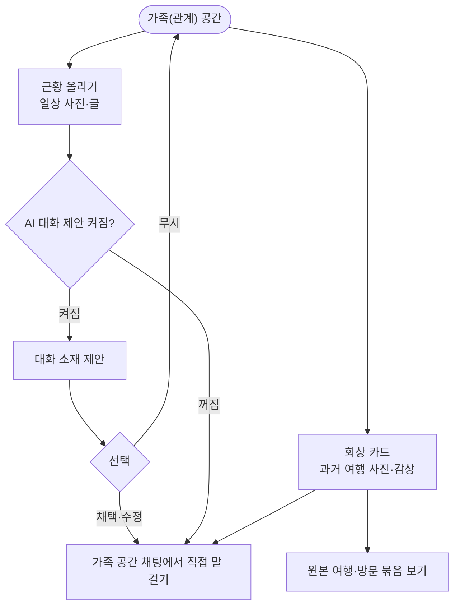

- AI는 사용자 이름으로 채팅을 자동 전송하지 않는다 [A-11]. 가족의 감정·건강 상태를 단정하지 않는다.
- 공유하지 않은 기록은 대화 소재·회상 카드에 쓰지 않는다. 결과물에서 뺀 사진·삭제 사진도 새 카드에 넣지 않는다.
- 근황은 다른 그룹에 복제되지 않고 여행 방문 통계에 집계되지 않는다.
- 미정: 가족 공간 만들기·초대 방식 **Q-1·Q-8**, 근황 한도·삭제 권한, 회상 카드 생성 시점·빈도 → **Q-8**. 회상 카드를 여행 그룹과 가족 공간 중 어디서 보여줄지도 함께 정한다.

## 5. 회상: 추억 지도와 연말 결산 (UJ-4)

### 5.1 추억 지도 (IE-FR-15)

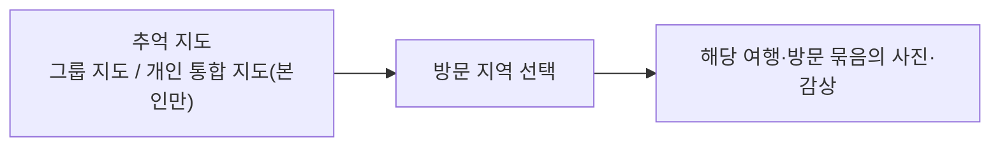

- 실제 방문(사진 위치·날짜 또는 수동 확인 [A-10])만 표시하고, 계획 장소와 구분한다.
- 위치 미지정 사진을 임의 좌표에 두지 않는다. 나간 그룹 자료는 개인 지도에서 열리지 않는다.
- 미정: 방문 지역 단위, 그룹/개인 지도 표시 방식 → **Q-7**.

### 5.2 연말 결산 (IE-FR-20)

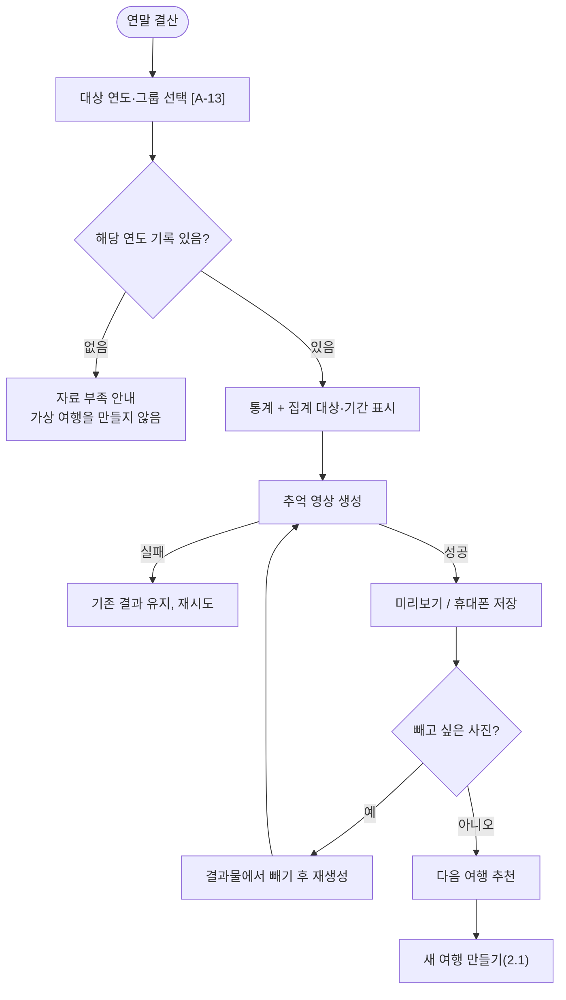

- 예정 코스와 실제 방문을 섞지 않는다. 과거 연도를 골라 개발·시연에서 확인할 수 있다.
- 미정: 그룹/개인 결산, 통계 항목, 영상 길이·음원, 재생성 버전 보관 → **Q-10**.

## 6. 공통: 설정·알림·나가기

### 6.1 AI·공유·알림 설정 (IE-FR-21, 22)

- 진입: 계정·제어 영역에서 AI 역할별(취향·추천·드라이버·근황 제안·회상·결산) 자동화와 공개 범위를 설정한다 [A-14].
- 자동화를 꺼도 사진 열람·채팅은 그대로 쓸 수 있다.
- 알림을 누르면 관련 화면으로 이동한다. 대상이 삭제됐으면 이유를 안내한다.
- OS 푸시를 거절해도 앱 안 알림함은 열린다. 종류별·그룹별로 끌 수 있다.
- 미정: AI 개입 기본값·외부 전송·공유 철회, 알림 보관·묶음 주기 → **Q-11**.

### 6.2 나가기·탈퇴 (PRD §8)

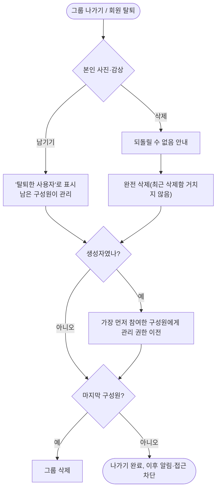

## 7. 흐름 확정 전에 정할 것

아래는 흐름도의 모양 자체를 바꾸는 항목이다. 47번 화면 목록 확정 전에 팀에서 정한다.

### 7.1 이번에 정한 방향 (담당자 제안, 팀 공유 필요)

| 결정 | 제안 | 흐름 반영 | PRD |
| --- | --- | --- | --- |
| 홈의 중심 | **여행 목록 + 캠핑카.** 진행 중·예정·지난 여행 카드 목록이 주인공이고 캠핑카는 상단 표현 | 1장·2.1의 '홈', 5.2의 '새 여행 만들기' 복귀 지점 | §9, Q-1 |
| 가족 근황 공간 | **여행 그룹과 별도인 가족(관계) 공간.** 여행마다 구성원이 바뀌어도 유지 | 4장의 시작점 | Q-1, Q-8 |

### 7.2 아직 남은 결정

| 결정 | 흐름에 미치는 영향 | PRD |
| --- | --- | --- |
| 캠핑카 누적 단위: 여행별 / 개인 / 가족(관계) 공간 | 2.1에서 캠핑카가 생기는 시점, 홈 상단에 어떤 캠핑카를 보여줄지 | Q-1, Q-3 |
| 가족 공간 만들기·초대 방식, 여행 그룹과의 연결 | 4장 진입 전 흐름, 가족 공간 채팅과 여행 그룹 채팅의 구분 | Q-1, Q-8, Q-9 |
| 투표 방식·확정 권한 | 2.4의 '확정' 분기 조건 | Q-6 |
| 취향 분석을 언제 요청하나: 여행 준비 중 / 별도 내 정보 화면 | 2.2 진입 위치 | Q-5, A-5 |
| 연말 결산 단위: 그룹 / 개인 | 5.2의 선택 단계 | Q-10, A-13 |
