# 어디로그 사용자 흐름

> [어디로그 PRD v0.3](../../_bmad-output/planning-artifacts/prds/prd-EODI-2026-10-22/prd.md)의 핵심 흐름(§2.1), 제안 여정(§2.2 UJ-1~5), 기능 요구사항(WD-FR-01~34)을 화면 이동 단위로 정리한다.
> 새 화면 목록·기능명세서의 입력으로 쓴다. 이전 이어행 흐름(캠핑카·가족 공간·회상·연말 결산)은 승계하지 않는다.

**표기 규칙**

- `[A-N]`은 PRD의 가정, `Q-N`은 PRD의 미정 결정이다. 해당 분기는 확정이 아니다.
- `[F-N]`은 이 문서에서 흐름을 그리기 위해 새로 둔 **제안**이다. PRD에 없는 결정이므로 팀 확인이 필요하다(§12).
- 흐름은 화면 이동과 분기만 다룬다. 버튼 배치·화면 개수는 UX 설계에서 정한다.
- 실패·빈 상태는 PRD 검증 조건에 있는 것만 그렸다.

## 0. 전체 순환

SNS 축(친구 지도에서 발견 → 저장)과 여행 축(그룹 → 추천 → 투표 → 코스 → 진행 → 정리)이 즐겨찾기와 피드로 맞물려 돈다. 여행 뒤 공개한 피드는 다시 친구의 홈 지도에 올라간다.

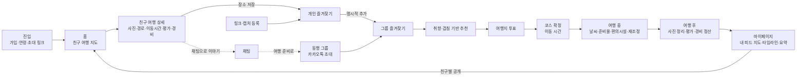

| 단계 | 관련 요구사항 | 관련 여정 | 문서 위치 |
| --- | --- | --- | --- |
| 진입·프로필 | WD-FR-01 | 전체 | 1장 |
| 친구 관계·추천 | WD-FR-02, 03 | UJ-5 | 2장 |
| 홈 지도·친구 여행 탐색 | WD-FR-10, 11, 24~26, 31 | UJ-1, UJ-5 | 3장 |
| 장소 모으기 | WD-FR-05~07 | UJ-1, UJ-2 | 4장 |
| 여행 준비 | WD-FR-04, 08, 09, 12~14 | UJ-2 | 5장 |
| 여행 중 | WD-FR-15~18 | UJ-3 | 6장 |
| 여행 후 정리 | WD-FR-19~23 | UJ-4 | 7장 |
| 마이페이지 | WD-FR-27~30 | UJ-4 | 8장 |
| 채팅 | WD-FR-33 | UJ-5 | 9장 |
| 인앱 알림 | WD-FR-34 | 전체 | 10장 |
| 기본 관리·삭제 영향 | WD-FR-32 | 전체 | 11장 |

### 0.1 주요 영역 [F-1]

PRD가 정한 화면은 **홈(친구 피드 지도)** 과 **마이페이지(내 피드 지도·타임라인)** 두 곳이다. 나머지 기능이 어디서 시작하는지는 PRD가 정하지 않았으므로 아래처럼 다섯 영역을 제안한다.

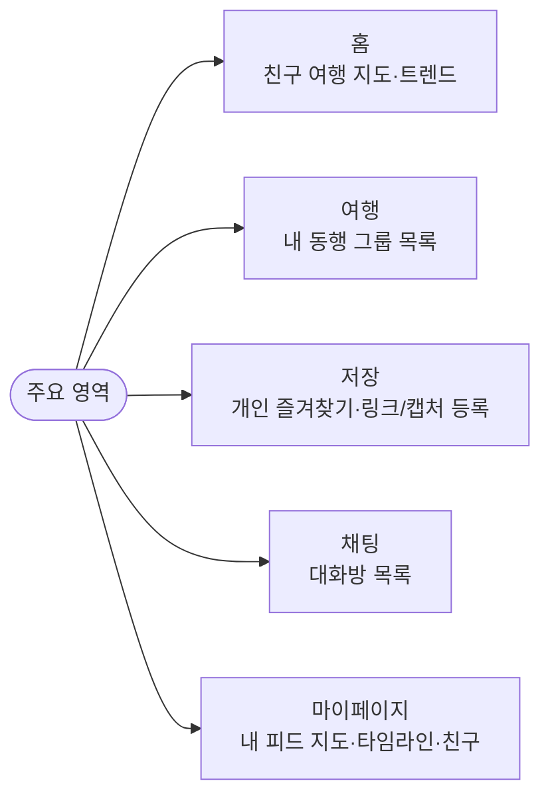

- 그룹 즐겨찾기·투표·코스·여행 중 안내·사진·정산은 모두 **여행(동행 그룹) 상세 안**에 둔다. 여행이 기록의 단위이기 때문이다(PRD §3).
- 친구 목록·친구 추천은 마이페이지 안에 둔다. 별도 영역이 필요한지는 화면 목록 단계에서 다시 본다.
- 알림 목록은 홈 상단 아이콘에서 연다 [F-7]. 별도 탭은 두지 않는다(10장).

## 1. 진입: 가입·연령·초대 링크 (WD-FR-01, 04)

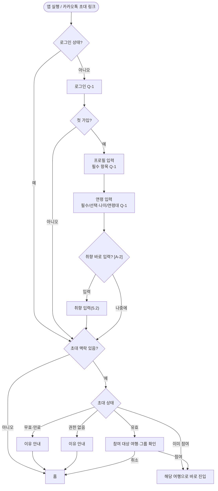

- 입력한 연령은 공개 프로필에 자동 노출하지 않는다.
- 카카오톡 공유는 초대 링크 전달 수단일 뿐이다. 카카오 로그인·카카오 친구 목록 접근을 뜻하지 않는다.
- 친구·과거 기록이 없어도 홈·장소 저장·여행 만들기로 시작할 수 있다 [A-2].
- 앱 실행·복귀 시 미확인 알림 처리(팝업)는 초대 경로를 포함해 10장에서 다룬다.
- 미정: 로그인 방식·플랫폼 **Q-1**, 앱 설치 후 초대 맥락 복귀·링크 만료·정원 **Q-4**.

## 2. 친구 관계와 친구 추천 (WD-FR-02, 03)

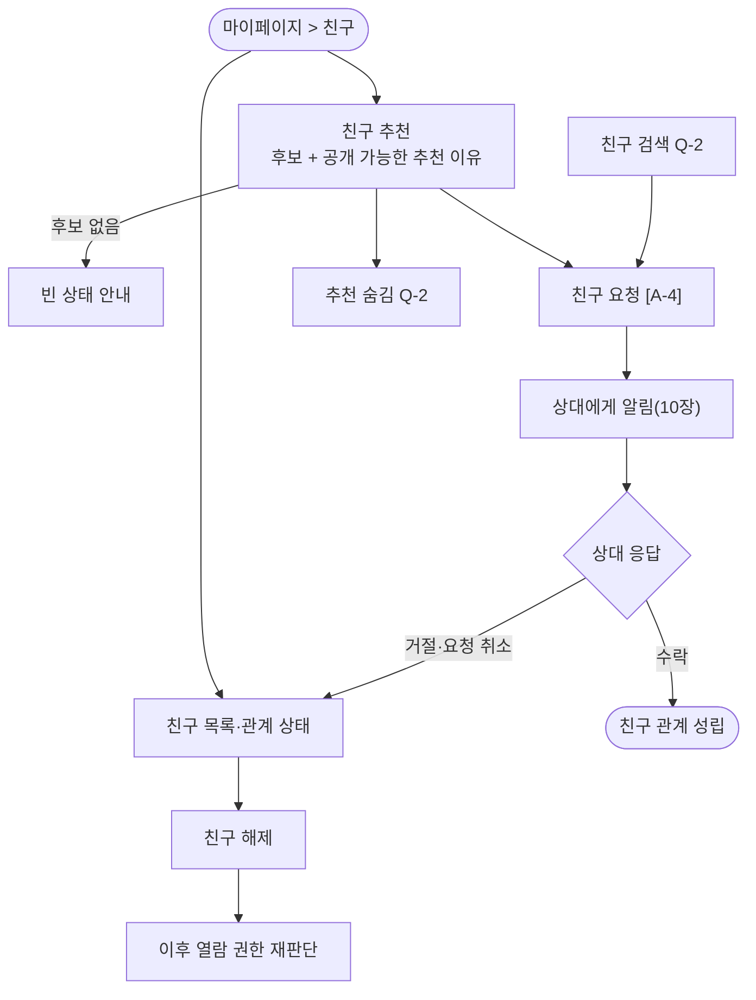

- 친구가 됐다고 비공개 피드·동행 그룹·채팅 이력에 자동으로 접근하지 않는다. 피드는 친구별 공개 설정(8.2)을 따른다.
- 추천 이유에 비공개 여행지·연령·관계 정보를 쓰지 않는다. 추천을 받았다고 자동으로 친구가 되지 않는다.
- 미정: 요청·수락 모델, 검색 범위, 차단, 추천 근거·숨김·중복 추천 → **Q-2**.

## 3. 발견: 홈 지도 → 친구 여행 (WD-FR-24~26, 10, 11, 31) — UJ-1, UJ-5

### 3.1 홈 친구 여행 지도

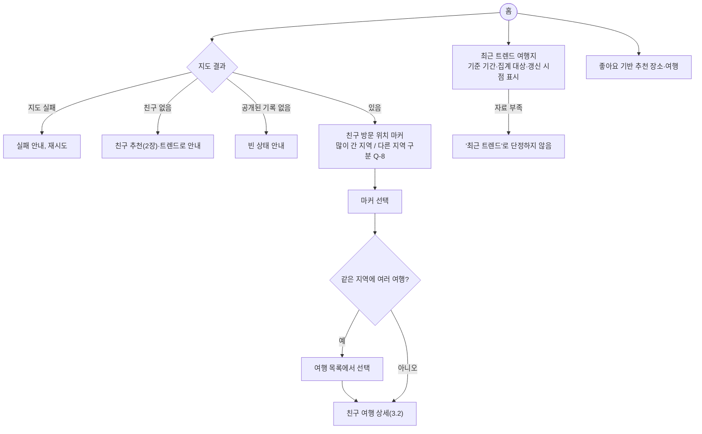

- 내게 허용되지 않은 위치·마커 수·사진은 지도에 나타나지 않는다. 비공개 기록이 **있다는 사실**도 드러나지 않는다.
- 좋아요 수·추천 노출을 실제 방문 횟수로 세지 않는다.
- 미정: '다르게 간 지역'의 의미, 기본 표시 범위·기간·마커 묶기 → **Q-8**, 트렌드 기준·연령 활용 → **Q-9**, 좋아요 신호 → **Q-5c**.

### 3.2 친구 여행 상세와 이어지는 행동

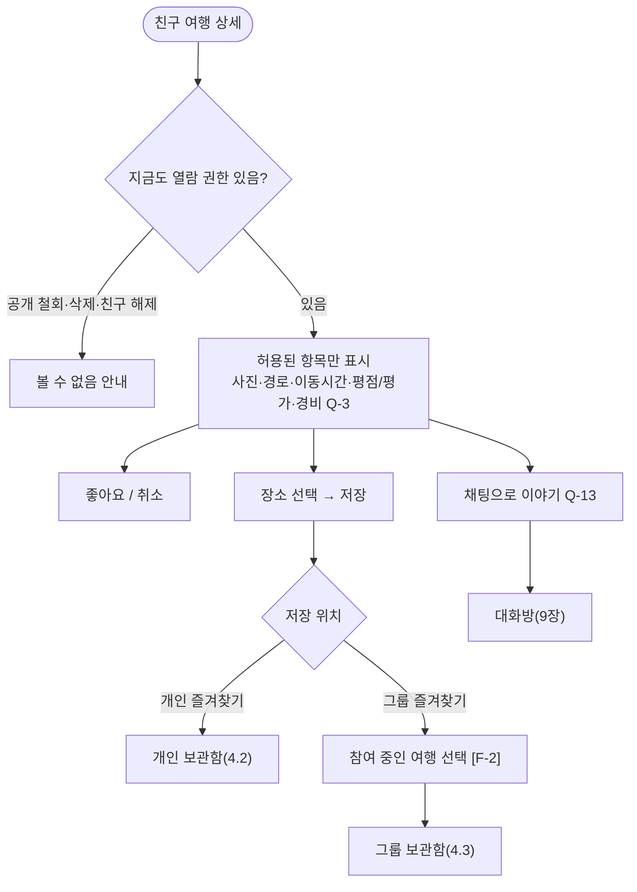

- 선택한 마커와 열린 상세가 같은 여행이어야 한다. 직접 링크·저장된 참조로 들어와도 권한을 다시 판단한다.
- 장소를 저장해도 원작성자의 비공개 자료에 접근 권한이 생기지 않는다.
- 좋아요는 방문 완료·평점을 대신하지 않는다. 같은 좋아요를 여러 번 보내도 수가 늘지 않는다.
- [F-2] 상세에서 그룹 즐겨찾기에 바로 담는 경로를 제안한다. PRD UJ-1은 '개인 저장 후 그룹에 추가'로 그렸으므로, 바로 담기를 허용할지 확인이 필요하다.

## 4. 장소 모으기 (WD-FR-05~07) — UJ-1, UJ-2

### 4.1 링크·캡처로 장소 추출

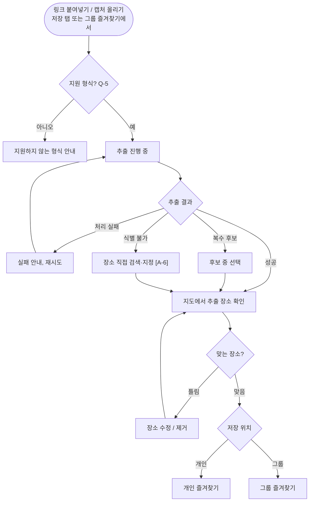

- 근거 없는 좌표로 자동 확정하지 않는다. 확인 단계를 거쳐야 저장된다 [A-6].
- 로그인이 필요한 페이지·비공개 SNS 콘텐츠를 가져올 수 있다고 보장하지 않는다.
- 미정: 지원 링크·캡처 형식, 한 자료 속 여러 장소, 원본 캡처 보관 → **Q-5a**.

### 4.2 개인 즐겨찾기

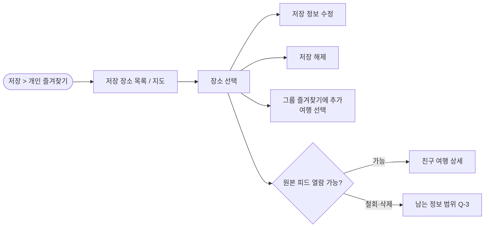

- 본인만 본다. 동행 그룹 구성원도 볼 수 없다.
- 그룹으로 넘기는 것은 항상 사용자의 명시적 행동이다.

### 4.3 그룹 즐겨찾기

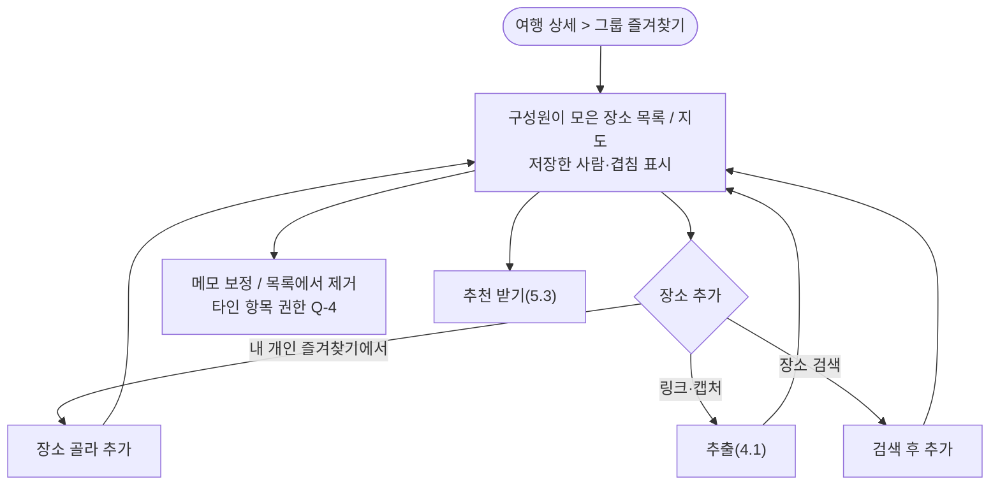

- 그룹에 담은 장소가 확정 코스에 자동으로 들어가지 않는다.
- 같은 장소를 여러 명이 담으면 겹침으로 보여준다. 한 사람의 저장을 모두의 합의처럼 표시하지 않는다.
- 미정: 동일 장소 판정·중복 표현 **Q-5a**, 추가·삭제 권한·그룹 이탈 후 보관 **Q-4**.

## 5. 여행 준비 (WD-FR-04, 08, 09, 12~14) — UJ-2

### 5.1 여행·동행 그룹 만들기와 초대

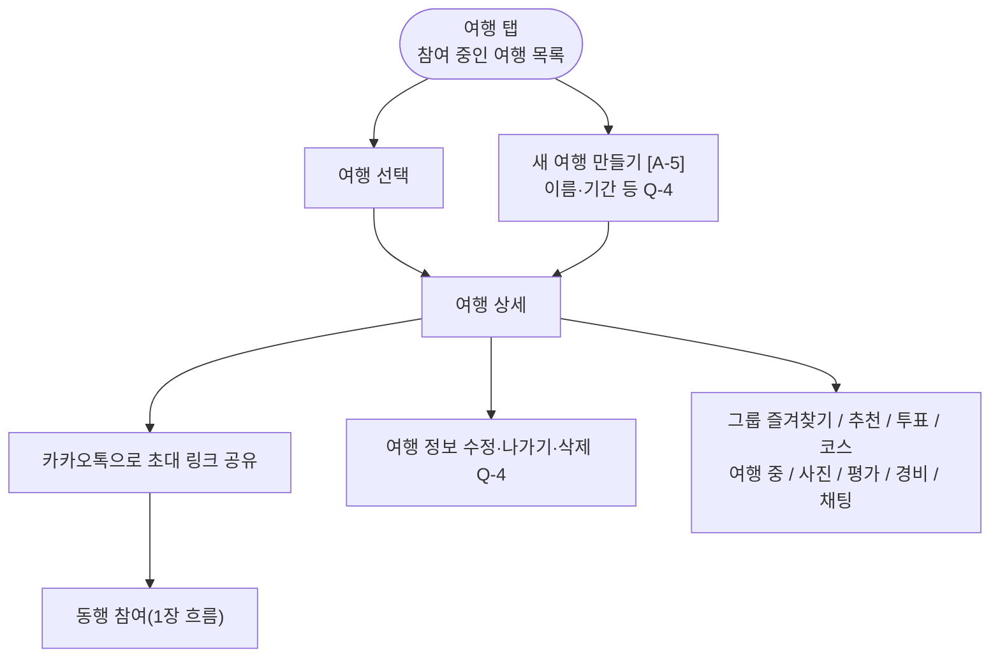

- 여행마다 새 그룹을 기본으로 한다 [A-5]. 이전 그룹 재사용 여부는 **Q-4**.
- 친구 관계와 여행 참여는 별개다. 친구가 아니어도 초대 링크로 참여할 수 있는지는 **Q-4**에서 정한다.
- 미정: 관리자·구성원 권한, 초대·내보내기, 관리자 이탈, 전체 삭제 → **Q-4**.

### 5.2 각자의 취향 준비 (WD-FR-08)

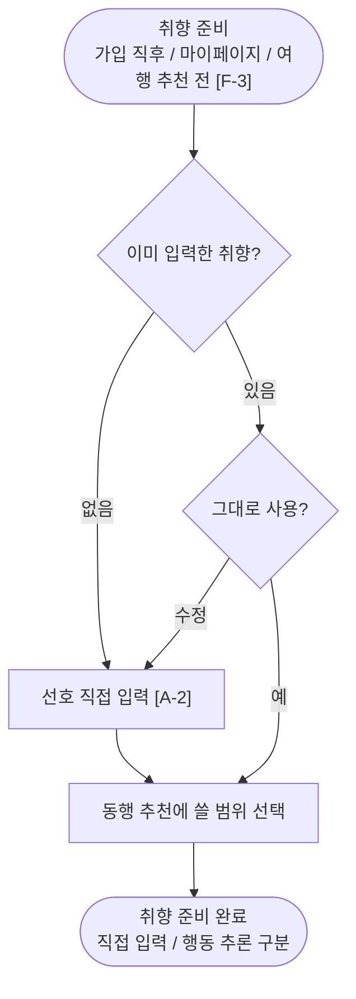

- 과거 사진 분석이 끝나지 않아도 추천을 준비할 수 있다.
- 행동에서 추론한 선호를 사용자가 직접 고른 선호처럼 표시하지 않는다.
- 미정: 입력 항목·추론·갱신·공유 철회 → **Q-5b**.

### 5.3 겹침·취향 기반 추천 (WD-FR-09)

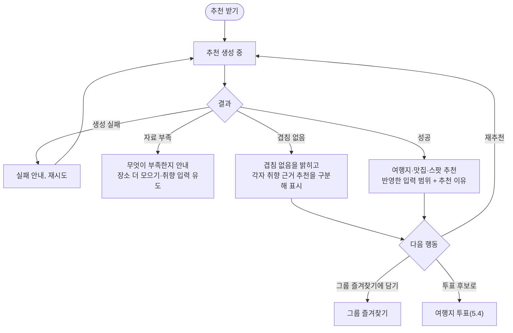

- 비공개 개인 보관함·비공개 취향은 추천 이유에 드러나지 않는다(설계 입력 대표 사례 '인경').
- 미정: 겹침 계산·가중치·재추천 정책 → **Q-5**.

### 5.4 여행지 투표 (WD-FR-12)

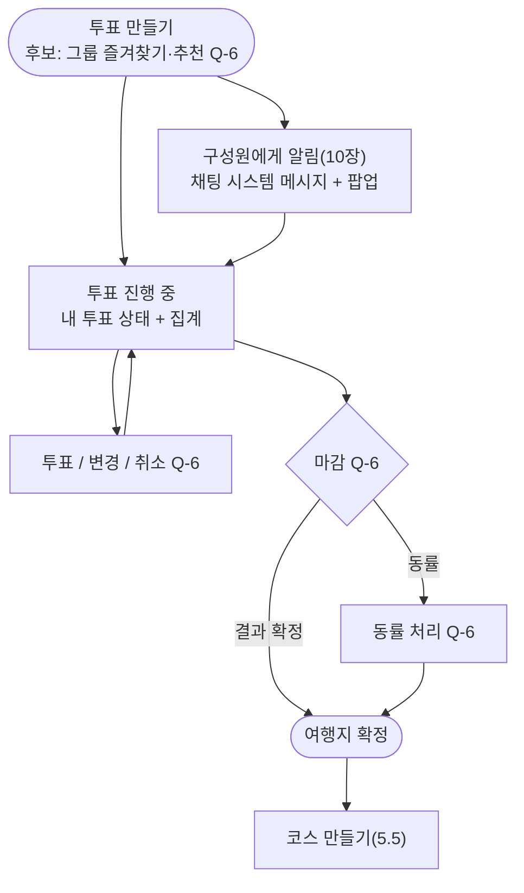

- '투표 진행 중'과 '여행지 확정'을 구분해 보여준다.
- 미정 **(선행 결정)**: 투표 단위(목적지 / 개별 장소), 선택 수·마감·동률·확정 권한 → **Q-6**.

### 5.5 코스 구성·이동 시간·확정 (WD-FR-13, 14)

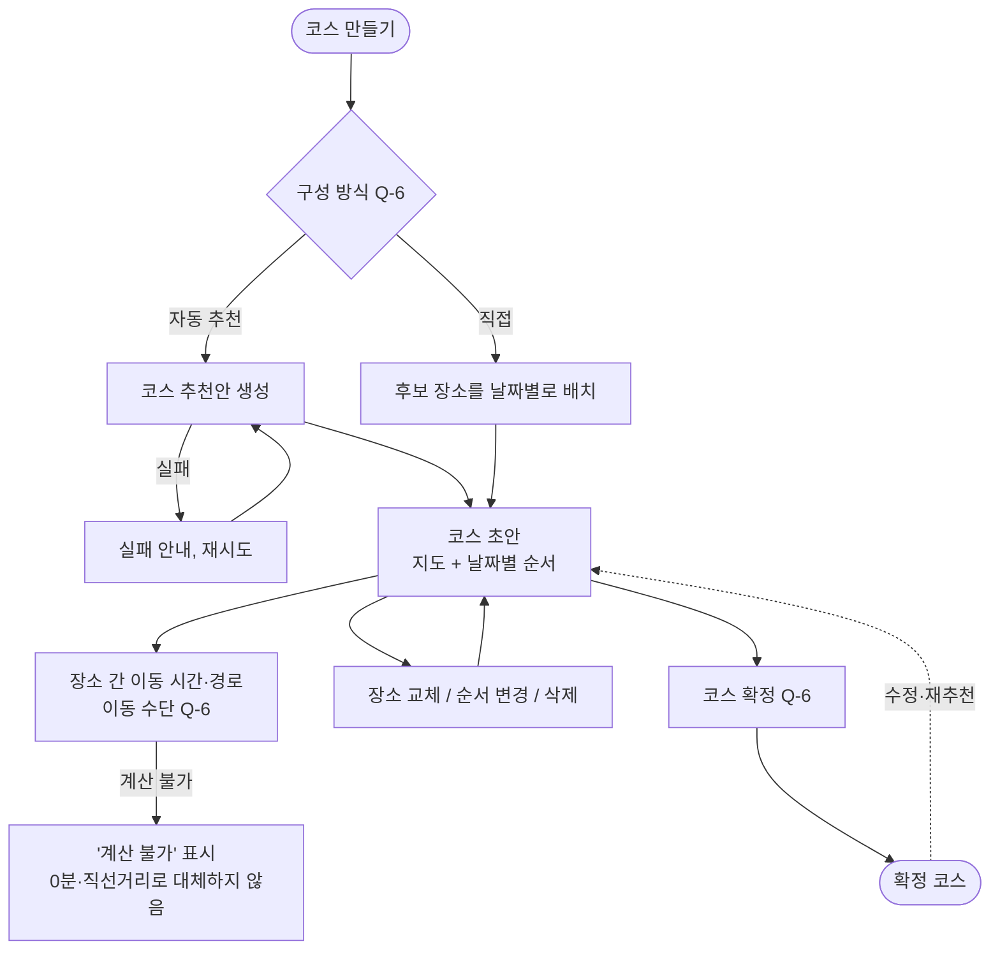

- 추천안과 확정 코스를 구분한다. 편집·재추천에 실패해도 기존 확정본은 남는다.
- 여러 명이 동시에 고칠 때 상대 변경이 조용히 사라지지 않아야 한다(정책 **Q-6**).

## 6. 여행 중 (WD-FR-15~18) — UJ-3

### 6.1 날씨 대안·준비물·편의시설

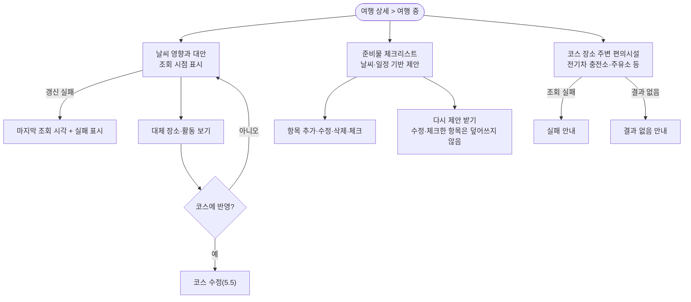

- LLM이 조회하지 않은 날씨·영업 정보를 사실처럼 만들지 않는다. 대안을 고르는 것과 코스를 바꾸는 것은 별개 행동이다.
- 충전기 가동 여부 같은 실시간 상태는 확인된 경우에만 표시한다.
- 미정: 준비물 개인/공동 목록·편집 권한, 시설 종류·반경·필터 → **Q-8b**.

### 6.2 장소 제외 후 자동 재조정 (WD-FR-15)

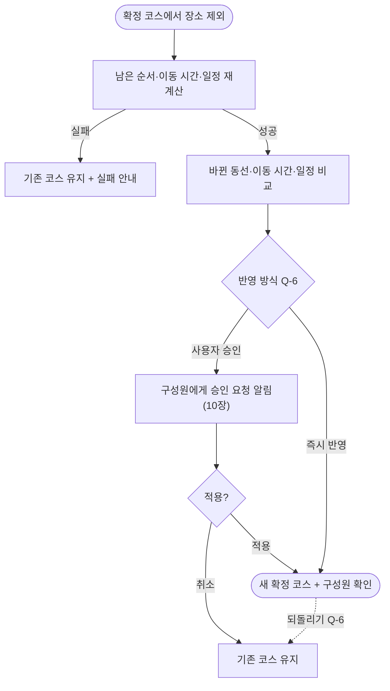

- 제외한 장소는 결과에 남지 않는다. 무엇이 바뀌었는지 항상 확인할 수 있다.
- 미정 **(선행 결정)**: 즉시 반영 / 승인 후 반영, 잠근 일정, 동시 수정, 되돌리기 → **Q-6**. 승인 요청을 알리는 방식 → **Q-14**(10장).

## 7. 여행 후 정리 (WD-FR-19~23) — UJ-4

### 7.1 사진 등록·자동 분류 (WD-FR-19, 20)

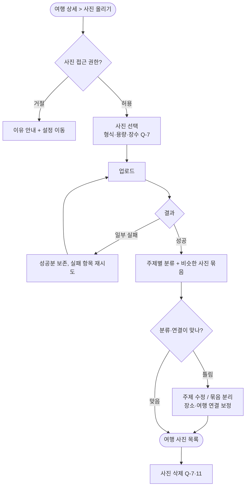

- 비슷한 사진으로 묶여도 원본을 자동 삭제하지 않는다 [A-7].
- 이전 이어행의 20장·8명·500장 한도는 승계하지 않는다.
- 미정: 주제 목록·복수 주제·유사 기준·촬영정보 누락·공동 사진 권한 → **Q-7**.

### 7.2 방문 장소 평점·평가 (WD-FR-21)

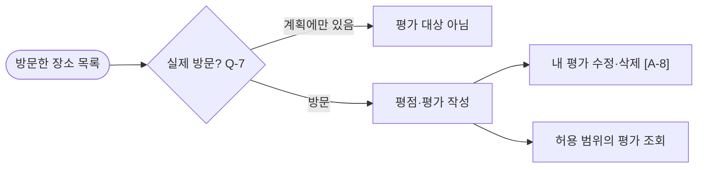

- 남의 평가는 고칠 수 없다 [A-8]. 미정: 점수 척도·방문 판정·중복 평가·공개 범위 → **Q-7**.

### 7.3 경비 입력과 최종 정산 (WD-FR-22, 23)

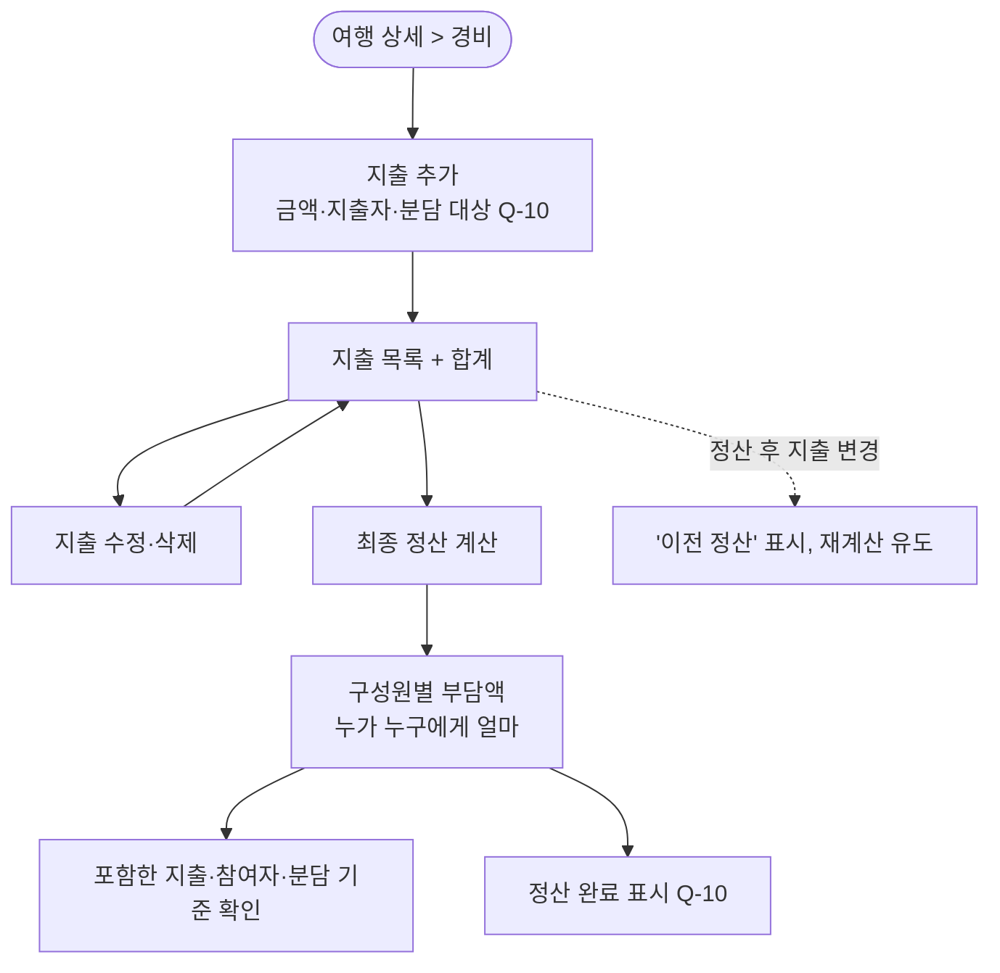

- 입력하지 않은 경비를 0원 지출로 단정하지 않는다.
- 계산만 한다. 송금·결제·계좌 연동은 범위 밖이다(PRD §9).
- 경비를 친구 피드에 공개하는 것과 동행이 정산 자료를 보는 것은 따로 제어한다.
- 미정 **(선행 결정)**: 균등/개별 분담, 반올림, 통화, 정산 확정 후 변경, 탈퇴자 → **Q-10**.

## 8. 마이페이지: 내 피드 지도·공개·타임라인 (WD-FR-27~30) — UJ-4

### 8.1 내 피드 지도와 피드 만들기

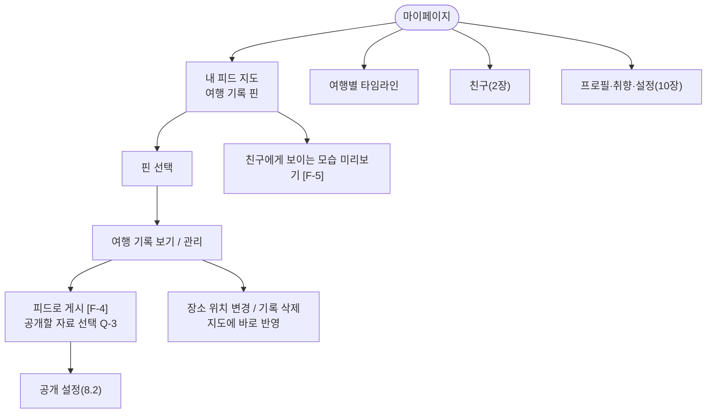

- 내가 관리하는 화면과 남이 보는 화면을 구분한다. 비공개 기록이 있다는 사실이 남의 지도에 나타나지 않는다.
- [F-4] 여행 기록에서 '피드로 게시'를 별도 행동으로 둔다. PRD는 피드를 '여행 기록 중 공개하도록 선택한 표현'으로 정의했지만 생성 단위는 **Q-3**이다.
- [F-5] 공개 설정이 맞는지 확인할 수 있도록 '친구에게 보이는 모습'을 제안한다.

### 8.2 친구별 공개 설정 (WD-FR-28)

```mermaid
flowchart TD
    S(["피드 공개 설정<br/>기본값 비공개 [A-9]"]) --> WHO["볼 수 있는 친구 선택"]
    WHO --> WHAT["공개 항목 선택<br/>사진·경로·평점/평가·경비 Q-3"]
    WHAT --> CO{"동행의 자료가 섞여 있나?"}
    CO -- "예" --> CONS["동행 자료 공개 동의 Q-3"]
    CO -- "아니오" --> SAVE
    CONS --> SAVE["저장"]
    SAVE --> APPLY["허용 친구의 홈 지도·상세에 반영<br/>불허 친구에게는 위치·본문 비노출"]
    S --> CHG["공개 범위 변경 / 게시 철회 / 피드 삭제"]
    CHG --> RE["직접 링크·지도·추천·저장 참조까지 권한 재판단"]
```

- 다른 동행의 자료를 내 의사만으로 공개하지 않는다.
- 미정 **(선행 결정)**: 피드 생성·공개 단위, 공동 사진 동의, 철회 후 즐겨찾기·요약 처리 → **Q-3**.

### 8.3 타임라인과 여행 요약 카드 (WD-FR-29, 30)

```mermaid
flowchart LR
    TL(["여행별 타임라인"]) --> ST["계획 중 / 실제 방문 / 날짜 미지정 구분"]
    TL --> TRIP["여행 선택"] --> ACT["여행별 상세 활동"]
    TRIP --> CARD["여행 요약 카드<br/>지도·사진·이동거리·경비"]
    CARD -- "미입력·미확인" --> UNK["'미입력' 표시<br/>임의 계산값으로 채우지 않음"]
```

- 남에게 보이는 요약 카드는 공개 허용 항목만 담는다.
- 미정: 정렬 기준(여행/게시/촬영 날짜)·활동 단위 **Q-7·8**, 실제/계획 거리 **Q-8a**, 경비 공개 범위 **Q-10**.

## 9. 채팅 (WD-FR-33) — UJ-5

```mermaid
flowchart TD
    E1(["채팅 탭"]) --> ROOMS["참여 중인 대화방 목록"]
    E2(["친구 여행 상세에서 '채팅' Q-13"]) --> ROOM
    E3(["여행 상세 > 동행 채팅 Q-13"]) --> ROOM
    ROOMS --> ROOM["대화방"]
    ROOM --> ACC{"참여자인가?"}
    ACC -- "아니오" --> DENY["열람·수신 차단"]
    ACC -- "예" --> MSG["메시지 보기·보내기"]
    MSG --> ST{"전송 상태"}
    ST -- "전송 중" --> MSG
    ST -- "실패" --> RT["실패 표시, 재시도<br/>중복 등록 방지"] --> MSG
    ST -- "성공" --> MSG
    MSG -. "이야기한 장소" .-> SAVE["장소 저장 / 여행 준비로 [F-6]"]
    SYS["시스템 메시지(10장)<br/>투표 시작·마감, 재조정 요청"] --> MSG
    SYS -- "이동 버튼" --> GO["해당 화면"]
```

- 피드 열람 권한과 채팅 참여 권한은 따로 검사한다. 피드를 볼 수 있어도 대화 이력은 볼 수 없다.
- 채팅 내용을 추천·피드에 자동으로 쓰지 않는다.
- [F-6] UJ-5의 '채팅으로 이야기한 장소를 여행 준비로 이어간다'를 장소 저장 연결로 그렸다. 메시지 안의 장소를 인식할지는 정하지 않았다.
- 미정 **(선행 결정)**: 친구 1:1·동행 그룹 중 제공 범위, 방 생성·초대·나가기, 과거 대화, 읽음·첨부·알림·수정/삭제·차단, 해제·이탈·탈퇴 처리 → **Q-13**.

## 10. 인앱 알림 (WD-FR-34)

```mermaid
flowchart TD
    EV(["이벤트 발생<br/>투표 시작·마감 / 동행 참여 / 재조정 승인 요청 / 친구 요청·수락 / 정산 완료 Q-14"]) --> SV["알림 저장<br/>대상: 권한 있는 당사자만"]
    SV --> SYS["동행 그룹 채팅방 시스템 메시지<br/>이동 버튼 포함"]
    SV --> LIST["알림 목록<br/>홈 상단 아이콘 [F-7]"]
    APP(["앱 실행 / 복귀"]) --> UN{"미확인 알림?"}
    UN -- "있음" --> POP["알림 팝업<br/>중요 이벤트 모아서 Q-14"]
    UN -- "없음" --> HOME["홈"]
    POP -- "바로 가기" --> ACC{"지금도 권한 있음?"}
    POP -- "닫기" --> HOME
    LIST --> ACC
    SYS -- "이동" --> ACC
    ACC -- "예" --> TARGET["해당 화면<br/>투표 / 여행 상세 / 코스 / 친구 / 정산"]
    ACC -- "아니오(이탈·해제)" --> GONE["볼 수 없음 안내"]
    TARGET --> READ["읽음 처리"]
```

- 푸시 알림은 쓰지 않는다. 앱을 열었을 때 팝업과 채팅 시스템 메시지로만 알린다(PRD §9).
- 알림 본문에 비공개 위치·경비·관계를 담지 않는다. 이동 버튼을 눌렀을 때 권한을 다시 검사한다.
- 같은 이벤트를 팝업·목록·시스템 메시지에 각각 보여줘도 한 번 읽으면 모두 읽음이 된다.
- 알림이 없어도 투표·코스·정산 화면은 직접 들어가서 쓸 수 있다.
- [F-7] 알림 목록 위치를 홈 상단 아이콘으로 제안한다.
- 미정 **(선행 결정)**: 이벤트 종류·보관 기간, 시스템 메시지를 넣을 방(1:1/그룹), 팝업 기준 → **Q-14**. 채팅 새 메시지 알림 → **Q-13**.

## 11. 공통: 기본 관리·삭제 영향 (WD-FR-01, 32)

```mermaid
flowchart TD
    A(["수정·삭제·나가기·탈퇴 요청"]) --> P{"권한 있음?"}
    P -- "아니오" --> NO["권한 없음 안내"]
    P -- "예" --> IMP["영향 안내<br/>지도·피드·추천·정산에 미치는 변화"]
    IMP --> OK{"진행?"}
    OK -- "취소" --> BACK["원래 화면"]
    OK -- "진행" --> DO["처리"]
    DO -- "실패" --> FAIL["실패 안내<br/>성공으로 표시하지 않음"]
    DO -- "성공" --> UPD["관련 지도·피드·요약·추천 갱신<br/>접근 상실 대상에게 이후 차단"]
```

- 여행 나가기·탈퇴 시 남는 자료·공유·정산 처리, 삭제·복구·보존 기간은 정해지지 않았다 → **Q-4·10·11**. 이전 이어행의 '탈퇴한 사용자 표시·관리 권한 이전' 규칙은 승계하지 않는다.
- 지도·타임라인·요약·트렌드는 원천 자료가 바뀌면 따라 갱신될 뿐, 직접 고치는 대상이 아니다(PRD §5).

## 12. 흐름 확정 전에 정할 것

### 12.1 흐름 모양을 바꾸는 PRD 미정 결정

| 결정 | 흐름에 미치는 영향 | PRD |
| --- | --- | --- |
| 피드 생성·공개 단위, 공동 자료 공개 동의 | 8.1 '피드로 게시' 단계 유무, 8.2 동의 분기, 3.2 상세에 보이는 항목 | Q-3 |
| 그룹 재사용, 관리자 권한, 비친구 초대 참여 | 5.1 여행 만들기·초대, 1장 초대 분기, 10장 나가기 | Q-4 |
| 투표 단위(목적지 / 장소)·마감·확정 권한 | 5.4 전체, 5.5 진입 조건 | Q-6 |
| 자동 재조정 즉시 반영 / 승인 | 6.2 '반영 방식' 분기 중 하나만 남김 | Q-6 |
| 정산 분담 규칙·확정 후 변경 | 7.3 지출 입력 항목·정산 완료 이후 흐름 | Q-10 |
| 채팅 유형(1:1 / 그룹)과 진입 위치 | 9장 진입점 E2·E3 유무 | Q-13 |
| 친구 요청·수락 모델 | 2장 요청 분기 | Q-2, A-4 |
| 알림 이벤트 종류·팝업 기준·시스템 메시지 방 | 10장 팝업 분기, 5.4·6.2·2장 알림 노드 | Q-14 |

### 12.2 이 문서의 제안 (팀 확인 필요)

| ID | 제안 | 이유 |
| --- | --- | --- |
| F-1 | 주요 영역을 홈·여행·저장·채팅·마이페이지 다섯 개로 둔다 | PRD가 홈·마이페이지만 정했고, 나머지 기능의 시작점이 필요함 |
| F-2 | 친구 여행 상세에서 그룹 즐겨찾기에 바로 담는 경로 허용 | UJ-1은 개인 저장 후 그룹 추가로 그렸지만 단계를 줄일 수 있음 |
| F-3 | 취향 입력 진입점을 가입 직후·마이페이지·추천 직전 세 곳에 둔다 | A-2(기록 없는 사용자) 대응 |
| F-4 | 여행 기록과 피드를 나누고 '피드로 게시'를 별도 행동으로 둔다 | PRD §3에서 기록과 피드를 구분함 |
| F-5 | 마이페이지에 '친구에게 보이는 모습' 미리보기 | WD-FR-27 '본인 화면과 타인 화면 구분' 확인 수단 |
| F-6 | 채팅에서 언급한 장소를 저장·여행 준비로 잇는 연결 | UJ-5의 '채팅 → 여행 준비' 연결 |
| F-7 | 알림 목록을 홈 상단 아이콘에 두고 별도 탭은 두지 않는다 | WD-FR-34는 팝업·시스템 메시지가 주 경로라 탭까지는 불필요 |
