# 어디로그 사용자 흐름

> [어디로그 PRD v0.4](../../_bmad-output/planning-artifacts/prds/prd-EODI-2026-10-22/prd.md)와 2026-10-27에 정한 [미정·제안 결정](../design/open-decisions-2026-10-27.md)을 기준으로, **현재 Figma Page0 화면**을 따라 화면 이동 단위로 정리한다. 화면 ID는 [화면 목록](./screen-list.md)과 같다.

**표기 규칙**

- `(v0.4)`는 PRD v0.4 확정 정책이다.
- `(결정 Q-N)` / `(결정 F-N)`은 2026-10-27에 정한 내용이다. 근거와 화면 영향은 [결정 기록](../design/open-decisions-2026-10-27.md)에 있다.
- **⚠️**는 PRD v0.4와 다른 결정이라 팀 합의가 필요한 부분이다(§12.2).
- `Q-N`만 붙은 것은 아직 정하지 않은 PRD 결정이다.
- **[화면 없음]** 은 흐름에는 필요하지만 Figma에 아직 그리지 않은 화면·상태다(§12.4).
- 흐름은 화면 이동과 분기만 다룬다. 실패·오류 상태는 Figma 15번 섹션(오류 상태)을 따른다.

## 0. 전체 순환

SNS 축(친구 지도에서 발견 → 저장)과 여행 축(그룹 → 추천 → 투표 → 코스 → 진행 → 정리)이 즐겨찾기와 공동 피드로 맞물려 돈다. 멤버가 게시한 공동 피드는 기본 전체 공개로 다시 친구의 홈 지도에 올라간다(v0.4).


| 단계 | 화면 | 관련 요구사항 | 문서 위치 |
| --- | --- | --- | --- |
| 진입·가입·초대 | S00~S04 | WD-FR-01, 04 | 1장 |
| 팔로우·친구 추천 | S43~S45 | WD-FR-02, 03 | 2장 |
| 홈·친구 여행 | S05~S09, N3, N7 | WD-FR-10, 11, 24~26, 31 | 3장 |
| 장소 모으기 | S10~S14 | WD-FR-05~07 | 4장 |
| 여행·멤버 관리 | S15~S19 | WD-FR-04, 32 | 5.1~5.2 |
| 같이 모으기·추천 | S20, S21, S03 | WD-FR-07~09 | 5.3 |
| 투표 | S22 | WD-FR-12 | 5.4 |
| 코스 | S23, S24 | WD-FR-13, 14 | 5.5 |
| 여행 중 | S25~S29 | WD-FR-15~18 | 6장 |
| 여행 후 | S30~S36 | WD-FR-19~23 | 7장 |
| 마이페이지·공동 피드 | S37~S42, N4 | WD-FR-27~30 | 8장 |
| 채팅 | S46, S47 | WD-FR-33 | 9장 |
| 인앱 알림 | S48, S49 | WD-FR-34 | 10장 |
| 삭제·나가기·탈퇴 | S50 | WD-FR-32 | 11장 |

### 0.1 주요 영역

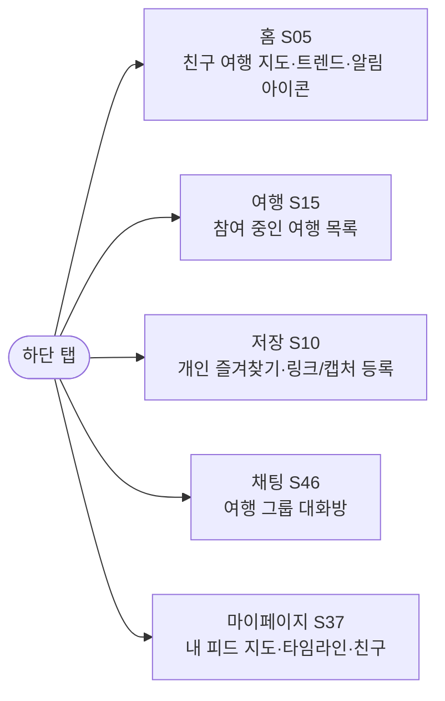

- 그룹 즐겨찾기·추천·투표·코스·여행 중·사진·평가·경비·그룹 채팅은 모두 **여행 상세(S17) 안**에 둔다.
- 화면의 '친구'는 팔로우 관계다(v0.4). 친구 목록·추천은 마이페이지 안에 둔다.
- 알림 목록(S49)은 홈 상단 아이콘에서 연다. 알림 팝업(S48)은 앱 실행·복귀 시 어느 탭에서든 뜬다.

## 1. 진입: 로그인·가입·초대 (WD-FR-01, 04)

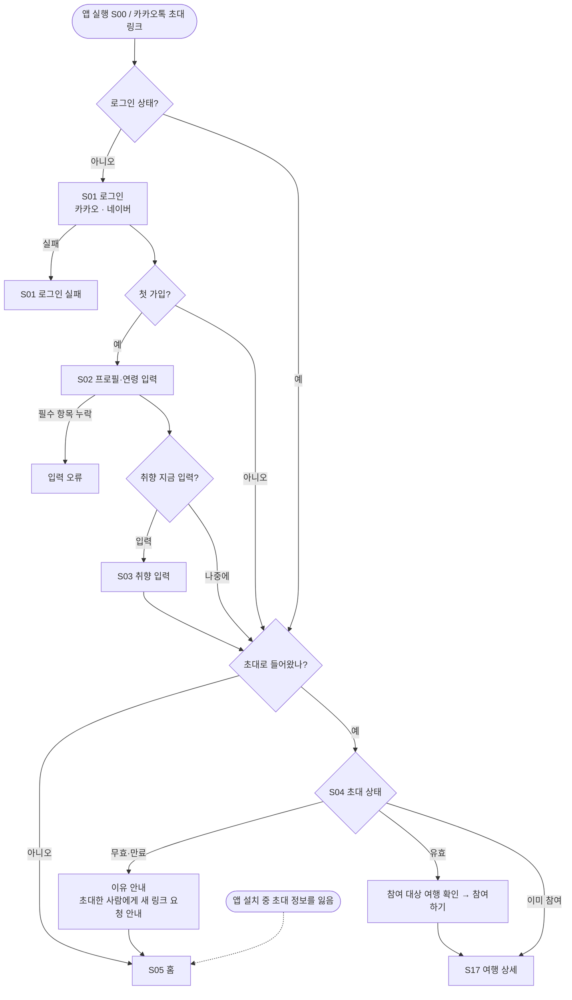

- 로그인은 카카오·네이버 두 가지다(v0.4).
- 초대 링크를 받은 사람은 **팔로우 관계와 상관없이 누구나** 참여한다(결정 Q-4). '친구가 아니라서 참여할 수 없음' 상태는 없다.
- **초대 코드는 쓰지 않는다**(결정 F-8). 앱을 설치하는 사이 초대 정보를 잃지 않도록 설치 후에도 링크 정보를 이어받는 처리(지연 딥링크)가 필요하다 [화면 없음 §12.4].
- 연령은 공개 프로필에 보이지 않는다. 카카오톡 공유는 링크 전달 수단일 뿐, 카카오 친구 목록 접근이 아니다.
- 계정 공개/비공개 설정은 지금 S45 설정에만 있다. 가입 때 고를지는 §12.4.
- 미정: 프로필 필수값·연령 형식 **Q-1**, 초대 링크 만료·정원 **Q-4**.

## 2. 팔로우와 친구 추천 (WD-FR-02, 03)

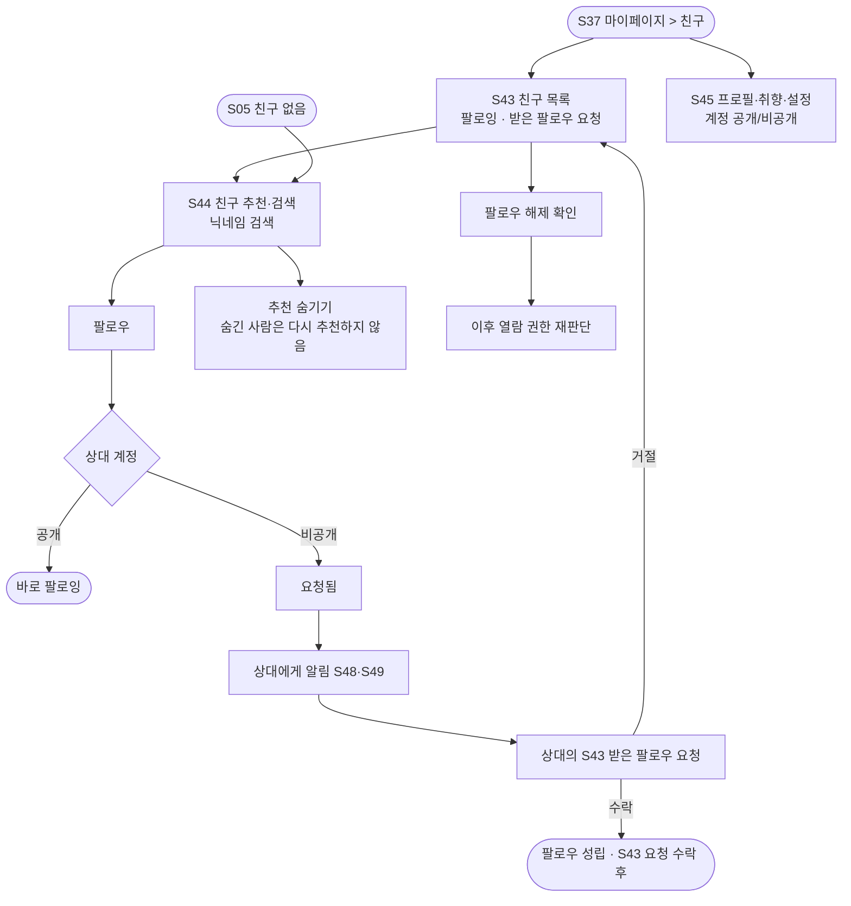

- 공개 계정은 바로 팔로우, 비공개 계정은 요청을 수락해야 팔로우가 된다(v0.4). 서로 맺는 친구 관계는 없다.
- 검색은 **닉네임만**, 추천에서 숨긴 사람은 **다시 추천하지 않는다**(결정 Q-2).
- 받은 팔로우 요청은 S43 맨 위에서 수락·거절한다(결정 F-24).
- 팔로우만으로 여행 그룹 자료·채팅 이력에 접근하지 않는다.
- 미정: 계정 공개 상태를 바꿀 때 기존 요청·팔로워 처리, 차단 → **Q-2**.

## 3. 홈: 친구 여행 발견 (WD-FR-10, 11, 24~26, 31)

### 3.1 홈 지도·트렌드·추천

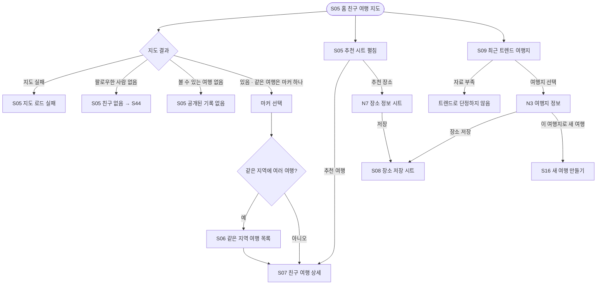

- 홈에는 내가 팔로우한 사람이 참여한 여행의 공동 피드가 보인다. 공동 피드는 여행당 하나라서 같은 여행은 마커 하나다(v0.4).
- 어떤 멤버가 나에게 숨긴 여행은 그 멤버 경로로는 안 보이지만, 숨기지 않은 다른 멤버를 통해서는 보인다(v0.4). 누가 숨겼는지는 드러나지 않는다.
- 추천 장소·여행지를 누르면 **정보를 먼저 보여 주고, 그 화면의 [저장]을 눌러야 저장**된다(결정 F-23).
- 미정: 비공개 계정 멤버가 있는 공동 피드의 열람 범위 **Q-3**, 지도 표시 기준 **Q-8**, 트렌드 기준 **Q-9**.

### 3.2 친구 여행 상세와 장소 저장

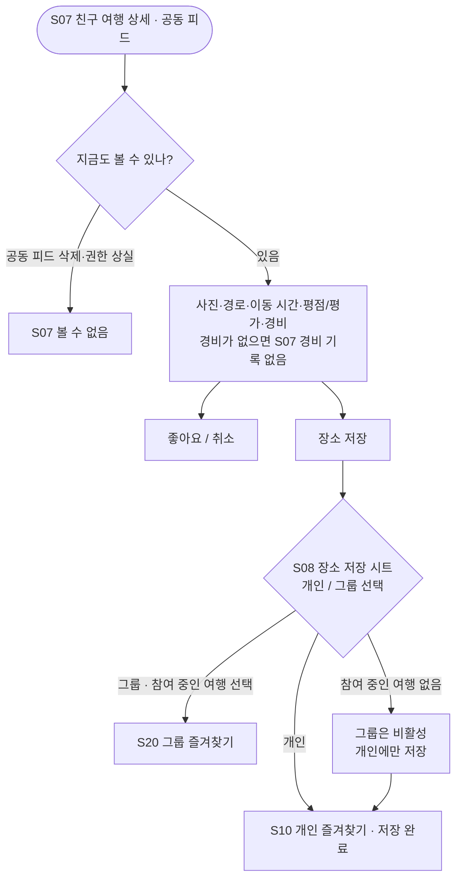

- 저장할 때 개인/그룹을 고른다. **참여 중인 여행이 없으면 그룹은 고를 수 없고 개인에만 저장**한다. 저장 시트에서 새 여행을 만들지 않는다(결정 F-10).
- 장소를 저장해도 그룹 내부 원본 자료에 접근 권한이 생기지 않는다. 좋아요는 방문·평점을 대신하지 않는다.
- **1:1 채팅이 없어서** 친구 여행을 보다가 그 친구와 이야기할 방법이 없다 ⚠️(결정 Q-13, §12.2).

## 4. 장소 모으기 (WD-FR-05~07)

### 4.1 링크·캡처로 장소 추출


- 확인 단계 없이 자동 저장하지 않는다. 근거 없는 좌표로 확정하지 않는다.
- 그룹 즐겨찾기에서 시작한 추출은 저장 위치를 다시 묻지 않고 그 그룹으로 돌아간다(결정 F-25).
- 캡처는 한 번에 최대 10장(결정 Q-5a). 한 링크에 장소가 여러 개일 때 여러 개를 골라 저장하는 상태는 없다 [화면 없음].

### 4.2 개인 즐겨찾기

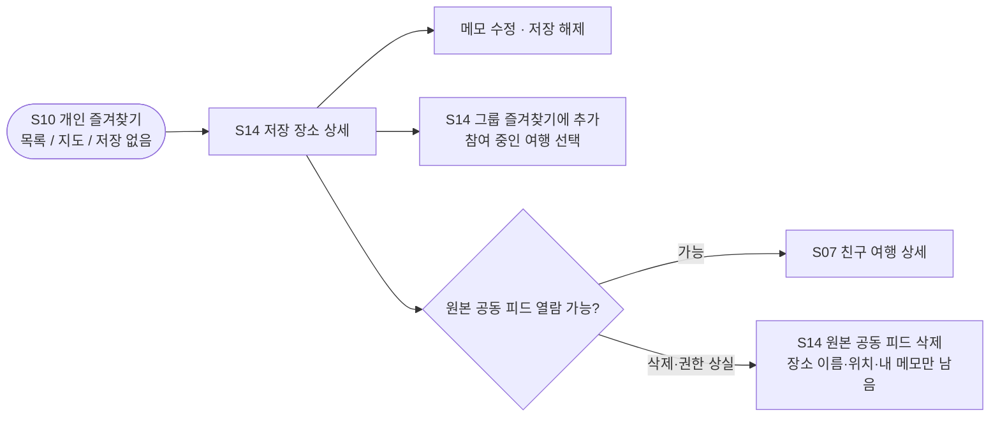

- 개인 즐겨찾기는 본인만 본다. 같은 여행 멤버도 못 본다.
- 원본 공동 피드가 사라져도 저장한 장소의 이름·위치·내 메모는 남는다(결정 Q-3).
- 참여 중인 여행이 없을 때 [그룹에 추가] 상태는 아직 없다 [화면 없음].

## 5. 여행 준비 (WD-FR-04, 07~09, 12~14)

### 5.1 여행 만들기와 여행 상세

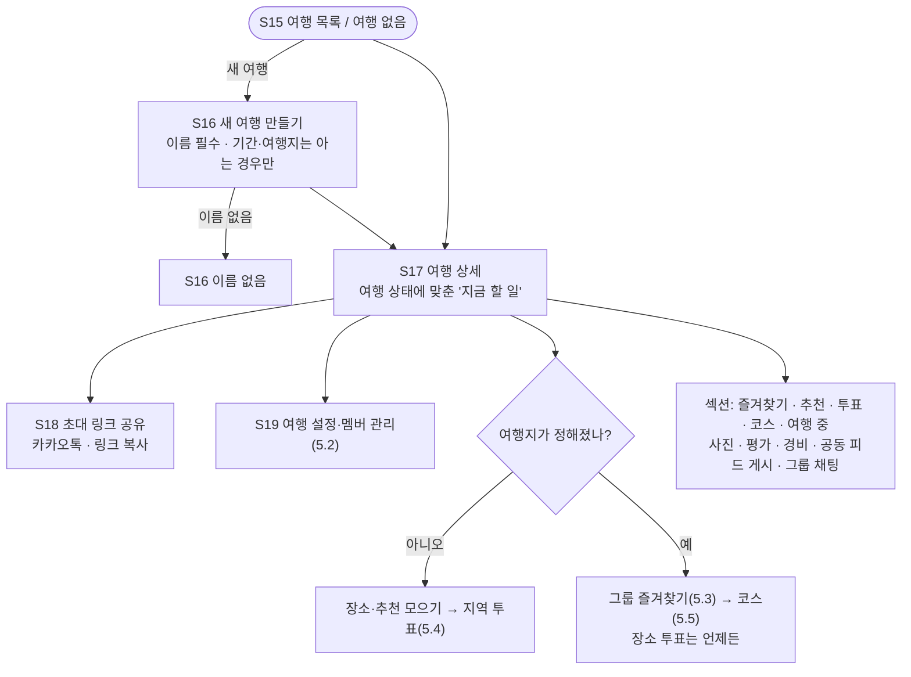

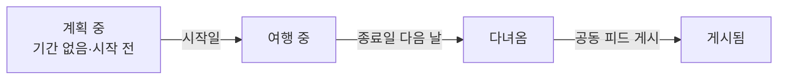

- 여행마다 그룹을 새로 만들고, 만든 사람이 방장이다(v0.4).
- 새 여행은 이름만 필수, 기간·여행지는 아는 경우에만 넣는다. 비워 두면 코스를 만들 때 기간을 묻는다(결정 F-11).
- 여행 상태는 기간으로 자동으로 바뀌고, S17 '지금 할 일'과 S15 진행 단계가 이 상태를 따른다(결정 F-17).
- 여행지가 정해진 여행은 지역 투표를 건너뛴다. 장소 투표는 언제든 연다(결정 F-12).
- 초대 링크 공유와 여행 이름·기간·여행지 수정은 **멤버 누구나** 한다(v0.4, 결정 Q-4).

### 5.2 멤버 관리와 나가기

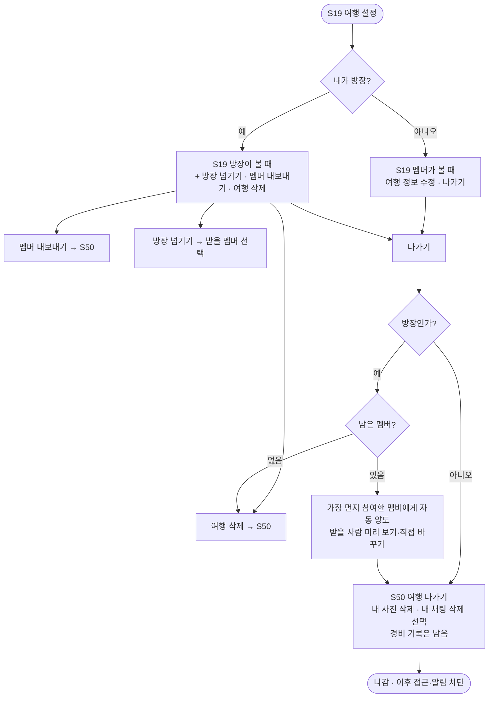

- 방장만 멤버 내보내기·여행 삭제·방장 넘기기를 한다. 일반 멤버 화면에는 이 버튼이 아예 없다(v0.4).
- 방장이 나가면 가장 먼저 참여한 멤버가 이어받고, 나가기 전에 받을 사람을 보여 준다(v0.4, 결정 F-26).
- **혼자 남은 방장이 나가면 여행 삭제와 같게** 처리한다(결정 Q-4).
- 나갈 때 내 사진·채팅을 지울지 고르고, 경비 기록은 남는다(v0.4).
- 내보내기 확인, 방장 넘기기 대상 선택, 나가기 선택지(체크박스)는 화면이 덜 그려졌다 [화면 없음].

### 5.3 같이 모으기와 추천

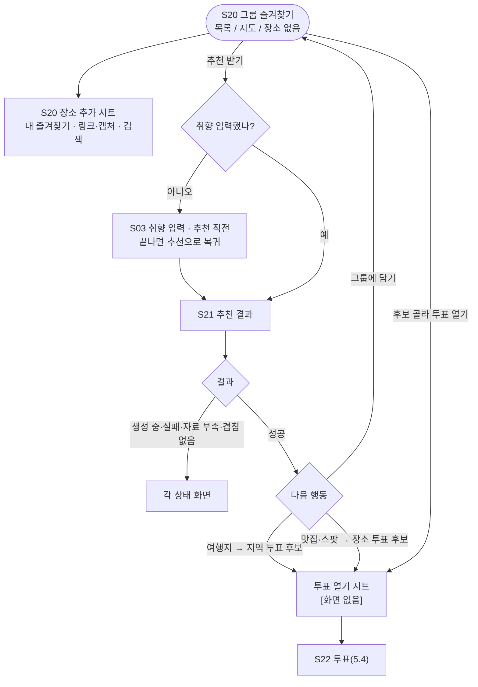

- 멤버 누구나 그룹 즐겨찾기에 장소를 담는다. 같은 장소를 여러 명이 담으면 '겹침'으로 보인다.
- 그룹에 담은 장소가 코스에 자동으로 들어가지 않는다.
- 비공개 개인 즐겨찾기·비공개 취향은 추천 이유에 드러나지 않는다.
- 미정: 다른 사람이 담은 장소를 지울 수 있는지 **Q-4**, 추천 기준 **Q-5**.

### 5.4 지역·장소 투표

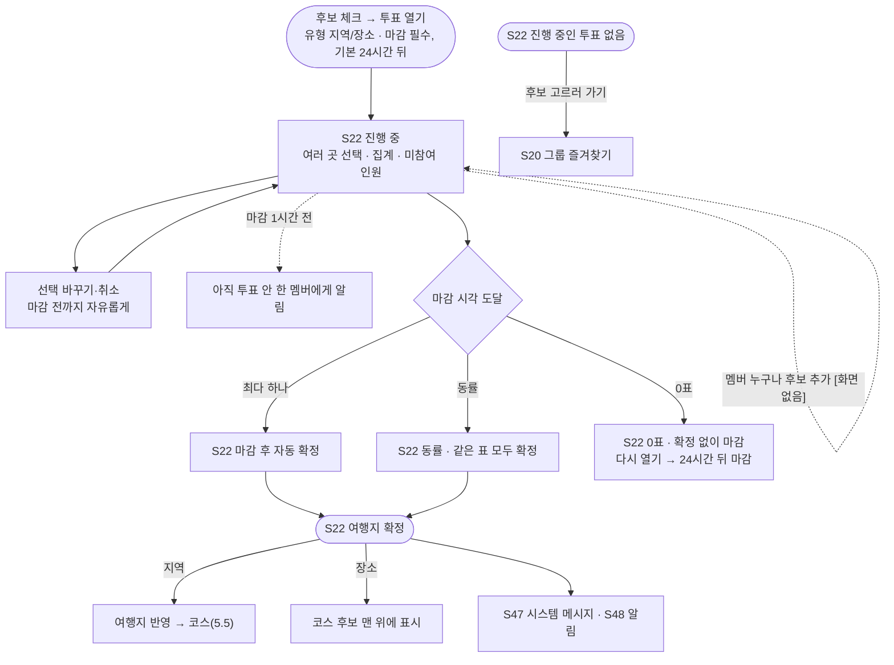

- 지역 투표와 장소 투표 모두 **여러 곳을 고를 수 있다**(v0.4).
- 투표는 그룹 즐겨찾기·추천에서 후보를 체크하고 바로 연다. 별도의 '투표 만들기' 화면은 없다(결정 F-13). 마감 시각은 필수, 기본은 지금부터 24시간 뒤다.
- **마감 시각이 되면 자동으로 확정**한다. 동률이면 같은 표를 받은 곳을 모두 확정하고, 0표면 확정 없이 마감한다 ⚠️(결정 F-14, PRD v0.4는 '방장이 종료·확정').
- 마감 1시간 전에 아직 투표하지 않은 멤버에게만 알린다(결정 F-14).
- 선택은 마감 전까지 바꾸거나 취소할 수 있다. 후보는 진행 중에도 멤버 누구나 추가한다(결정 Q-6).
- 지역이 여러 곳 확정되면 여행지를 여러 곳으로 두고 코스에서 날짜별로 나눈다(결정 Q-6) [화면 없음].

### 5.5 코스 짜기

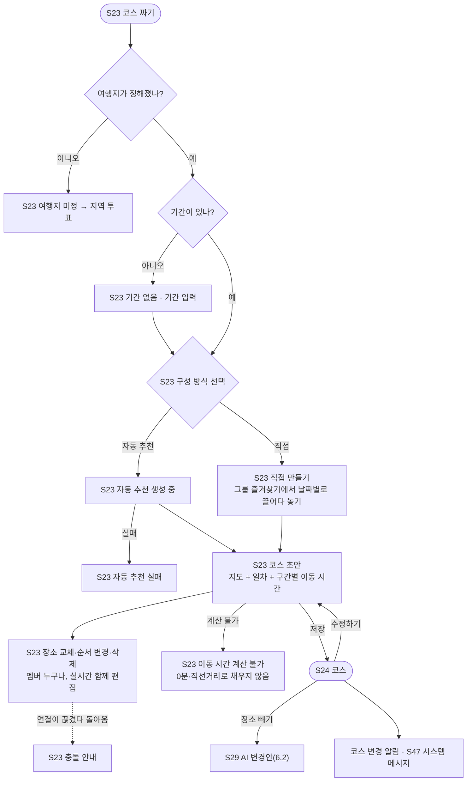

- 자동 추천과 직접 만들기 둘 다 쓴다(결정 Q-6).
- 이동 수단은 **구간마다** 자동차·대중교통·도보 중에서 고른다(결정 Q-6).
- **확정 단계가 없다.** 저장하면 바로 지금 코스가 되고, 확정 버튼·확정 요청도 없다(결정 F-15).
- 여러 명이 **실시간으로 함께 편집**한다. 연결이 끊겼다 돌아왔을 때만 충돌을 안내한다 ⚠️(결정 Q-6).
- 코스 후보는 그룹 즐겨찾기에서 가져오고, 장소 투표로 확정된 곳을 맨 위에 둔다(결정 F-12).
- 실시간 편집과 [저장] 버튼을 어떻게 함께 쓸지, 코스 변경 알림을 어떻게 묶을지는 정해야 한다(§12.4).

## 6. 여행 중 (WD-FR-15~18)

### 6.1 오늘 코스·날씨·준비물·편의시설

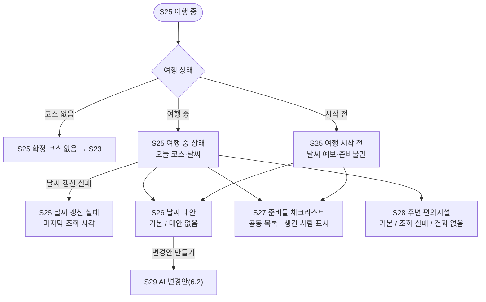

- 날씨 대안은 제안만 하고, 변경안을 만들어 [적용]해야 코스가 바뀐다.
- 준비물은 **멤버 모두 같은 목록**을 쓰고, 챙긴 사람이 표시된다(결정 Q-8b). 다시 제안 받아도 직접 고친 항목은 유지한다.
- 조회하지 않은 날씨·영업 정보를 사실처럼 보여 주지 않는다. 실시간 위치는 공유하지 않는다.

### 6.2 AI 변경안 (장소 제외·날씨 변화)

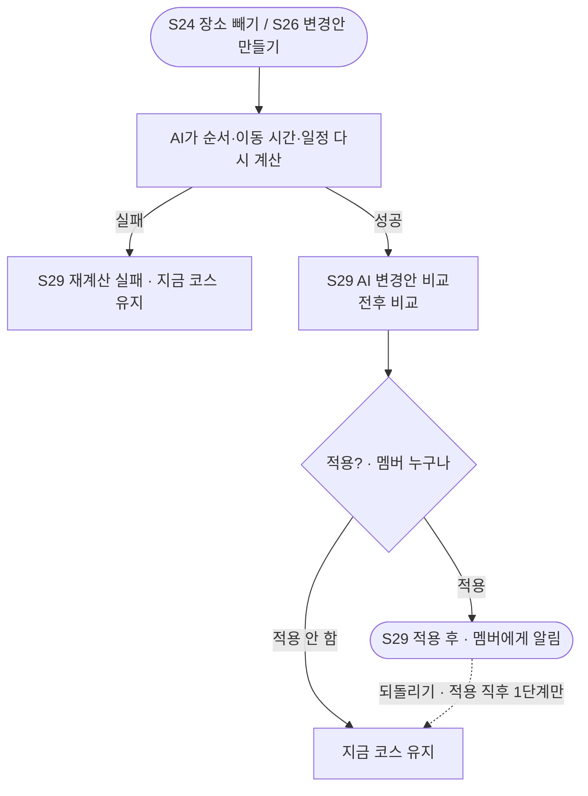

- AI는 **제안만** 하고, 코스는 멤버가 [적용]을 눌러야 바뀐다. 적용은 멤버 누구나 한다(v0.4, 결정 F-16).
- 변경안을 만든 뒤 코스가 바뀌었는지 확인하는 단계는 두지 않는다(결정 F-16). 실시간 편집 중 적용하면 다른 사람의 수정을 덮을 수 있다(§12.4).
- 되돌리기는 AI 변경안을 적용한 직후 1단계만 된다(결정 Q-6).

## 7. 여행 후 정리 (WD-FR-19~23)

### 7.1 사진


- 비슷한 사진으로 묶여도 원본을 자동 삭제하지 않는다.
- 위치·날짜가 없는 사진은 '장소 미지정' 묶음에서 코스 장소에 연결한다(결정 F-18). 연결된 사진은 방문 확인과 지도 핀의 근거가 된다.
- 사진 형식·장수는 결정 Q-7.

### 7.2 방문 장소 평가

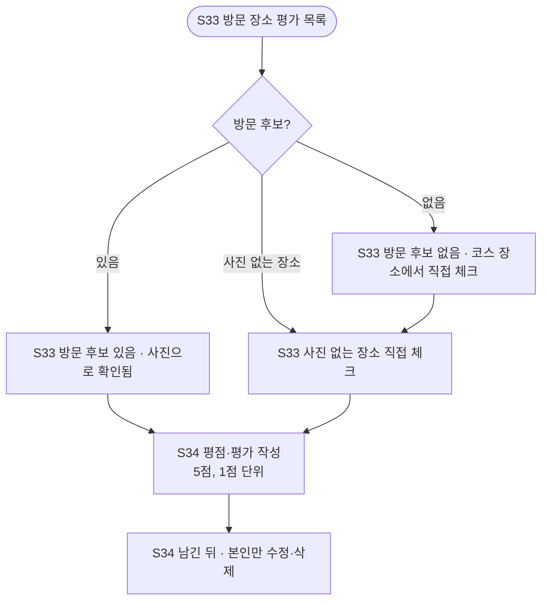

- 방문은 사진 위치·날짜가 맞거나 '다녀옴'을 직접 체크해서 정한다(결정 F-18). 계획에만 있고 체크하지 않은 곳은 평가 대상이 아니다.
- 별점은 5점, 반 점 없이 1점 단위다(결정 Q-7). 남의 평가는 고칠 수 없다.

### 7.3 경비와 정산


- 지출마다 나눌 사람을 고르고, 고른 사람끼리 똑같이 나눈다. 등록한 사람만 수정·삭제한다(v0.4).
- 통화는 **원화만**, 1인 부담액은 **10원 단위로 올린다**(결정 Q-10).
- **정산 완료 표시는 없다.** 누가 누구에게 얼마 보낼지 계산만 하고, 송금·결제는 범위 밖이다(v0.4).
- 나간 멤버의 경비 기록은 남는다(v0.4).
- 입력하지 않은 경비를 0원으로 보여 주지 않는다.

## 8. 마이페이지와 공동 피드 (WD-FR-27~30)

### 8.1 내 여행 기록과 공동 피드 게시

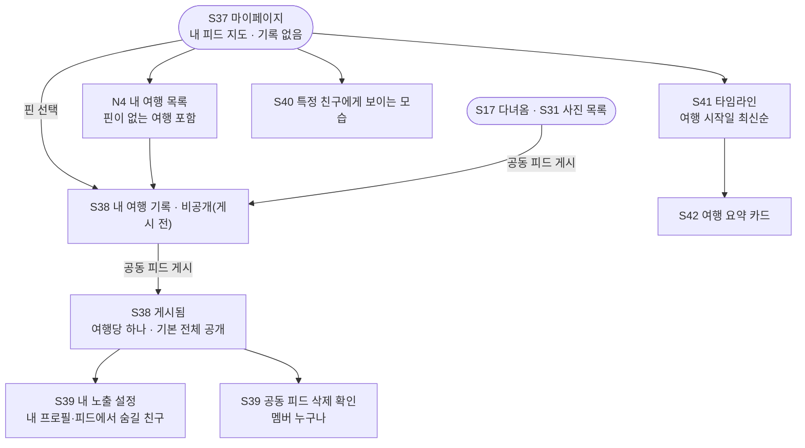

- 공동 피드는 여행당 하나, 기본 전체 공개다(v0.4). **멤버가 [공동 피드 게시]를 눌러야 생기고**, 멤버 누구나 게시·삭제한다(결정 Q-3).
- 다른 멤버가 게시하거나 삭제해도 **따로 알리지 않는다**(결정 F-20). 기본 전체 공개라 내 사진이 모르는 사이 공개될 수 있다(§12.4).
- 지도 핀이 없는 여행도 N4 내 여행 목록이나 S17·S31에서 게시한다(결정 F-19).
- 무엇이 공개되는지 미리 보는 게시 확인 화면은 아직 없다 [화면 없음].

### 8.2 내 노출 설정

```mermaid
flowchart TD
    S39(["S39 내 노출 설정"]) --> HIDE["내 프로필·피드에서 보여 줄 친구 선택<br/>고르지 않은 친구에게 숨김"]
    HIDE --> NOTE["안내: 숨겨도 다른 멤버의 피드나<br/>다른 경로에서는 보일 수 있어요"]
    NOTE --> SAVE["저장"]
    SAVE --> APPLY["숨긴 친구가 보는 내 프로필·피드·지도에서 제외"]
```

- 숨김은 숨긴 멤버의 프로필·피드 경로에만 적용하고, 공동 피드 자체를 막지 않는다(v0.4).
- 사진·경로·평가·경비를 항목별로 공개하는 설정은 없다(v0.4).
- S40에서 특정 친구에게 내 지도·피드가 어떻게 보이는지 확인한다.
- 타임라인은 여행 시작일 최신순, 날짜 없는 여행은 맨 아래 '날짜 미정'에 모은다(결정 Q-7·8).
- 미정: 공동 피드에 공개할 내용 범위, 공동 사진 동의 → **Q-3**.

## 9. 채팅 (WD-FR-33)

```mermaid
flowchart TD
    T(["채팅 탭"]) --> S46["S46 대화방 목록<br/>여행 그룹 방만 / 대화방 없음"]
    S17(["S17 그룹 채팅"]) --> S47
    S46 --> S47["S47 대화방"]
    S47 --> ACC{"그 여행 멤버인가?"}
    ACC -- "아니오" --> DENY["S47 비참여자 차단"]
    ACC -- "예" --> MSG["메시지 보기·보내기<br/>전송 중 / 실패·다시 보내기"]
    SYS["S47 시스템 메시지<br/>투표 시작·마감·확정, AI 변경안, 코스 변경"] --> MSG
    SYS -- "이동 버튼" --> GO["해당 화면"]
    MSG -- "메시지 속 장소" --> S08["S08 장소 저장 시트"]
```

- **1:1 채팅은 없다. 여행 그룹 채팅만** 쓴다 ⚠️(결정 Q-13, PRD v0.4는 1:1·그룹 모두 제공).
- 그룹 채팅방은 여행 멤버로 이루어지고, 나갈 때 내 채팅을 지울지 고른다(v0.4).
- 피드를 볼 수 있어도 대화 이력은 볼 수 없다. 두 권한은 따로다.

## 10. 인앱 알림 (WD-FR-34)

```mermaid
flowchart TD
    EV(["이벤트<br/>투표 시작 · 투표 마감 1시간 전 · 투표 마감·확정<br/>멤버 참여 · AI 변경안 · 코스 변경 · 팔로우 요청·수락"]) --> SV["권한 있는 당사자에게 저장"]
    SV --> SYS["S47 그룹 채팅 시스템 메시지"]
    SV --> S49["S49 알림 목록 · 홈 상단 아이콘<br/>기본 / 알림 없음"]
    APP(["앱 실행·복귀"]) --> UN{"행동이 필요한 미확인 알림?"}
    UN -- "있음" --> S48["S48 알림 팝업<br/>투표 시작·마감 전·팔로우 요청·AI 변경안"]
    UN -- "없음" --> HOME["S05 홈"]
    S48 -- "바로 가기" --> AC{"지금도 권한?"}
    S49 --> AC
    SYS -- "이동" --> AC
    AC -- "예" --> TG["해당 화면 → 읽음"]
    AC -- "아니오" --> GONE["S49 볼 수 없음"]
```

- 알림은 투표 마감 1시간 전과 코스 변경을 추가로 보낸다. 방장 양도·공동 피드 게시·정산 완료 알림은 없다(결정 F-21).
- 앱 실행 팝업은 **내가 해야 할 일이 있는 알림만** 모아 보여 준다(결정 Q-14).
- **푸시 알림은 쓰지 않는다**(PRD §9). 앱을 열어야 알림을 본다(§12.4).
- 한 번 읽으면 팝업·목록·시스템 메시지 모두 읽음이 된다. 알림 본문에 비공개 위치·경비·관계를 담지 않는다.

## 11. 삭제·나가기·탈퇴 (WD-FR-01, 32)

```mermaid
flowchart LR
    A(["S19 · S32 · S35 · S38 · S39 · S45"]) --> P{"권한 있음?<br/>방장 전용·등록자 전용 확인"}
    P -- "아니오" --> NO["버튼 숨김 · 링크로 들어오면 권한 없음"]
    P -- "예" --> S50["S50 영향 안내<br/>여행 나가기 · 사진 · 탈퇴"]
    S50 -- "취소" --> BK["원래 화면"]
    S50 -- "진행" --> DO["처리"]
    DO -- "실패" --> FL["S50 처리 실패 · 성공으로 표시 안 함"]
    DO -- "성공" --> UP["지도·피드·요약 갱신, 이후 접근 차단"]
```

- 방장 전용(내보내기·여행 삭제·방장 넘기기)과 등록자 전용(지출 수정·삭제) 버튼은 권한 없는 사람에게 아예 보이지 않는다.
- 미정: 삭제·보존 기간, 탈퇴 시 처리 → **Q-11**.

## 12. 결정 요약과 남은 일

### 12.1 PRD v0.4 확정으로 정해진 흐름

| 영역 | v0.4 |
| --- | --- |
| 로그인·관계 | 카카오·네이버, 팔로우(공개 즉시·비공개 수락 후) |
| 여행 권한 | 모두 초대·수정, 방장만 내보내기·삭제·양도, 방장이 나가면 자동 양도 |
| 투표 | 지역·장소 투표 모두 여러 곳 선택 |
| AI 변경안 | 멤버 누구나 적용 |
| 공동 피드 | 여행당 하나, 기본 전체 공개, 숨김은 내 프로필·피드에만 |
| 정산 | 고른 사람끼리 균등, 등록자만 수정, 계산만 |
| 나가기 | 내 사진·채팅 삭제 선택, 경비 유지 |

### 12.2 PRD v0.4와 달라 팀 합의가 필요한 결정 ⚠️

| 결정 | PRD v0.4 | 영향 |
| --- | --- | --- |
| 1:1 채팅 없음, 여행 그룹 채팅만 (Q-13) | 1:1·그룹 모두 제공 | S07에서 친구와 이야기할 길이 없어짐(UJ-5) |
| 투표 마감 시 자동 확정, 동률 모두 확정 (F-14) | 방장이 종료·확정 | 방장 역할이 내보내기·삭제·양도로 줄어듦 |
| 실시간 동시 편집 (Q-6) | 미정 | 실시간 동기화 서버가 필요해 BE·FE 범위가 커짐 |

[API 명세](../api-spec.md)·[ERD](../erd.dbml)는 PRD v0.5(레포에 없음) 기준이라 이 문서와 여러 곳이 다르다. 차이는 [API 변경 요청](../design/api-change-requests-2026-10-27.md)에 정리했다.

### 12.3 아직 정하지 않은 PRD 결정

| Q | 남은 결정 |
| --- | --- |
| Q-1 | 프로필 필수값, 연령 형식·동의 |
| Q-2 | 계정 공개 상태 변경 시 기존 관계, 차단 |
| Q-3 | 공동 피드 공개 내용 범위, 공동 사진 동의, 비공개 계정 멤버가 있는 공동 피드의 열람 범위 |
| Q-4 | 초대 링크 만료·정원, 다른 사람이 담은 장소 삭제 권한 |
| Q-5·8·9 | 추천 기준, 지도 표시 기준, 트렌드 기준 |
| Q-11 | 삭제·보존 기간 |
| Q-12 | AI 이용 한도 |

### 12.4 Figma에 아직 없는 화면과 정할 규칙

**흐름이 막히는 곳**

| 위치 | 필요한 것 |
| --- | --- |
| 전체 | 푸시 알림이 없어 투표 마감 1시간 전 알림 등이 앱을 열어야만 보임 |
| 가입·여행 참여 | "멤버가 게시하면 전체 공개될 수 있어요" 안내 (게시 알림이 없음) |
| 다른 사용자 | 다른 사용자 프로필 화면 (팔로우·숨김·비공개 잠금의 기준 화면) |
| S20 | 후보 체크 → 투표 열기 시트 (유형, 마감 시각) |
| 지역 투표 | 지역 후보를 고르는 곳 |
| S22 | [후보 추가]와 '새 후보' 표시 |
| S23 | 여러 지역이 확정됐을 때 날짜별 지역 나누기 |
| S23 | 실시간 편집과 [저장] 버튼 중 하나로 정리 |
| S38 | 공동 피드 게시 미리보기·확인 |
| 초대 | 앱 설치 후 초대 정보 이어받기(지연 딥링크), 만료 시 새 링크 요청 방법 |

**빠진 화면·상태**

S02 계정 공개 선택·약관 동의, S43 팔로잉/팔로워 탭·팔로워 삭제, S14 참여 중인 여행이 없을 때, S12 한 링크의 여러 장소 저장, S19 내보내기 확인·방장 넘기기 대상 선택·나가기 체크박스·혼자 남았을 때, S22 투표 목록, S23 구간별 이동 수단 시트·시간 편집·지금 편집 중인 멤버 표시·자동 추천으로 덮어쓰기 전 확인, S38 게시 후 수정, 공동 피드에서 내 사진만 빼기, S36 정산 결과 공유, S47 장소 공유.

**정할 규칙**

투표 중 후보 추가 시 알림 여부, 모두 투표하면 조기 마감할지, 지역 투표 결과가 이미 정한 여행지와 다를 때, 기간을 줄였을 때 넘치는 코스, 코스 변경 알림 묶음, AI 변경안이 여러 개일 때, 실시간 편집 중 AI 변경안 적용, 지출 등록자가 나간 뒤 수정, 나간 멤버의 정산 결과 열람, 10원 올림 차액, 차단·신고.
