# 어디로그 사용자 흐름

> [어디로그 PRD v0.4](../../_bmad-output/planning-artifacts/prds/prd-EODI-2026-10-22/prd.md)와 2026-10-27에 정한 [미정·제안 결정](../design/open-decisions-2026-10-27.md)을 기준으로, **현재 Figma Page0 화면**을 따라 화면 이동 단위로 정리한다. 화면 ID는 [화면 목록](./screen-list.md)과 같다.

**표기 규칙**

- `(v0.4)`는 PRD v0.4 확정 정책이다.
- `(결정 Q-N)` / `(결정 F-N)`은 2026-10-27에 정한 내용이다. 근거와 화면 영향은 [결정 기록](../design/open-decisions-2026-10-27.md)에 있다.
- **⚠️**는 PRD v0.4와 다른 결정이라 팀 합의가 필요한 부분이다(§12.2).
- `Q-N`만 붙은 것은 아직 정하지 않은 PRD 결정이다.
- **[화면 없음]** 은 흐름에는 필요하지만 Figma에 아직 그리지 않은 화면·상태다(§12.4).
- 여행에 함께하는 사람은 **동행**이라고 부른다.
- 흐름은 화면 이동과 분기만 다룬다. 실패·오류 상태는 Figma 15번 섹션(오류 상태)을 따른다.

## 0. 전체 순환

SNS 축(친구 지도에서 발견 → 저장)과 여행 축(그룹 → 추천 → 투표 → 코스 → 진행 → 정리)이 즐겨찾기와 공동 피드로 맞물려 돈다. 동행이 게시한 공동 피드는 기본 전체 공개로 다시 친구의 홈 지도에 올라간다(v0.4).

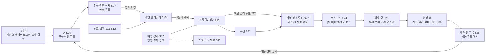

| 단계 | 화면 | 관련 요구사항 | 문서 위치 |
| --- | --- | --- | --- |
| 진입·가입·초대 | S00~S04 | WD-FR-01, 04 | 1장 |
| 팔로우·친구 추천 | S43~S45, N9 | WD-FR-02, 03 | 2장 |
| 홈·친구 여행 | S05~S09, N3, N7 | WD-FR-10, 11, 24~26, 31 | 3장 |
| 장소 모으기 | S10~S14 | WD-FR-05~07 | 4장 |
| 여행·동행 관리 | S15~S19 | WD-FR-04, 32 | 5.1~5.2 |
| 같이 모으기·추천 | S20, S21, S03 | WD-FR-07~09 | 5.3 |
| 투표 | N8, S22 | WD-FR-12 | 5.4 |
| 코스 | S23, S24 | WD-FR-13, 14 | 5.5 |
| 여행 중 | S25~S29 | WD-FR-15~18 | 6장 |
| 여행 후 | S30~S36, N10, N11 | WD-FR-19~23 | 7장 |
| 마이페이지·공동 피드 | S37~S42, N4 | WD-FR-27~30 | 8장 |
| 채팅 | S46, S47 | WD-FR-33 | 9장 |
| 인앱 알림 | S48, S49 | WD-FR-34 | 10장 |
| 삭제·나가기·탈퇴 | S50 | WD-FR-32 | 11장 |

### 0.1 주요 영역


- 그룹 즐겨찾기·추천·투표·코스·여행 중·사진·평가·경비·그룹 채팅은 모두 **여행 상세(S17) 안**에 둔다.
- 화면의 '친구'는 팔로우 관계다(v0.4). 친구 목록·추천은 마이페이지 안에 둔다.
- 알림 목록(S49)은 홈 상단 아이콘에서 연다. 알림 팝업(S48)은 앱 실행·복귀 시 어느 탭에서든 뜬다.

## 1. 진입: 로그인·가입·초대 (WD-FR-01, 04)

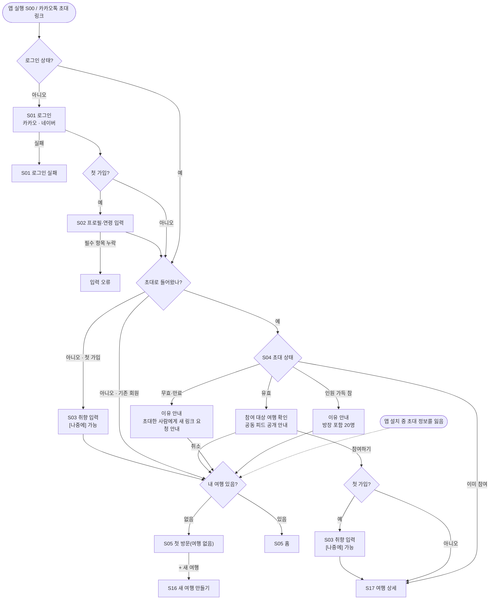

- 로그인은 카카오·네이버 두 가지다(v0.4).
- **초대로 들어온 첫 가입자는 프로필(S02) 다음에 바로 초대 확인(S04)을 본다.** 취향 입력(S03)은 참여한 뒤에 한다. 가입 단계가 길어져 왜 들어왔는지 잊지 않게 하려는 순서다(2026-11-02).
- 초대 미리보기(여행 이름·기간·초대한 사람)는 로그인 전에도 볼 수 있다(API `GET /invitations/{token}`). 그래서 S01에서도 '누가 어떤 여행에 초대했는지'를 보여 줄 수 있다.
- 취향 건너뛰기는 S03 [나중에]가 맡는다. S02에는 건너뛰기 버튼이 없다(2026-10-30).
- **S05 첫 방문(여행 없음)**: 내 여행이 0개면 홈에 지도 대신 '첫 여행을 만들어 볼까요?' + [+ 새 여행](→S16)만 보인다(2026-10-30 팀 회의 코치 의견: 여행 만들기를 신규 가입자 첫 화면에). 초대로 참여한 사람은 여행이 생기므로 이 화면을 보지 않는다. 초대 없이 가입했거나, 초대를 취소했거나, 초대가 무효일 때만 보인다.
- 초대 링크를 받은 사람은 **팔로우 관계와 상관없이 누구나** 참여한다(결정 Q-4). '친구가 아니라서 참여할 수 없음' 상태는 없다.
- **초대 코드는 쓰지 않는다**(결정 F-8). 앱을 설치하는 사이 초대 정보를 잃지 않도록 설치 후에도 링크 정보를 이어받는 처리(지연 딥링크)가 필요하다 [화면 없음 §12.4].
- 연령은 공개 프로필에 보이지 않는다. 카카오톡 공유는 링크 전달 수단일 뿐, 카카오 친구 목록 접근이 아니다.
- S04 유효 화면에 '이 여행의 기록은 동행이 공동 피드로 게시하면 모두에게 공개될 수 있어요'를 안내한다. 게시 알림이 없어서 참여 전에 알린다(결정 F-20).
- 계정 공개/비공개 설정은 지금 S45 설정에만 있다. 가입 때 고를지는 §12.4.
- 초대 링크는 만든 뒤 7일간 쓸 수 있고, 여행 인원은 방장 포함 20명까지다(Q-4, 2026-10-30 결정).
- 미정: 프로필 필수값·연령 형식 **Q-1**.

## 2. 팔로우와 친구 추천 (WD-FR-02, 03)

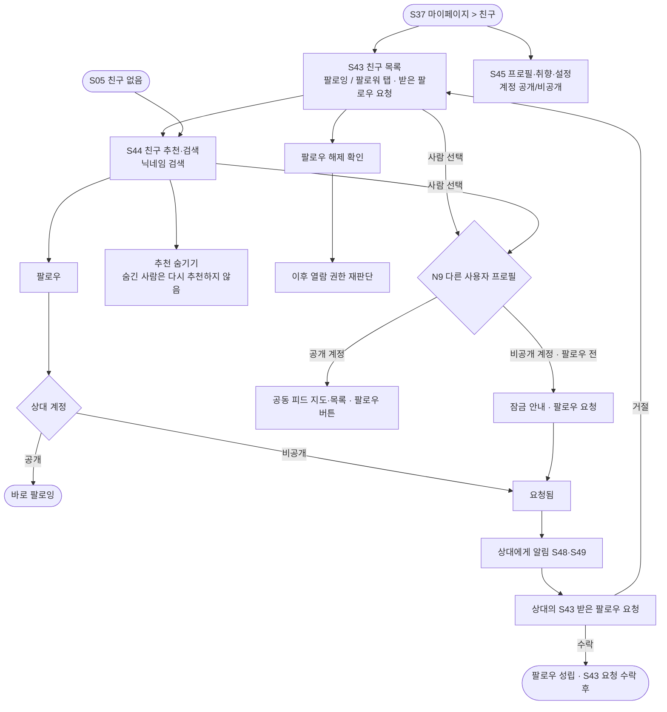

- 공개 계정은 바로 팔로우, 비공개 계정은 요청을 수락해야 팔로우가 된다(v0.4). 서로 맺는 친구 관계는 없다.
- 검색은 **닉네임만**, 추천에서 숨긴 사람은 **다시 추천하지 않는다**(결정 Q-2).
- 받은 팔로우 요청은 S43 맨 위에서 수락·거절한다(결정 F-24). S43은 팔로잉 / 팔로워 탭으로 나누고, 함께 간 여행·동행 중인 여행을 같이 보여 준다.
- 사람을 누르면 N9 다른 사용자 프로필로 간다. 공개 계정은 공동 피드를 보고, 비공개 계정은 팔로우 요청이 수락되기 전까지 잠겨 있다.
- 팔로우만으로 여행 그룹 자료·채팅 이력에 접근하지 않는다.
- 미정: 계정 공개 상태를 바꿀 때 기존 요청·팔로워 처리, 차단 → **Q-2**.

## 3. 홈: 친구 여행 발견 (WD-FR-10, 11, 24~26, 31)

### 3.1 홈 지도·트렌드·추천

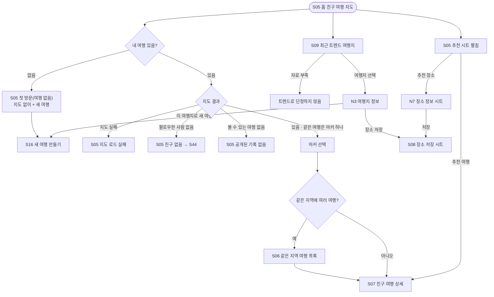

- 홈에는 내가 팔로우한 사람이 참여한 여행의 공동 피드가 보인다. 공동 피드는 여행당 하나라서 같은 여행은 마커 하나다(v0.4).
- 어떤 동행이 나에게 숨긴 여행은 그 동행 경로로는 안 보이지만, 숨기지 않은 다른 동행을 통해서는 보인다(v0.4). 누가 숨겼는지는 드러나지 않는다.
- 추천 장소·여행지를 누르면 **정보를 먼저 보여 주고, 그 화면의 [저장]을 눌러야 저장**된다(결정 F-23).
- 미정: 비공개 계정 동행이 있는 공동 피드의 열람 범위 **Q-3**, 지도 표시 기준 **Q-8**, 트렌드 기준 **Q-9**.

### 3.2 친구 여행 상세와 장소 저장


- 저장할 때 개인/그룹을 고른다. **참여 중인 여행이 없으면 그룹은 고를 수 없고 개인에만 저장**한다. 저장 시트에서 새 여행을 만들지 않는다(결정 F-10).
- 장소를 저장해도 그룹 내부 원본 자료에 접근 권한이 생기지 않는다. 좋아요는 방문·평점을 대신하지 않는다.
- **1:1 채팅이 없어서** 친구 여행을 보다가 그 친구와 이야기할 방법이 없다 ⚠️(결정 Q-13, §12.2).

## 4. 장소 모으기 (WD-FR-05~07)

### 4.1 링크·캡처로 장소 추출

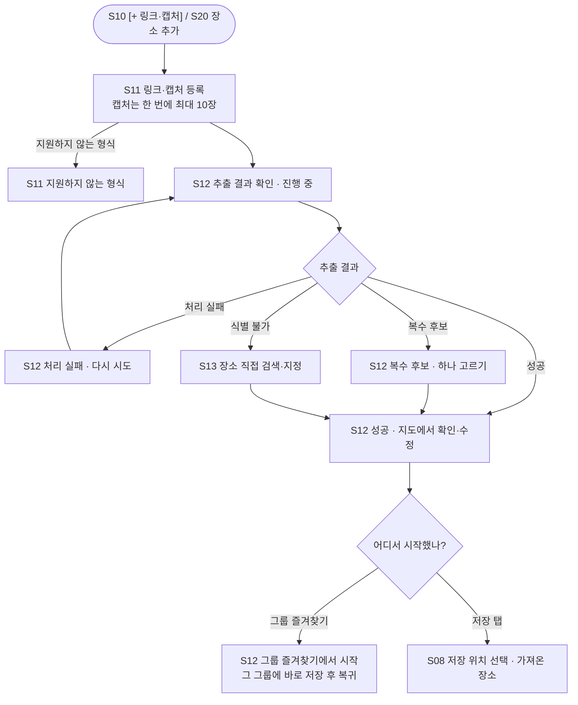

- 확인 단계 없이 자동 저장하지 않는다. 근거 없는 좌표로 확정하지 않는다.
- 그룹 즐겨찾기에서 시작한 추출은 저장 위치를 다시 묻지 않고 그 그룹으로 돌아간다(결정 F-25).
- 캡처는 한 번에 최대 10장(결정 Q-5a). 한 링크에서 장소를 여러 개 찾으면 S12 성공에서 함께 보여 주고 골라 저장한다.

### 4.2 개인 즐겨찾기

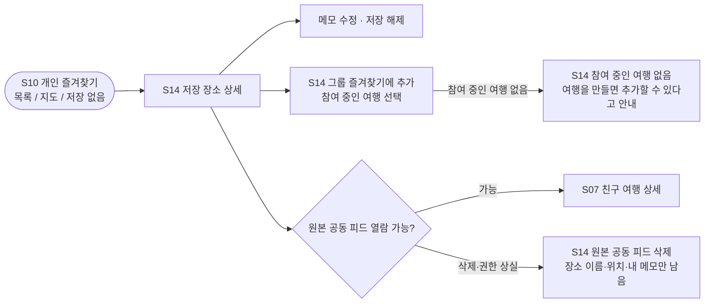

- 개인 즐겨찾기는 본인만 본다. 같은 여행 동행도 못 본다.
- 원본 공동 피드가 사라져도 저장한 장소의 이름·위치·내 메모는 남는다(결정 Q-3).
- 참여 중인 여행이 없으면 [그룹 즐겨찾기에 추가]에서 여행을 만들면 추가할 수 있다고 안내한다(결정 F-10과 같은 규칙).

## 5. 여행 준비 (WD-FR-04, 07~09, 12~14)

### 5.1 여행 만들기와 여행 상세


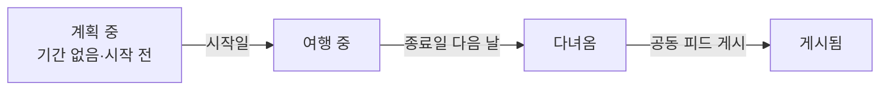

- 여행마다 그룹을 새로 만들고, 만든 사람이 방장이다(v0.4).
- 새 여행은 이름만 필수, 기간·여행지는 아는 경우에만 넣는다. 비워 두면 코스를 만들 때 기간을 묻는다(결정 F-11).
- 여행 상태는 기간으로 자동으로 바뀌고, S17 '지금 할 일'과 S15 진행 단계가 이 상태를 따른다(결정 F-17).
- 여행지가 정해진 여행은 지역 투표를 건너뛴다. 장소 투표는 언제든 연다(결정 F-12).
- 초대 링크 공유와 여행 이름·기간·여행지 수정은 **동행 누구나** 한다(v0.4, 결정 Q-4).

### 5.2 동행 관리와 나가기

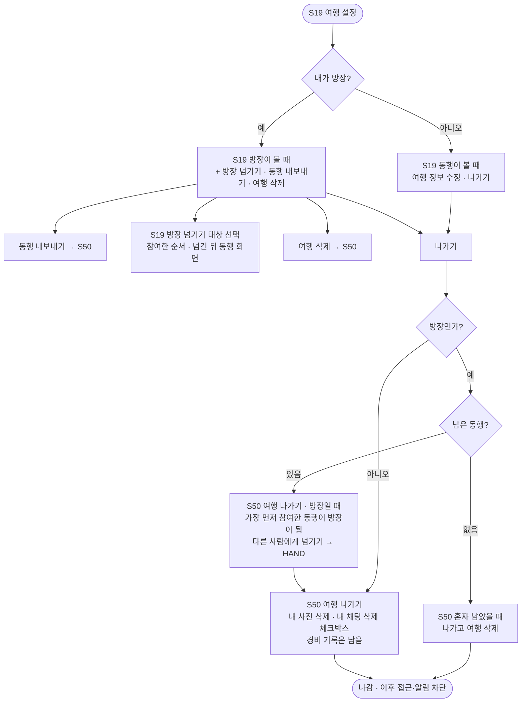

- 방장만 동행 내보내기·여행 삭제·방장 넘기기를 한다. 일반 동행 화면에는 이 버튼이 아예 없다(v0.4).
- 방장이 나가면 가장 먼저 참여한 동행이 이어받고, 나가기 전에 받을 사람을 보여 준다(v0.4, 결정 F-26).
- **혼자 남은 방장이 나가면 여행 삭제와 같게** 처리한다(결정 Q-4).
- 나갈 때 내 사진·채팅을 지울지 고르고, 경비 기록은 남는다(v0.4).
- 방장 넘기기는 참여한 순서대로 동행을 보여 주고 한 명을 고른다. 넘기면 내보내기·여행 삭제는 새 방장만 한다.
- 동행 내보내기 확인 화면은 아직 없다 [화면 없음].

### 5.3 같이 모으기와 추천


- 동행 누구나 그룹 즐겨찾기에 장소를 담는다. 같은 장소를 여러 명이 담으면 '겹침'으로 보인다.
- 그룹에 담은 장소가 코스에 자동으로 들어가지 않는다.
- 비공개 개인 즐겨찾기·비공개 취향은 추천 이유에 드러나지 않는다.
- 미정: 다른 사람이 담은 장소를 지울 수 있는지 **Q-4**, 추천 기준 **Q-5**.

### 5.4 지역·장소 투표

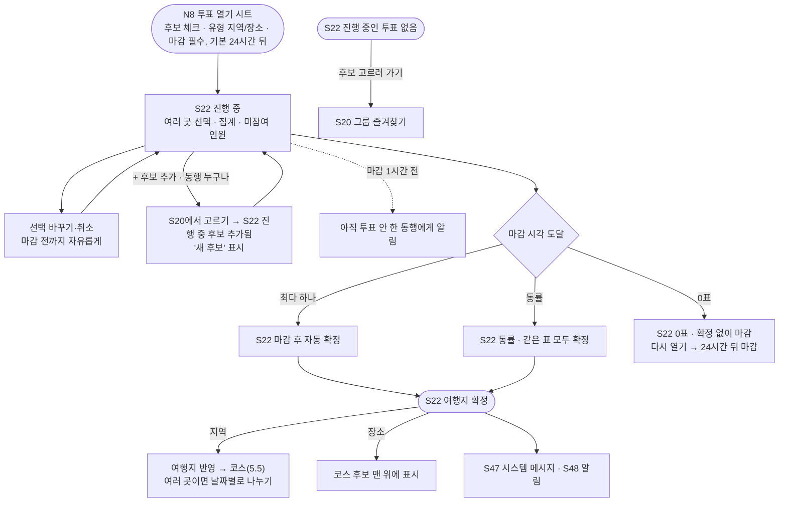

- 지역 투표와 장소 투표 모두 **여러 곳을 고를 수 있다**(v0.4).
- 투표는 그룹 즐겨찾기·추천에서 후보를 체크하고 N8 투표 열기 시트에서 바로 연다. 별도의 '투표 만들기' 화면은 없다(결정 F-13). 마감 시각은 필수, 기본은 지금부터 24시간 뒤다.
- **마감 시각이 되면 자동으로 확정**한다. 동률이면 같은 표를 받은 곳을 모두 확정하고, 0표면 확정 없이 마감한다 ⚠️(결정 F-14, PRD v0.4는 '방장이 종료·확정').
- 마감 1시간 전에 아직 투표하지 않은 동행에게만 알린다(결정 F-14).
- 선택은 마감 전까지 바꾸거나 취소할 수 있다. 후보는 진행 중에도 동행 누구나 추가한다(결정 Q-6).
- 지역이 여러 곳 확정되면 여행지를 여러 곳으로 두고 코스에서 날짜별로 나눈다(결정 Q-6). S22 동률 화면의 [코스에서 날짜별로 나누기]가 S23 여러 지역 날짜별로 나누기로 이어진다.

### 5.5 코스 짜기

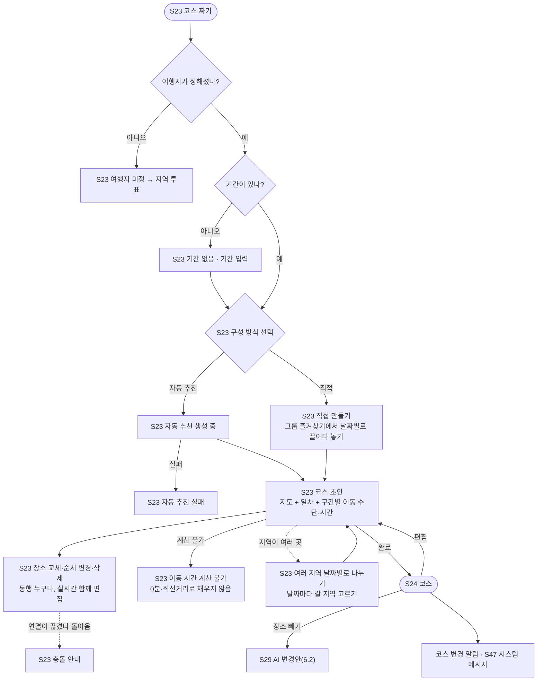

- 자동 추천과 직접 만들기 둘 다 쓴다(결정 Q-6).
- 이동 수단은 **구간마다** 자동차·대중교통·도보 중에서 고른다(결정 Q-6).
- **확정 단계가 없다.** [완료]를 누르면 바로 지금 코스가 되고, 확정 버튼·확정 요청도 없다(결정 F-15).
- 여러 명이 **실시간으로 함께 편집**한다. 연결이 끊겼다 돌아왔을 때만 충돌을 안내한다 ⚠️(결정 Q-6).
- 코스 후보는 그룹 즐겨찾기에서 가져오고, 장소 투표로 확정된 곳을 맨 위에 둔다(결정 F-12).
- 실시간 편집과 [완료] 버튼을 어떻게 함께 쓸지, 코스 변경 알림을 어떻게 묶을지는 정해야 한다(§12.4).

## 6. 여행 중 (WD-FR-15~18)

### 6.1 오늘 코스·날씨·준비물·편의시설

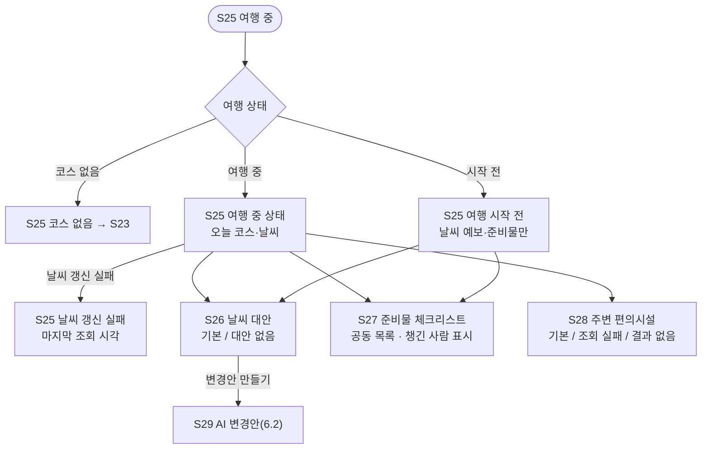

- 날씨 대안은 제안만 하고, 변경안을 만들어 [적용]해야 코스가 바뀐다.
- 준비물은 **동행 모두 같은 목록**을 쓰고, 챙긴 사람이 표시된다(결정 Q-8b). 다시 제안 받아도 직접 고친 항목은 유지한다.
- 조회하지 않은 날씨·영업 정보를 사실처럼 보여 주지 않는다. 실시간 위치는 공유하지 않는다.

### 6.2 AI 변경안 (장소 제외·날씨 변화)


- AI는 **제안만** 하고, 코스는 동행이 [적용]을 눌러야 바뀐다. 적용은 동행 누구나 한다(v0.4, 결정 F-16).
- 변경안을 만든 뒤 코스가 바뀌었는지 확인하는 단계는 두지 않는다(결정 F-16). 실시간 편집 중 적용하면 다른 사람의 수정을 덮을 수 있다(§12.4).
- 되돌리기는 AI 변경안을 적용한 직후 1단계만 된다(결정 Q-6).

## 7. 여행 후 정리 (WD-FR-19~23)

### 7.1 사진

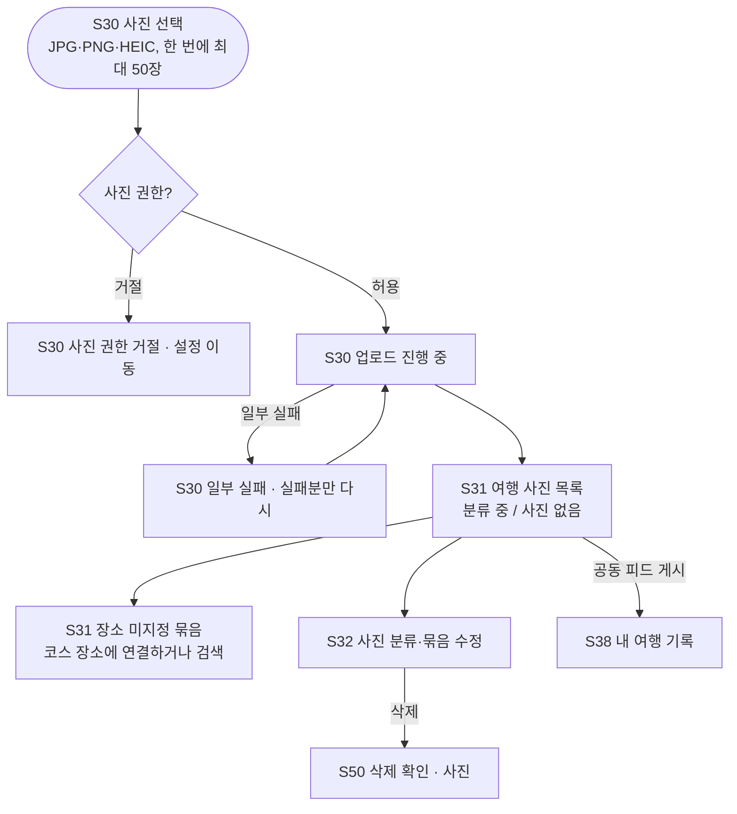

- 비슷한 사진으로 묶여도 원본을 자동 삭제하지 않는다.
- 위치·날짜가 없는 사진은 '장소 미지정' 묶음에서 코스 장소에 연결한다(결정 F-18). 연결된 사진은 방문 확인과 지도 핀의 근거가 된다.
- 사진 형식·장수는 결정 Q-7.

### 7.2 방문 장소 평가


- 방문은 사진 위치·날짜가 맞거나 '다녀옴'을 직접 체크해서 정한다(결정 F-18). 계획에만 있고 체크하지 않은 곳은 평가 대상이 아니다.
- 별점은 5점, 반 점 없이 1점 단위다(결정 Q-7). 남의 평가는 고칠 수 없다.

### 7.3 경비와 정산

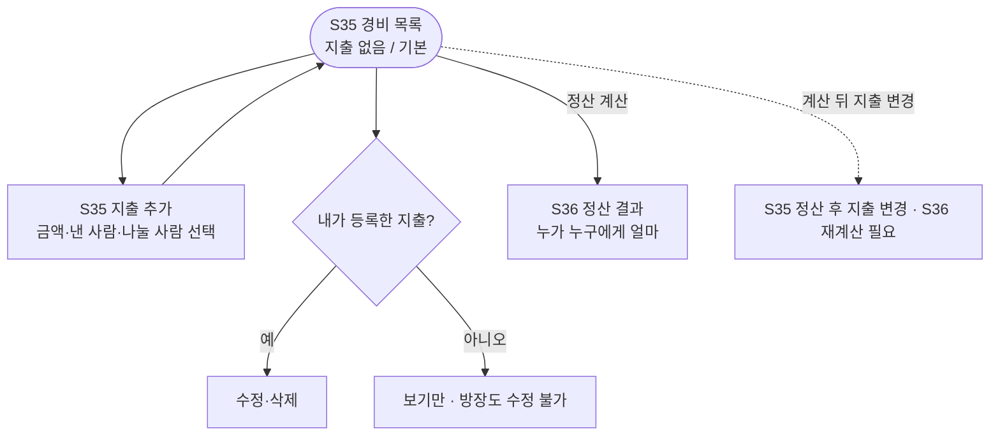

- 지출마다 나눌 사람을 고르고, 고른 사람끼리 똑같이 나눈다. 등록한 사람만 수정·삭제한다(v0.4).
- 통화는 **원화만**, 1인 부담액은 **10원 단위로 올린다**(결정 Q-10).
- **정산 완료 표시는 없다.** 누가 누구에게 얼마 보낼지 계산만 하고, 송금·결제는 범위 밖이다(v0.4).
- 나간 동행의 경비 기록은 남는다(v0.4).
- 입력하지 않은 경비를 0원으로 보여 주지 않는다.

### 7.4 말로 경비 입력 (2026-11-12)

한 번 녹음해서 여러 지출을 말하면 지출 초안 목록을 만들고, 사용자가 확인·수정한 것만 한 번에 저장한다. AI 결과만으로 경비를 자동 등록하지 않는다. 기준 문서는 [음성 공동 경비 작업 분담](../plan/voice-expense-stt-work-split-2026-11-12.md)이고, 아래는 그 문서를 화면 흐름으로 옮긴 것이다.

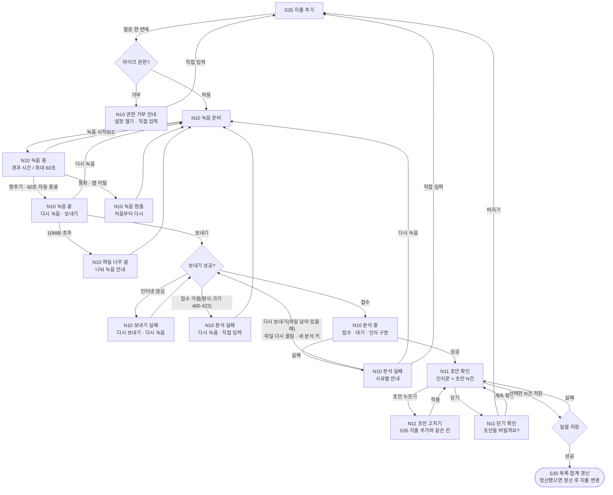

**녹음 (N10)**

- 진입은 S35 지출 추가 상단의 [🎤 말로 한 번에] 버튼이다. 시트 제목은 "말로 지출 기록"이다. 직접 입력은 그대로 둔다.
- 처음 누르면 마이크 권한을 묻는다. 거부하면 설정 열기와 직접 입력을 안내한다.
- 녹음은 최대 60초, 60초가 되면 자동으로 멈춘다. 파일이 10MiB를 넘으면 보내기 전에 막고 나눠 녹음하라고 안내한다.
- 녹음 중 화면에는 경과 시간(예: 0:12 / 1:00)과 [멈추기]·[취소]를 둔다. 통화가 오거나 앱을 벗어나면 녹음을 멈추고 "녹음이 멈췄어요" 안내와 함께 처음 상태로 돌아간다. 1분이 되어 멈추면 녹음 끝 화면에 "1분이 되어 자동으로 멈췄어요"를 함께 보여 준다.
- 녹음 끝 화면에는 [다시 녹음]·[보내기]를 둔다. 들어 보기는 1차 범위에 없다.
- 분석 중에는 "접수했어요 → 기다리는 중 → 말을 글로 바꾸는 중"처럼 단계만 보여 준다. 남은 초 카운트다운은 만들지 않는다.
- 분석 중 화면을 벗어나면 결과 확인을 멈춘다(서버 작업 취소는 아니다). 다시 들어와 이어 보는 화면은 1차 범위에 없어 새로 녹음한다.
- 한 번에 10건까지 만든다. 그보다 많으면 일부만 만들지 않고 나눠 녹음하라고 안내한다.

**분석 실패 안내 (N10)**

| 서버 오류 코드 | 화면 문구 방향 | 버튼 |
| --- | --- | --- |
| (접수 전) 인터넷 끊김·업로드 실패 — 서버가 답하지 않음 | 녹음을 보내지 못했어요 | 다시 보내기 · 다시 녹음 |
| (접수 단계) 서버가 파일 형식·크기를 거절 — HTTP 400·422 | 녹음 파일을 읽지 못했어요 / 한 번에 10건까지 돼요 | 다시 녹음 · 직접 입력 (다시 보내도 결과가 같아 다시 보내기 없음) |
| VOICE_AUDIO_INVALID | 녹음 파일을 읽지 못했어요 | 다시 녹음 · 직접 입력 |
| VOICE_INPUT_LIMIT_EXCEEDED | 한 번에 10건까지 돼요. 나눠서 말해 주세요 | 다시 녹음 · 직접 입력 |
| VOICE_NO_SPEECH_OR_EXPENSE | 지출을 찾지 못했어요 | 다시 녹음 · 직접 입력 |
| VOICE_EXPENSE_UNSUPPORTED | 원화·똑같이 나누기만 돼요 | 직접 입력 |
| VOICE_PROVIDER_UNAVAILABLE | 지금 분석할 수 없어요 | 다시 보내기(파일이 남아 있으면) · 다시 녹음 |
| VOICE_PROCESSING_TIMEOUT | 분석이 오래 걸려 멈췄어요 | 다시 보내기(파일이 남아 있으면) · 다시 녹음 |
| VOICE_PROCESSING_INTERRUPTED | 정리가 중단됐어요 | 다시 녹음 · 직접 입력 |

- 자동 재시도는 없다. 다시 보내기·다시 녹음은 사용자가 누른다.
- 다시 보내기는 남아 있는 녹음 파일을 처음부터 다시 올리고 새 분석 키로 새 작업을 만든다(작업 분담 문서 3장). 다시 보내다 인터넷이 끊기면 다시 보내기 실패가 된다.
- VOICE_AUDIO_INVALID·VOICE_PROCESSING_INTERRUPTED·접수 단계 거절은 따로 그리지 않고 "분석 실패 · 찾지 못함"과 같은 모양([직접 입력] [다시 녹음])에 문구만 바꿔 쓴다.
- 녹음 파일은 결과를 받거나 취소하면 기기에서 지운다. 실패했을 때만 이 화면에 있는 동안 다시 보내기용으로 남기고, 화면을 벗어나면 지운다.

**초안 확인 (N11)**

- 맨 위에 받아 적은 글 전체를 보여 준다. 이 글을 고쳐도 다시 분석하지 않는다. 틀리면 초안 칸을 직접 고치거나 다시 녹음한다.
- 아래에 초안을 카드로 나열한다. 카드마다 항목 이름·금액·낸 사람·나눌 사람과, 그 초안이 나온 말 한 줄(`transcriptSegment`)을 작게 보여 준다.
- 카드마다 선택 체크가 있고 기본은 모두 선택이다. [빼기]로 목록에서 지울 수 있다.
- 확인이 필요한 칸은 카드에 표시한다. 금액 없음, 낸 사람·나눌 사람을 모름, 같은 이름이 여럿이거나 없는 이름이다. AI가 사람을 임의로 고르지 않으므로 사용자가 직접 고른다.
- "셋이서"처럼 사람 수만 말했으면 나눌 사람을 비워 두고 고르게 한다. "내가 냈어"만으로 나를 나눌 사람에 넣지 않는다.
- 지출 시각을 말하지 않았으면 직접 입력과 같은 기본값(저장하는 지금)으로 저장한다. 이 값은 AI가 알아낸 시각처럼 보이지 않게 한다.
- 카드를 누르면 S35 지출 추가와 같은 칸(금액·낸 사람·나눌 사람·항목 이름)으로 고치고 [적용]으로 목록에 돌아온다. 늦게 온 응답이 사용자가 고친 값을 덮지 않는다.
- 확인이 필요한 칸이 남은 초안이 선택돼 있으면 저장 버튼을 누를 수 없다. 이때 지출 시각(spentAt)은 따지지 않는다. 시각을 말하지 않으면 거의 모든 초안의 unresolvedFields에 spentAt이 들어오고(SPENT_AT_UNKNOWN), 저장할 때 지금 시각을 쓰기 때문이다.
- 아래 버튼은 [N건 저장]이다. 선택한 1~10건을 한 번에 보내고, 한 건이라도 잘못되면 모두 저장하지 않는다. 저장 중에는 버튼을 막는다.
- "‘민수’는 이 여행 동행에 없어요", "‘세은’이 두 명이에요" 처럼 이름을 맞추지 못한 칸은 카드에 표시하고 사용자가 고른다(N11 사람 확인).
- 말한 지출과 초안 수가 다를 수 있다는 경고(COUNT_MISMATCH)가 오면 맨 위에 "빠진 지출이 있으면 직접 추가해 주세요"를 보여 준다(N11 건수 다름).
- 초안을 모두 빼거나 선택을 다 풀면 [0건 저장]이 꺼지고 "저장할 초안을 하나 이상 골라 주세요"를 보여 준다(N11 고른 초안 없음).
- 저장하지 않고 닫으면 "초안을 버릴까요?" 확인을 띄운다(N11 닫기 확인).
- 저장에 성공하면 S35로 돌아가 목록·합계를 새로 받고 "N건 저장했어요"를 띄운다. 정산을 이미 했다면 S35 "정산 후 지출 변경" 상태가 된다.
- 저장에 실패하면 고치던 목록을 그대로 두고 [다시 저장]을 보여 준다.
- 인식문과 초안은 서버에 1시간만 남는다. 결과 만료는 초안 확인을 다시 열 때(앱을 다시 켜 결과를 서버에서 다시 받는 경우) 작업 조회가 404면 보여 준다. 일괄 저장은 draftId 없이 지출 값만 보내므로 화면에 이미 받은 초안은 1시간이 지나도 저장할 수 있다.

## 8. 마이페이지와 공동 피드 (WD-FR-27~30)

### 8.1 내 여행 기록과 공동 피드 게시

```mermaid
flowchart TD
    S37(["S37 마이페이지<br/>내 피드 지도 · 기록 없음"]) -- "핀 선택" --> S38
    S37 --> N4["N4 내 여행 목록<br/>핀이 없는 여행 포함"] --> S38
    TDS(["S17 다녀옴 · S31 사진 목록"]) -- "공동 피드 게시" --> S38
    S38["S38 내 여행 기록 · 게시 전"] -- "공동 피드 게시" --> CONF["S38 게시 확인<br/>모두에게 공개 안내"]
    CONF -- "닫기" --> S38
    CONF -- "친구에게 보이는 모습 미리 보기" --> S40
    CONF -- "게시" --> PUB["S38 게시됨<br/>여행당 하나 · 기본 전체 공개"]
    PUB --> S39["S39 내 노출 설정<br/>내 프로필·피드에서 숨길 친구"]
    PUB --> DEL["S39 공동 피드 삭제 확인<br/>동행 누구나"]
    S37 --> S40["S40 특정 친구에게 보이는 모습"]
    S37 --> S41["S41 타임라인<br/>여행 시작일 최신순"] --> S42["S42 여행 요약 카드"]
```

- 공동 피드는 여행당 하나, 기본 전체 공개다(v0.4). **동행이 [공동 피드 게시]를 눌러야 생기고**, 동행 누구나 게시·삭제한다(결정 Q-3).
- 다른 동행이 게시하거나 삭제해도 **따로 알리지 않는다**(결정 F-20). 기본 전체 공개라 내 사진이 모르는 사이 공개될 수 있다(§12.4).
- 지도 핀이 없는 여행도 N4 내 여행 목록이나 S17·S31에서 게시한다(결정 F-19).
- 게시 전에 S38 게시 확인에서 동행 모두의 사진·코스·평가·경비가 모두에게 공개된다고 안내하고, 숨길 친구는 게시한 뒤 내 노출 설정에서 고르게 한다.

### 8.2 내 노출 설정

```mermaid
flowchart TD
    S39(["S39 내 노출 설정"]) --> HIDE["내 프로필·피드에서 보여 줄 친구 선택<br/>고르지 않은 친구에게 숨김"]
    HIDE --> NOTE["안내: 숨겨도 다른 동행의 피드나<br/>다른 경로에서는 보일 수 있어요"]
    NOTE --> SAVE["저장"]
    SAVE --> APPLY["숨긴 친구가 보는 내 프로필·피드·지도에서 제외"]
```

- 숨김은 숨긴 동행의 프로필·피드 경로에만 적용하고, 공동 피드 자체를 막지 않는다(v0.4).
- 사진·경로·평가·경비를 항목별로 공개하는 설정은 없다(v0.4).
- S40에서 특정 친구에게 내 지도·피드가 어떻게 보이는지 확인한다.
- 타임라인은 여행 시작일 최신순, 날짜 없는 여행은 맨 아래 '날짜 미정'에 모은다(결정 Q-7·8).
- 미정: 공동 피드에 공개할 내용 범위, 공동 사진 동의 → **Q-3**.

## 9. 채팅 (WD-FR-33)

```mermaid
flowchart TD
    T(["채팅 탭"]) --> S46["S46 대화방 목록<br/>여행 그룹 방만 / 대화방 없음"]
    S17(["S17 그룹 채팅"]) --> S47
    S46 --> S47["S47 대화방"]
    S47 --> ACC{"그 여행 동행인가?"}
    ACC -- "아니오" --> DENY["S47 비참여자 차단"]
    ACC -- "예" --> MSG["메시지 보기·보내기<br/>전송 중 / 실패·다시 보내기"]
    SYS["S47 시스템 메시지<br/>투표 시작·마감·확정, AI 변경안, 코스 변경"] --> MSG
    SYS -- "이동 버튼" --> GO["해당 화면"]
    MSG -- "메시지 속 장소" --> S08["S08 장소 저장 시트"]
```

- **1:1 채팅은 없다. 여행 그룹 채팅만** 쓴다 ⚠️(결정 Q-13, PRD v0.4는 1:1·그룹 모두 제공).
- 그룹 채팅방은 여행 동행으로 이루어지고, 나갈 때 내 채팅을 지울지 고른다(v0.4).
- 피드를 볼 수 있어도 대화 이력은 볼 수 없다. 두 권한은 따로다.

## 10. 인앱 알림 (WD-FR-34)

```mermaid
flowchart TD
    EV(["이벤트<br/>투표 시작 · 투표 마감 1시간 전 · 투표 마감·확정<br/>동행 참여 · AI 변경안 · 코스 변경 · 팔로우 요청·수락"]) --> SV["권한 있는 당사자에게 저장"]
    SV --> SYS["S47 그룹 채팅 시스템 메시지"]
    SV --> S49["S49 알림 목록 · 홈 상단 아이콘<br/>기본 / 알림 없음"]
    APP(["앱 실행·복귀"]) --> UN{"행동이 필요한 미확인 알림?"}
    UN -- "있음" --> S48["S48 알림 팝업<br/>투표 시작·마감 전·팔로우 요청·AI 변경안"]
    UN -- "없음" --> HOME["S05 홈"]
    S48 -- "알림 선택" --> AC{"지금도 권한?"}
    S48 -- "알림 모두 보기" --> S49
    S49 --> AC
    SYS -- "이동" --> AC
    AC -- "예" --> TG["해당 화면 → 읽음"]
    AC -- "아니오" --> GONE["S49 볼 수 없음"]
```

- 알림은 투표 마감 1시간 전과 코스 변경을 추가로 보낸다. 방장 양도·공동 피드 게시·정산 완료 알림은 없다(결정 F-21).
- 앱 실행 팝업은 **내가 해야 할 일이 있는 알림만** 모아 보여 준다(결정 Q-14).
- **푸시 알림은 쓰지 않는다**(PRD §9). 앱을 열어야 알림을 본다(§12.4).
- 한 번 읽으면 팝업·목록·시스템 메시지 모두 읽음이 된다. 알림 본문에 비공개 위치·경비·관계를 담지 않는다.

## 11. 삭제·나가기·탈퇴 (WD-FR-01, 32)

```mermaid
flowchart LR
    A(["S19 · S32 · S35 · S38 · S39 · S45"]) --> P{"권한 있음?<br/>방장 전용·등록자 전용 확인"}
    P -- "아니오" --> NO["버튼 숨김 · 링크로 들어오면 권한 없음"]
    P -- "예" --> S50["S50 영향 안내<br/>여행 나가기 · 사진 · 탈퇴"]
    S50 -- "취소" --> BK["원래 화면"]
    S50 -- "진행" --> DO["처리"]
    DO -- "실패" --> FL["S50 처리 실패 · 성공으로 표시 안 함"]
    DO -- "성공" --> UP["지도·피드·요약 갱신, 이후 접근 차단"]
```

- 방장 전용(내보내기·여행 삭제·방장 넘기기)과 등록자 전용(지출 수정·삭제) 버튼은 권한 없는 사람에게 아예 보이지 않는다.
- 미정: 삭제·보존 기간, 탈퇴 시 처리 → **Q-11**.

## 12. 결정 요약과 남은 일

### 12.1 PRD v0.4 확정으로 정해진 흐름

| 영역 | v0.4 |
| --- | --- |
| 로그인·관계 | 카카오·네이버, 팔로우(공개 즉시·비공개 수락 후) |
| 여행 권한 | 모두 초대·수정, 방장만 내보내기·삭제·양도, 방장이 나가면 자동 양도 |
| 투표 | 지역·장소 투표 모두 여러 곳 선택 |
| AI 변경안 | 동행 누구나 적용 |
| 공동 피드 | 여행당 하나, 기본 전체 공개, 숨김은 내 프로필·피드에만 |
| 정산 | 고른 사람끼리 균등, 등록자만 수정, 계산만 |
| 나가기 | 내 사진·채팅 삭제 선택, 경비 유지 |

### 12.2 PRD v0.4와 달라 팀 합의가 필요한 결정 ⚠️

| 결정 | PRD v0.4 | 영향 |
| --- | --- | --- |
| 1:1 채팅 없음, 여행 그룹 채팅만 (Q-13) | 1:1·그룹 모두 제공 | S07에서 친구와 이야기할 길이 없어짐(UJ-5) |
| 투표 마감 시 자동 확정, 동률 모두 확정 (F-14) | 방장이 종료·확정 | 방장 역할이 내보내기·삭제·양도로 줄어듦 |
| 실시간 동시 편집 (Q-6) | 미정 | 실시간 동기화 서버가 필요해 BE·FE 범위가 커짐 |

[API 명세](../api-spec.md)·[ERD](../erd.dbml)는 PRD v0.5(레포에 없음) 기준이라 이 문서와 여러 곳이 다르다. BE는 이 문서와 [화면 목록](./screen-list.md)을 기준으로 명세를 맞춘다.

### 12.3 아직 정하지 않은 PRD 결정

| Q | 남은 결정 |
| --- | --- |
| Q-1 | 프로필 필수값, 연령 형식·동의 |
| Q-2 | 계정 공개 상태 변경 시 기존 관계, 차단 |
| Q-3 | 공동 피드 공개 내용 범위, 공동 사진 동의, 비공개 계정 동행이 있는 공동 피드의 열람 범위 |
| Q-4 | 다른 사람이 담은 장소 삭제 권한(초대 링크 만료 7일·정원 20명은 2026-10-30 결정) |
| Q-5·8·9 | 추천 기준, 지도 표시 기준, 트렌드 기준 |
| Q-11 | 삭제·보존 기간 |
| Q-12 | AI 이용 한도 |

### 12.4 Figma에 아직 없는 화면과 정할 규칙

2026-10-27에 그린 것: N8 투표 열기 시트, S22 진행 중 후보 추가됨, S23 여러 지역 날짜별로 나누기, S38 게시 확인, N9 다른 사용자 프로필, S04 공동 피드 공개 안내, S43 팔로워 탭, S14 참여 중인 여행 없음, S19 방장 넘기기 대상 선택, S50 여행 나가기(체크박스·방장일 때·혼자 남았을 때).

**흐름이 막히는 곳**

| 위치 | 필요한 것 |
| --- | --- |
| 전체 | 푸시 알림이 없어 투표 마감 1시간 전 알림 등이 앱을 열어야만 보임 |
| 가입 | "동행이 게시하면 전체 공개될 수 있어요" 안내 (여행 참여 때 안내는 S04에 있음) |
| 지역 투표 | 지역 후보를 고르는 곳 (N8은 장소 투표만 그림) |
| S23 | 실시간 편집과 [완료] 버튼 중 하나로 정리 |
| 초대 | 앱 설치 후 초대 정보 이어받기(지연 딥링크), 만료 시 새 링크 요청 방법 |

**빠진 화면·상태**

S02 계정 공개 선택·약관 동의, S43 팔로워 삭제, S19 동행 내보내기 확인, S22 투표 목록, S23 구간별 이동 수단 시트·시간 편집·지금 편집 중인 동행 표시·자동 추천으로 덮어쓰기 전 확인, S38 게시 후 수정, 공동 피드에서 내 사진만 빼기, S36 정산 결과 공유, S47 장소 공유, S28 기준 장소 바꾸기 시트, S38 기록 삭제 확인·S34 평가 삭제 확인(S50에 상태 추가), 항목 고치기 시트(S27 준비물 고치기, S14 메모 고치기).

**정할 규칙**

투표 중 후보 추가 시 알림 여부, 모두 투표하면 조기 마감할지, 지역 투표 결과가 이미 정한 여행지와 다를 때, 기간을 줄였을 때 넘치는 코스, 코스 변경 알림 묶음, AI 변경안이 여러 개일 때, 실시간 편집 중 AI 변경안 적용, 지출 등록자가 나간 뒤 수정, 나간 동행의 정산 결과 열람, 10원 올림 차액, 차단·신고.

### S45 화면 구현 보충 (2026-11-05)

- S45 첫 화면에는 프로필·취향 편집 진입, AI 설정 요약, 알림 스위치 3개, 계정 공개, 로그인 계정, 로그아웃, 탈퇴를 둔다.
- S45 → AI 기능 설정(전체 화면) → 뒤로 → S45. AI 선택지는 항목 안에서 고르고, 추가 시트는 열지 않는다.
- 방문 장소 찾기의 자동 선택지는 비활성 상태를 유지한다. 날씨 대안은 제안만/끄기다.
- 설정 변경 실패는 이전 값으로 복원하고 재시도 토스트를 표시한다.
- 일반 화면의 프로필은 기존 /profile, 취향은 /preferences?from=settings로 연결한다. 기존 편집 화면의 저장 후 S45 복귀와 서버 저장은 후속 연동 과제다.
- /dev/settings의 프로필·취향 편집은 로컬 검토용이다. 저장 후 설정으로 돌아오며 실제 계정에는 반영하지 않는다.
