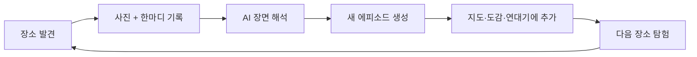

# LoreMap 아이디어 문서 (초안)

> 평범한 도시의 장소가 나만의 이야기 세계로 바뀐다면?

| 항목 | 내용 |
|------|------|
| 문서 상태 | 아이디어 초안 (v0.1) |
| 작성일 | 2026-10-13 |
| 프로젝트명 | LoreMap (가칭) |
| 기간 | 6주 (자율 프로젝트) |

## 1. 한 줄 소개

사진 한 장과 짧은 한마디를 남기면 AI가 현실의 장소를 나만의 판타지 세계로 바꾸고, 친구·연인의 세계와 가끔 교차시키는 **AI 도시 탐험 스토리 서비스**.

> **핵심 메시지:** 내가 지나온 도시가 나만의 이야기가 된다.

## 2. 아이디어 배경

사람들은 산책이나 여행 중 많은 장소를 지나고 사진을 남기지만, 대부분의 기록은 사진첩이나 SNS 피드에 쌓인 채 다시 보지 않게 된다. 지도 서비스는 장소 정보를 제공하고, 일기 서비스는 하루를 기록하지만, 사용자가 발견한 장소들을 하나의 연속된 이야기로 만들어주지는 않는다.

LoreMap은 사용자의 평범한 이동과 관찰을 미션으로 바꾸는 대신, **이야기로 보상**한다.

- 익숙한 동네를 새로운 시선으로 바라보게 한다.
- 흩어진 사진과 감정을 하나의 세계관으로 연결한다.
- 여행 기록을 장소 목록이 아닌 완성된 이야기로 남긴다.
- 친구·연인과 같은 장소를 서로 다른 시점으로 경험하게 한다.

## 3. 타깃 사용자

### 주 사용자: 새로운 동네와 장소를 탐험하는 사람

- 산책, 카페 탐방, 골목 구경을 좋아한다.
- 사진은 자주 찍지만 별도로 정리하지 않는다.
- 평범한 지도 리뷰나 위치 기반 미션에는 흥미를 느끼지 못한다.
- 자신의 기록이 창작물처럼 재구성되는 경험을 좋아한다.

### 확장 사용자: 여행 기록을 특별하게 남기고 싶은 사람

여행 중 남긴 여러 장소와 사진을 하나의 챕터로 묶고, 함께 여행한 친구·연인과 공동 이야기를 만들고 싶은 사용자.

## 4. 핵심 경험

사용자는 장소에서 **사진 한 장, 짧은 한마디, 대략적인 위치**를 남긴다. AI는 사진 속 장면과 사용자의 감정을 해석하고, 기존 세계관의 인물·사건·복선과 연결해 짧은 에피소드를 만든다.

예시:

| 현실의 기록 | AI의 이야기 해석 |
|-------------|------------------|
| 오래된 세탁소 사진 | 잊고 싶은 기억을 세탁하는 비밀 상점 |
| 매일 만나는 길고양이 | 도시의 사건을 기록하는 정보상 |
| 폐업한 극장과 "왠지 아쉽다" | 사라진 배우들의 목소리가 남은 기억 극장 |
| 한강을 건넌 여행 기록 | 세계의 경계를 넘어 새로운 챕터가 열리는 사건 |

### 기본 반복 흐름

## 5. 핵심 기능

| # | 기능 | 설명 | 우선순위 |
|---|------|------|----------|
| F1 | AI 장소 이야기 | 사진·한마디·장소를 분석해 판타지 공간 이름과 짧은 에피소드 생성 | 필수 |
| F2 | 이야기 지도 | 사용자가 기록한 현실 장소와 판타지 공간을 지도 위에 표시 | 필수 |
| F3 | 연속 세계관 | 이전 인물·사건·복선을 기억하고 다음 에피소드에 연결 | 필수 |
| F4 | 인물·유물 도감 | 장소에서 발견한 등장인물과 유물을 가볍게 수집 | 필수 |
| F5 | 동행자 연결 | 친구·연인을 초대하고 공개를 허용한 설정을 서로의 이야기에 반영 | 차별화 |
| F6 | 교차 에피소드 | 같은 장소나 관련 지역에서 두 사람의 세계관이 만나는 특별 이야기 생성 | 차별화 |
| F7 | 여행 챕터 | 여행 기간의 기록을 제목·표지·에필로그가 있는 하나의 이야기로 완성 | 차별화 |
| F8 | 챕터 공유 | 완성된 개인·공동 챕터를 링크나 카드 형태로 공유 | 후순위 |

## 6. AI 활용

AI는 단순히 사진을 묘사하는 것이 아니라 **현실 장면을 해석하고, 이전 이야기와 연결하고, 세계관을 유지하는 역할**을 맡는다.

| 단계 | AI 역할 | 결과 |
|------|---------|------|
| 장면 이해 | 사진의 공간·사물·색감·분위기와 사용자의 감정 분석 | 이야기 재료 추출 |
| 기억 검색 | 최근 사건, 등장인물, 유물, 미회수 복선 중 관련 정보 검색 | 현재 장면에 필요한 세계관 맥락 |
| 이야기 생성 | 현실 장소를 판타지 공간으로 재해석하고 짧은 에피소드 생성 | 공간 이름, 이야기, 인물·유물, 복선 |
| 일관성 관리 | 기존 설정과 충돌하는 이름·성격·사건 확인 | 이어지는 개인 세계관 |
| 교차 구성 | 두 사용자가 공개한 설정만 조합 | 친구·연인의 특별 에피소드 |

세계관의 기본 배경은 **현대 도시 위에 숨겨진 판타지 세계**로 통일한다. 사용자는 시작할 때 이야기 분위기만 선택한다.

- 따뜻하고 신비로운 이야기
- 미스터리하고 기묘한 이야기
- 유쾌하고 모험적인 이야기

## 7. 친구·연인과의 이야기 교차

사용자는 초대 링크나 친구 코드를 통해 서로를 **동행자**로 연결한다. 연결 후에도 원본 사진, 메모, 정확한 위치는 자동으로 공개되지 않는다.

### 시간차 교차

동행자가 과거에 기록한 장소와 같거나 가까운 지역을 방문하면, 상대방이 공개한 인물이나 유물이 내 이야기에 흔적으로 등장한다.

> "먼저 이곳을 지나간 달빛 수집가가 낡은 열쇠를 남겼다."

### 공동 여행 챕터

여행 그룹을 만들고 각자 기록을 남기면, 여행 종료 후 AI가 두 사람의 시점이 번갈아 등장하는 공동 챕터를 생성한다.

### 공개 원칙

- 원본 사진과 한마디는 작성자만 기본 열람
- 공개를 허용한 세계관 설정만 교차에 사용
- 정확한 방문 시각과 위치는 상대에게 제공하지 않음
- 낯선 사용자는 직접 등장시키지 않고 이야기 수만 익명 표시

## 8. 주요 화면

| 화면 | 주요 내용 |
|------|-----------|
| 첫 세계 만들기 | 분위기·닉네임 선택, 첫 기록으로 서비스 가치 체험 |
| 이야기 지도 | 장소, 판타지 이름, 현재 챕터, 최근 사건 |
| 기록 남기기 | 사진·한마디·대략적인 장소·교차 허용 여부 입력 |
| 이야기 공개 | 새 에피소드, 인물·유물, 이전 복선과의 연결 |
| 도감과 연대기 | 발견한 장소·인물·유물, 시간순 이야기, 미회수 복선 |
| 동행자·여행 | 친구 초대, 교차 에피소드, 공동 여행 챕터 |

## 9. 기존 서비스와의 차별점

| 유형 | 주로 제공하는 경험 | LoreMap의 차이 |
|------|--------------------|----------------|
| 지도·장소 서비스 | 장소 검색, 리뷰, 방문 기록 | 장소를 개인 세계관의 공간으로 재해석 |
| AI 일기 | 작성한 글의 요약·감정 분석 | 사진과 장소를 연결해 지도 위에 연속 서사 생성 |
| 위치 기반 게임 | 정해진 미션, 경쟁, 보상 | 미션 대신 사용자의 실제 기록을 이야기로 보상 |
| 여행 기록 앱 | 일정·사진·동선 정리 | 여러 사람의 시점을 하나의 판타지 챕터로 구성 |

## 10. MVP 범위

### 포함

- 사진 + 한마디 + 대략적인 장소 기록
- AI 장소 해석과 짧은 에피소드 생성
- 기본 세계관 기억과 이전 사건 연결
- 이야기 지도와 인물·유물 도감
- 동행자 초대와 제한적인 교차 에피소드
- 여행 기록을 하나의 챕터로 묶기

### 제외

- AI가 제안하는 현실 미션
- 실시간 위치 추적과 위치 공유
- 전체 공개 SNS 피드
- 전투, 레벨, 복잡한 게임 밸런스
- 낯선 사용자 간 직접 상호작용
- AI 삽화·영상 생성

## 11. 기대 포인트

- 첫 기록만으로도 AI 해석의 재미를 즉시 보여줄 수 있다.
- 기록이 쌓일수록 지도와 세계관이 성장해 재방문 이유가 생긴다.
- 멀티모달 분석, 이야기 생성, 장기 기억, 사용자 간 안전한 세계관 결합 등 AI 역할이 분명하다.
- 개인 기록과 친구·연인 공유를 함께 담아 발표 시 시나리오를 보여주기 좋다.
- 일상 탐험과 여행이라는 두 사용 상황을 하나의 흐름으로 연결할 수 있다.

## 12. 리스크와 열린 질문

| 항목 | 고려할 점 |
|------|-----------|
| 이야기 반복 | 비슷한 장소에서 유사한 설정이 반복되지 않도록 생성 규칙 필요 |
| 세계관 일관성 | 기록이 많아져도 인물·복선이 충돌하지 않는 기억 구조 필요 |
| 생성 대기 시간 | 분석 중에도 이탈하지 않도록 단계별 진행 화면 필요 |
| 위치 개인정보 | 정확한 좌표 대신 대략적인 장소를 저장하는 기준 결정 필요 |
| 교차 조건 | 어느 거리까지 같은 장소로 볼지, 사용자가 직접 교차를 선택할지 결정 필요 |
| 여행 종료 | 수동 종료와 자동 종료 중 어떤 방식이 자연스러운지 검토 필요 |
| 서비스명 | LoreMap은 가칭이며 세계관의 감성을 살린 이름 추가 검토 필요 |

> LoreMap은 사용자를 밖으로 내보내기 위한 미션 앱이 아니다. 이미 지나온 현실을 다시 보고 싶게 만드는 **개인화된 도시 이야기 지도**다.
