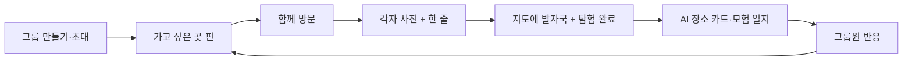
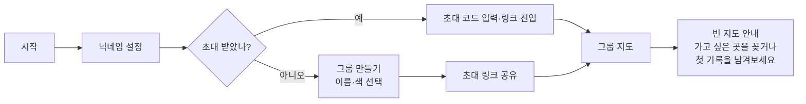
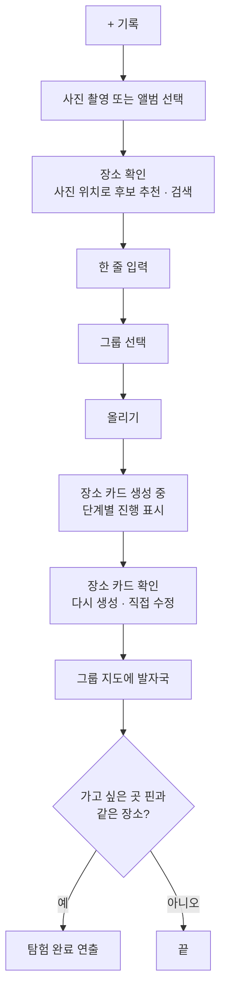
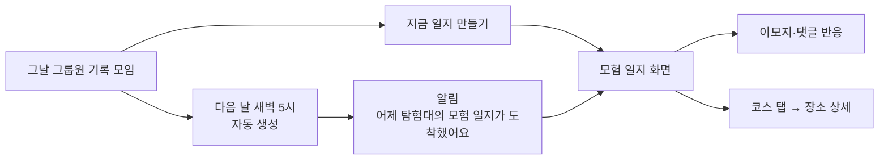
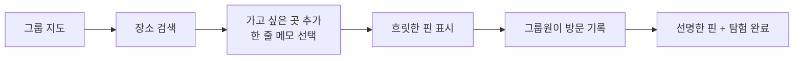
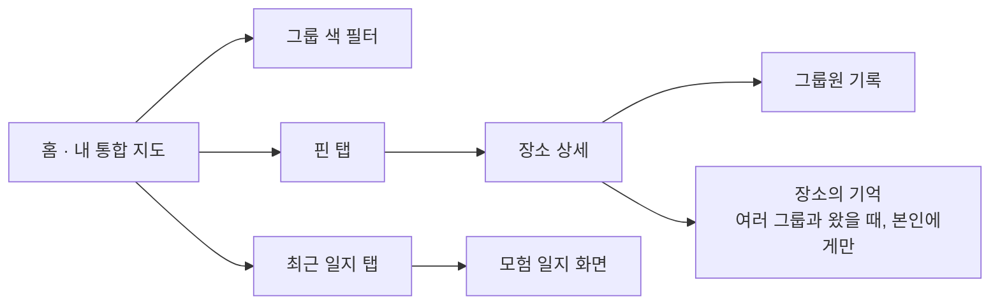

# LoreMap v2 아이디어 문서 (초안)

> 친구들과 다녀온 곳이 우리만의 모험 지도가 된다면?

| 항목 | 내용 |
|------|------|
| 문서 상태 | 아이디어 초안 (v0.3, 화면 흐름 추가) |
| 작성일 | 2026-10-14 |
| 프로젝트명 | LoreMap (가칭, 변경 예정) |
| 기간 | 6주 (자율 프로젝트) |
| 확정 사항 | 여러 그룹, 판타지·게임 요소 제외, 일지는 날짜 기준 자동 묶음 |
| 이전 문서 | [LoreMap.md](./LoreMap.md) (v0.1, 판타지 세계관 버전) |

## 0. v0.1에서 바뀐 점

| 항목 | v0.1 | v0.2 |
|------|------|------|
| 성격 | 혼자 쓰는 AI 판타지 스토리 서비스 | 그룹끼리 공유하는 장소 기록 서비스 |
| 중심 | AI가 만드는 세계관 | 함께 다녀온 장소와 기억 |
| 판타지 | 모든 기록을 판타지로 재해석 | 제거. 귀여운 모험 **분위기**만 남김 |
| 게임 요소 | 인물·유물 도감, 연속 세계관, 복선 | 모두 제거 |
| 공유 | 동행자 1:1 교차 | 여러 그룹, 그룹마다 지도 공유 |
| AI 역할 | 세계관 생성·유지 | 그룹원의 기록을 모아 이야기로 정리 |

## 1. 한 줄 소개

친구·연인과 함께 다녀온 장소를 귀여운 모험 지도에 모으고, 그룹원이 각자 남긴 사진과 한 줄을 **AI가 그날의 모험 이야기로 엮어주는** 그룹 공유 서비스.

> **핵심 메시지:** 우리가 함께 다녀온 곳이 우리만의 모험 지도가 된다.

## 2. 아이디어 배경

친구나 연인과 놀러 가면 사진은 많이 찍지만, 사진은 각자의 앨범에 흩어지고 단톡방에 올린 사진은 금방 대화에 묻힌다. "우리 거기 언제 갔었지?", "그때 뭐 먹었더라?"를 다시 찾기 어렵다.

- 함께한 기록이 **사람마다 따로** 남는다.
- 기록이 **날짜순으로만** 쌓여서 어디를 다녔는지 한눈에 보이지 않는다.
- 사진만 남고 **그날의 이야기**는 남지 않는다.

이 서비스는 그룹원 각자의 기록을 **장소를 기준으로** 한곳에 모으고, AI가 이를 하나의 이야기로 정리해 준다.

## 3. 타깃 사용자

### 주 사용자: 친구·연인과 자주 놀러 다니는 20대

- 카페, 맛집, 산책, 여행을 함께 다닌다.
- 사진은 많이 찍지만 정리는 하지 않는다.
- 공개 SNS보다 친한 사람끼리만 보는 공간을 선호한다.
- 동기, 고향 친구, 연인처럼 **여러 무리**에 속해 있다.

### 확장 사용자: 함께 여행하는 그룹

여행 기간의 기록을 그룹원이 함께 채우고, 끝난 뒤 한 편의 여행 이야기로 남기고 싶은 사용자.

## 4. 핵심 경험

### 기본 흐름



### 예시 시나리오

1. 대학 동기 4명이 그룹 "시험끝 탐험대"를 만든다.
2. 그룹 지도에 "망원동 붕어빵 가게 가보자" 핀을 꽂는다. 아직 안 간 곳은 흐릿하게 보인다.
3. 토요일에 함께 망원동에 간다. 각자 사진을 찍고 한 줄씩 남긴다.
   - A: "줄 30분 섰는데 인정" / B: "팥 vs 슈크림 논쟁 종결" / C: "한강까지 걸어감"
4. 핀이 선명해지며 **탐험 완료**로 바뀌고, 지도에 그룹 발자국이 찍힌다.
5. 저녁에 AI가 그날 기록을 모아 모험 일지를 만든다.
   > "오늘 시험끝 탐험대는 망원동에서 붕어빵 원정에 나섰다. 30분의 기다림 끝에 팥과 슈크림의 오랜 논쟁이 마침내 끝났고, 탐험대는 그 기세로 한강까지 진격했다."
6. 그룹원이 일지에 이모지와 댓글을 남긴다.

## 5. 핵심 기능

| # | 기능 | 설명 | 우선순위 |
|---|------|------|----------|
| F1 | 그룹 | 여러 그룹 생성·참여, 초대 링크·코드로 초대 | 필수 |
| F2 | 장소 기록 | 사진(현장 촬영 또는 앨범 업로드) + 한 줄 + 장소 | 필수 |
| F3 | 그룹 지도 | 그룹이 다녀온 장소를 발자국·핀으로 표시 | 필수 |
| F4 | AI 장소 카드 | 기록 하나를 제목·짧은 요약·분위기 태그로 정리 | 필수 |
| F5 | AI 모험 일지 | 같은 날 그룹원 기록을 코스별 짧은 이야기로 엮기 | 필수 |
| F6 | 반응 | 기록과 일지에 이모지·댓글 | 필수 |
| F7 | 가고 싶은 곳 → 탐험 완료 | 위시 핀을 꽂고, 방문 기록이 생기면 탐험 완료로 전환 | 차별화 |
| F8 | 내 통합 지도 | 내가 속한 모든 그룹의 발자국을 그룹별 색으로 한 지도에 표시 | 차별화 |
| F9 | 장소의 기억 | 같은 장소를 여러 그룹과 다녀왔을 때 나에게만 기억을 모아 보여주기 | 차별화 |
| F10 | 모험 회고 | 월간·여행 단위 요약 (다녀간 곳 수, 자주 간 동네, 자주 나온 말) | 후순위 |
| F11 | 사진 스티커화 | 사진을 귀여운 스티커·일러스트로 변환 | 후순위 |
| F12 | 그룹 캐릭터 | 그룹 마스코트 선택·꾸미기, 일지 말투에 반영 | 후순위 |

## 6. AI 활용

AI는 혼자 쓴 글을 꾸미는 것이 아니라 **여러 사람이 각자 남긴 조각을 하나의 이야기로 엮는 역할**을 맡는다.

| 결과물 | 생성 시점 | 입력 | 출력 |
|--------|-----------|------|------|
| 장소 카드 | 기록 하나가 올라왔을 때 | 사진, 한 줄, 장소 | 제목, 2~3줄 요약, 분위기 태그 |
| 모험 일지 | 같은 날 같은 그룹의 기록이 모였을 때 | 그룹원 기록 묶음, 방문 순서 | 코스별 짧은 이야기 (그룹 캐릭터 말투) |
| 장소의 기억 | 같은 장소에 내 기록이 여러 그룹에 있을 때 | 해당 장소의 내 기록들 | 시기별 기억 요약 (본인에게만 표시) |
| 모험 회고 | 월말 또는 여행 종료 시 | 기간 내 그룹 기록 | 통계 + 한 단락 회고 |

### 글 작성 원칙

- 판타지로 바꾸지 않는다. **실제 있었던 일**을 모험 말투로 살짝 과장하는 정도로 쓴다.
- 짧게 쓴다. 장소 카드는 3줄, 일지는 코스당 2~3문장 이내.
- 사용자가 쓴 한 줄의 표현과 말투를 최대한 살린다.
- 결과는 다시 생성하거나 직접 고칠 수 있다.

## 7. 그룹과 공개 원칙

- 모든 기록은 **기록을 올린 그룹 안에서만** 보인다. 전체 공개 피드는 없다.
- 다른 그룹의 기록은 서로 넘어가지 않는다. 내 통합 지도와 장소의 기억은 **본인에게만** 보인다.
- 위치는 장소명(가게·공원) 단위로 저장하고, 실시간 위치는 공유하지 않는다.
- 기록 시점은 자유다. 현장에서 바로 남겨도 되고 다녀와서 앨범에서 올려도 된다.
- 알림으로 기록을 강요하지 않는다. 남기지 않은 사람이 있어도 빈칸으로 표시하지 않는다.

## 8. 모험 분위기 (게임 요소 없이)

| 장치 | 내용 |
|------|------|
| 발자국 | 다녀온 장소에 그룹 색 발자국이 찍힌다 |
| 지도 색칠 | 처음 가본 동네가 지도에 칠해진다 |
| 흐릿한 핀 | 가고 싶은 곳은 흐릿하게, 다녀오면 선명하게 |
| 탐험대 말투 | AI 일지가 "오늘 탐험대는…" 같은 귀여운 말투로 쓰인다 |
| 그룹 캐릭터 | 그룹마다 마스코트가 있다 (후순위) |

레벨, 순위, 미션, 보상, 수집 도감은 넣지 않는다. 모험은 **분위기**이지 목표가 아니다.

## 9. 주요 화면

| 화면 | 주요 내용 |
|------|-----------|
| 시작 | 닉네임 설정, 첫 그룹 만들기 또는 초대 코드 입력 |
| 홈 (내 통합 지도) | 모든 그룹 발자국, 그룹 목록, 최근 모험 일지 |
| 그룹 지도 | 다녀온 곳·가고 싶은 곳 핀, 그룹원, 그룹 일지 목록 |
| 기록 남기기 | 사진, 한 줄, 장소 검색·선택 |
| 장소 상세 | 장소 카드, 그룹원 기록, (본인에게만) 장소의 기억 |
| 모험 일지 | AI 일지, 코스, 사진, 반응 |

### 화면 구조

하단 탭 3개 + 가운데 기록 버튼으로 구성한다.

```
[ 홈(내 통합 지도) ]  [ + 기록 ]  [ 그룹 ]  [ 내 정보 ]
```

- **홈:** 모든 그룹의 발자국과 최근 모험 일지
- **+ 기록:** 어느 화면에서든 바로 기록 남기기
- **그룹:** 그룹 목록 → 그룹 지도·일지
- **내 정보:** 프로필, 알림 설정

## 10. 날짜 묶음 규칙

모험 일지는 **같은 그룹 + 같은 날짜**의 기록을 자동으로 묶어 만든다.

| 항목 | 규칙 |
|------|------|
| 묶음 단위 | 그룹별·날짜별. 같은 날이라도 그룹이 다르면 일지가 따로 생긴다 |
| 하루의 경계 | 새벽 5시 기준 (밤늦게 논 기록이 다음 날 일지로 넘어가지 않도록) |
| 기록의 날짜 | 사진 촬영 시각(EXIF) 우선, 없으면 업로드 시각 |
| 다녀와서 올린 사진 | 촬영 시각을 따르므로 며칠 뒤 올려도 그날 일지에 들어간다 |
| 코스 순서 | 같은 날짜 안에서 촬영 시각 순 |
| 수정 | 기록의 날짜를 직접 옮길 수 있고, 옮기면 해당 일지가 다시 만들어진다 |
| 생성 시점 | 하루가 끝난 뒤(다음 날 새벽 5시) 자동 생성. 그 전에 "지금 일지 만들기"로 미리 생성 가능 (제안, 미확정) |
| 늦게 추가된 기록 | 일지가 이미 있으면 "새 기록이 추가됐어요 · 일지 다시 쓰기" 버튼 표시 |

## 11. 화면 흐름

### 11-1. 첫 진입



### 11-2. 기록 남기기 (핵심 흐름)



- 사진의 촬영 시각으로 날짜가 정해지고, 그날 일지 묶음에 자동으로 들어간다.
- 장소 카드는 기다리지 않고 나가도 백그라운드에서 생성된다.

### 11-3. 모험 일지 받기



### 11-4. 가고 싶은 곳



### 11-5. 둘러보기



## 12. 기존 서비스와의 차별점

| 유형 | 주로 제공하는 경험 | 이 서비스의 차이 |
|------|--------------------|------------------|
| 셋로그 | 매시간 짧은 영상을 친구 방에 올려 하루를 브이로그로 완성 | **시간이 아니라 장소** 기준. 알림 없이 자발적으로 기록하고, 지도 위에 계속 쌓인다 |
| 인스타그램 | 공개 피드, 위치 태그 | 친한 그룹끼리만, 장소가 중심 |
| 커플 앱 | 1:1 관계의 기념일·사진첩 | 여러 그룹, 지도 중심 |
| 지도 앱 저장 | 개인 장소 저장, 리뷰 | 그룹이 함께 채우고, 기억과 이야기가 붙는다 |
| 단톡방 사진 | 즉시 공유 | 대화에 묻히지 않고 장소별로 정리된다 |

## 13. MVP 범위

### 포함

- 여러 그룹 생성·초대
- 사진 + 한 줄 + 장소 기록 (촬영·업로드)
- 그룹 지도와 내 통합 지도
- 가고 싶은 곳 핀과 탐험 완료
- AI 장소 카드, AI 모험 일지
- 이모지·댓글 반응

### 제외

- 시간 기반 알림과 기록 강요
- 전체 공개 피드, 모르는 사람과의 상호작용
- 레벨·순위·미션·도감 등 게임 요소
- 실시간 위치 공유
- 판타지 세계관 재해석

## 14. 열린 질문

| 항목 | 고려할 점 |
|------|-----------|
| 그룹 인원 상한 | 2~20명 정도에서 결정. 인원이 많으면 일지가 길어진다 |
| 일지 생성 시점 확정 | 다음 날 새벽 5시 자동 생성 + "지금 만들기" (제안). 알림 시각도 함께 결정 |
| 장소 판별 | 사진 위치 정보, 지도 검색, 직접 입력 중 무엇을 기본으로 할지 |
| 사진 스티커화 | 반응은 좋지만 비용·시간이 크다. MVP 이후 검토 |
| 서비스명 | 판타지·세계관을 뺐으므로 장소·모험·그룹을 살린 이름 필요 |
