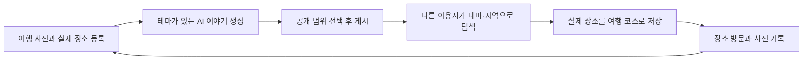

# LoreMap 고도화 계획

> 여행 사진으로 만든 AI 이야기를 여행 영감과 실제 코스 계획으로 연결한다.

| 항목 | 내용 |
|---|---|
| 문서 상태 | 고도화 계획 |
| 작성일 | 2026-10-14 |
| 프로젝트명 | LoreMap (가칭) |
| 프로젝트 기간 | 6주 |
| 관련 초안 | [LoreMap 아이디어 문서](LoreMap.md) |

## 1. 제품 방향

### 한 줄 소개

여행자가 사진과 실제 방문 장소를 바탕으로 테마가 있는 이야기를 만들고, 다른 이용자는 그 이야기에서 영감을 받아 실제 장소를 여행 코스로 저장하는 서비스.

### 핵심 문제

AI 이야기 생성은 재미있지만, 한 번 생성하고 공유하면 이용자의 행동이 끝날 수 있다. 공개된 이야기를 테마와 지역으로 탐색하고, 이야기 속 실제 장소를 코스로 저장하게 하면 여행 전에도 서비스를 이용할 이유가 생긴다.

### 핵심 이용자와 목적

- **이야기 작성자:** 여행 사진과 기억을 재미있게 정리하고, 공개할 장소와 이야기를 직접 골라 공유한다.
- **여행 탐색자:** 가고 싶은 분위기나 테마로 이야기를 발견하고, 이야기와 연결된 실제 장소를 다음 여행 후보로 저장한다.

### 핵심 이용 흐름

공유는 이 흐름의 한 단계이며, 반복 이용의 주된 이유는 **이야기에서 여행지를 발견하고 코스로 저장하는 것**이다. 여행 주제의 서비스 특성상 매일 접속보다 여행을 탐색·준비·기록하는 시점마다 다시 선택받는 것을 목표로 한다.

## 2. 제품 설계 원칙

1. **이야기와 현실 정보를 구분한다.** AI가 생성한 서사와 실제 장소 정보를 서로 다른 데이터로 저장하고 화면에서도 구분한다. 이야기 속 상상 장소를 실제 여행지처럼 표시하지 않는다.
2. **실제 장소는 확인된 장소 정보에 연결한다.** 사용자가 장소를 선택하거나 지도 검색 결과에서 지정하도록 하고, 실제 장소의 좌표·이름은 생성된 문장만으로 추론하지 않는다.
3. **공개 범위는 작성자가 정한다.** 기본 공개 범위는 비공개로 두고, 이야기·사진·장소를 각각 공개할지 선택하게 한다. 사진 EXIF와 정확한 촬영 시각은 공개 콘텐츠에서 제거한다.
4. **계획 기능은 작게 시작한다.** 첫 버전은 저장한 장소의 목록·순서·지도 확인을 제공한다. 영업 여부, 이동 시간, 예약 가능 여부를 보장하는 자동 최적화는 데이터 검증 이후에 다룬다.

## 3. 6주 MVP 범위

### 포함

- 여행 사진과 사용자가 선택한 실제 장소를 연결해 AI 이야기 생성
- 이야기 테마와 지역 정보 표시
- 비공개·링크 공유·전체 공개 설정
- 공개 이야기를 테마와 지역으로 탐색
- 이야기 상세에서 실제 장소 확인 및 여행 코스에 저장
- 저장한 장소의 순서 변경과 지도 확인
- 이야기 조회부터 장소·코스 저장까지의 핵심 행동 측정

### 후순위

- 팔로우, 댓글, DM, 인기도 중심의 무한 피드
- 예약·결제, 실시간 영업 정보 보장, 자동 일정 최적화
- 실시간 위치 공유와 낯선 사용자 간 직접 상호작용
- 전체 공개 사진첩 및 자동 위치 공개

공개 이야기가 없어 탐색 화면이 비는 초기 상황에 대비해, 팀이 만든 대표 테마 이야기와 장소 코스를 초기 콘텐츠로 제공한다.

## 4. 6주 진행 계획

| 주차 | 목표 | 완료 산출물 |
|---|---|---|
| 1주차 | 사용자 문제와 핵심 흐름 검증 | 여행자 인터뷰, 이야기 탐색·코스 저장 프로토타입, 검증 결과 |
| 2주차 | 이야기와 실제 장소 데이터 구조 정의 | 장소 식별 정보와 AI 서사 분리, 생성 결과 형식 확정 |
| 3주차 | 이야기 생성 및 공개 권한 구현 | 장소가 연결된 이야기 생성, 공개 범위와 EXIF 처리 |
| 4주차 | 테마·지역별 탐색 구현 | 이야기 목록·상세, 초기 테마 콘텐츠와 빈 상태 화면 |
| 5주차 | 코스 저장 구현 | 장소 저장·순서 변경·지도 확인 |
| 6주차 | 통합 검증 및 개선 | 사용자 과업 테스트, 전환 지표 확인, 오류·개선점 정리 |

## 5. 성공 지표와 검증

### 핵심 지표

- **이야기 상세 조회 → 실제 장소 또는 코스 저장 전환율**: 이야기가 여행 계획에 기여하는지 확인한다.
- **코스 저장 후 계획 재열람 비율**: 저장이 일회성 클릭으로 끝나지 않는지 확인한다.
- **이야기 생성 완료 → 공개 게시 비율**: 작성자가 다른 여행자에게 콘텐츠를 제공할 의향이 있는지 확인한다.
- **사실 구분 성공률**: 사용자가 AI 서사와 실제 장소 정보를 혼동하지 않는지 과업 테스트로 확인한다.

초기에는 숫자 목표를 임의로 정하기보다, 테스트 참가자의 과업 성공과 이탈 지점을 기준으로 제품 가설을 수정한다.

### 초기 검증 과업

1. 특정 테마(예: 비 오는 날의 미스터리)로 여행 이야기를 찾는다.
2. 이야기 속 실제 장소와 생성된 서사를 구분해 확인한다.
3. 마음에 든 장소를 새 여행 코스로 저장하고 순서를 바꾼다.
4. 자신의 여행 사진과 장소로 이야기를 만든 뒤 공개 범위를 선택한다.

이야기는 읽지만 실제 장소를 저장하지 않는다면, 이야기 테마가 여행 계획으로 이어진다는 가설은 아직 검증되지 않은 것으로 본다.

## 6. 주요 리스크와 대응

| 리스크 | 대응 |
|---|---|
| 초기 공개 콘텐츠가 부족함 | 팀 제작 샘플 콘텐츠와 테마별 추천 예시를 준비 |
| 이야기와 장소 정보가 혼동됨 | 실제 장소 카드와 AI 서사를 시각적으로 분리하고 장소 출처를 표시 |
| AI가 존재하지 않는 장소나 사실을 생성함 | 장소 선택은 사용자 입력·지도 검색으로 제한하고 생성된 장소명은 실제 장소로 취급하지 않음 |
| 여행 위치·사진이 원치 않게 노출됨 | 비공개 기본값, 선택적 공개, EXIF 제거, 장소별 공개 설정 |
| SNS 기능이 범위를 키움 | 탐색·상세·코스 저장을 먼저 제공하고 댓글·팔로우 기능은 지표 검증 이후 결정 |

## 7. Jira 작업 목록

작업은 Jira 프로젝트 `EODI`의 LoreMap 고도화 에픽 아래 관리한다.

- 에픽: [EODI-11 — 이야기 기반 여행 탐색·계획 경험 구축](https://jira.example.com/browse/EODI-11)

| 순서 | 작업 | Jira |
|---|---|---|
| 1 | 여행 이야기 탐색과 코스 저장 가설 검증 | [EODI-12](https://jira.example.com/browse/EODI-12) |
| 2 | 실제 장소가 연결된 AI 여행 이야기 생성 | [EODI-13](https://jira.example.com/browse/EODI-13) |
| 3 | 이야기 게시 및 공개 범위·위치 권한 설정 | [EODI-14](https://jira.example.com/browse/EODI-14) |
| 4 | 테마·지역별 이야기 탐색과 초기 콘텐츠 구성 | [EODI-15](https://jira.example.com/browse/EODI-15) |
| 5 | 이야기 속 실제 장소를 여행 코스로 저장 | [EODI-16](https://jira.example.com/browse/EODI-16) |
| 6 | 이야기 조회부터 코스 저장까지 지표와 사용성 검증 | [EODI-17](https://jira.example.com/browse/EODI-17) |

