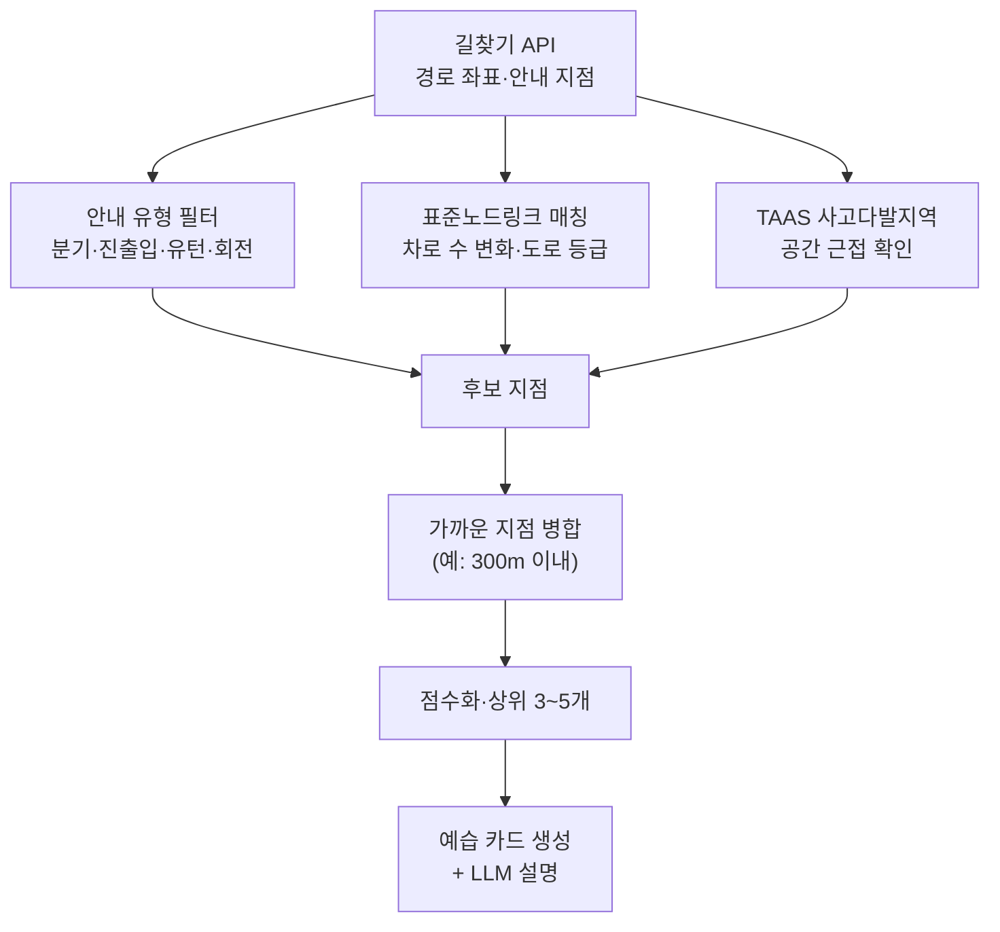
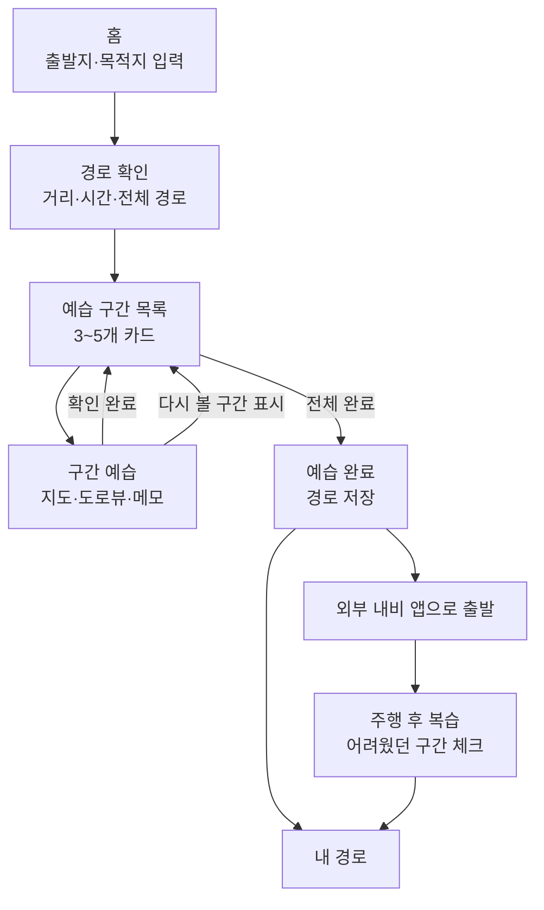
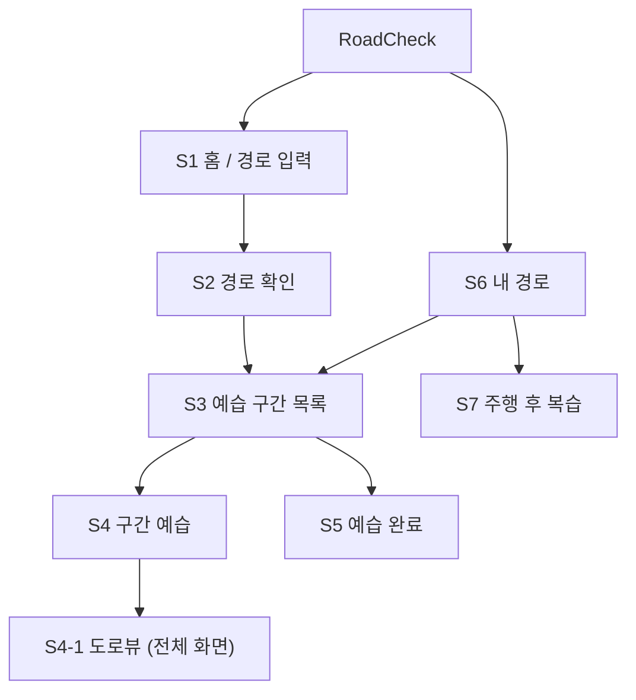

# RoadCheck 아이디어 문서 (초안)

> 처음 가는 길, 운전하기 전에 먼저 가보세요.

| 항목 | 내용 |
|------|------|
| 문서 상태 | 초안 (v0.1) |
| 작성일 | 2026-10-13 |
| 팀 | A204 · 장수철(팀장·AI), 전성환·황승기(BE), 정인경·박세은(FE) |
| 기간 | 6주 (자율 프로젝트) |

## 1. 한 줄 소개

출발지와 목적지를 입력하면 경로에서 미리 확인할 구간을 찾아주고, 지도·도로뷰로 출발 전에 예습하게 하는 **초보운전자용 경로 예습 서비스**.

- 내비게이션을 대체하지 않는다. 내비를 켜기 전에 쓰는 **운전 준비 서비스**다.
- 위험한 도로를 예측하지 않는다. 운전자가 **헷갈릴 수 있는 구간**을 출발 전에 이해하도록 돕는다.

## 2. 문제 정의

기존 내비게이션은 목적지까지 가는 길을 안내하지만, 초보운전자가 그 길을 실제로 운전할 자신이 있는지는 해결해주지 않는다.

- 복잡한 분기점이나 큰 교차로에서 차로를 놓치면 당황해서 경로를 이탈한다.
- 경로 전체 미리보기는 길고, 어디를 집중해서 봐야 하는지 알려주지 않는다.
- 도로뷰를 직접 찾아보려면 경로를 따라 지점을 하나하나 옮겨야 한다.

> **문제:** 초보운전자는 처음 가는 길에서 "어디가 헷갈릴지"를 출발 전에 알 방법이 없어, 낯선 길 운전을 피하거나 불안한 상태로 출발한다.

## 3. 타깃 사용자

### 주 사용자: 초보운전자·장롱면허 운전자

**페르소나 (가상): 이하늘, 27세, 면허 취득 6개월 차**

- 평소엔 집-회사 익숙한 길만 운전한다.
- 다음 주 처음 가는 동네로 면접을 보러 차를 몰고 가야 한다.
- 지난번 처음 간 길에서 분기점을 놓쳐 15분을 돌아간 경험이 있다.
- 출발 전 5분 정도 투자해서라도 헷갈리는 곳을 미리 보고 싶다.

### 보조 사용자

- 오랜만에 운전을 다시 시작하는 장롱면허 운전자
- 초보 가족·연인의 경로를 대신 예습해주는 동승자

## 4. 핵심 기능

| # | 기능 | 설명 | 우선순위 |
|---|------|------|----------|
| F1 | 경로 검색 | 출발지·목적지 입력, 거리·예상 시간·전체 경로 표시 | 필수 |
| F2 | 예습 구간 자동 추출 (핵심) | 분기·진출입·유턴·회전 안내 지점, 차로 수 변화, 사고다발지역 인접 구간을 규칙으로 추려 3~5개 예습 카드 생성 | 필수 |
| F3 | 구간별 예습 | 지도 확대·경로 진행 방향 표시, 도로뷰 열기, 메모 | 필수 |
| F4 | 예습 진행·완료 | 구간 체크, 진행률, "다시 볼 구간" 표시 | 필수 |
| F5 | 경로 저장·복습 | 예습한 경로 저장, 다시 보기, 주행 후 "어려웠어요" 피드백 | 필수 |
| F6 | 사고다발지역 결합 | TAAS 사고다발지역과 경로 공간 매칭, 참고 정보로 표시 | 차별화 |
| F7 | AI 예습 설명 | 규칙 결과를 초보자 말투로 풀어주는 LLM 설명 | 차별화 |
| F8 | 개인화 | "어려웠어요" 구간 유형을 학습해 다음 경로에서 우선 표시 | 후순위 |

## 5. 예습 구간 추출 로직

초기에는 AI보다 **규칙 기반 추출**이 적합하다. 학습 데이터 없이 동작하고, 왜 이 구간이 뽑혔는지 설명할 수 있다.



| 단계 | 내용 |
|------|------|
| 1 | 길찾기 API에서 경로 좌표와 안내 지점(turn-by-turn) 수집 |
| 2 | 유턴·분기·고속도로 진출입·회전교차로 등 미리 정의한 안내 유형만 남김 |
| 3 | 경로를 표준노드링크에 매칭해 차로 수가 줄거나 크게 바뀌는 지점, 대형 교차로 탐지 |
| 4 | TAAS 사고다발지역과 경로의 거리 계산, 인접 구간 표시 |
| 5 | 서로 가까운 지점을 하나의 예습 구간으로 병합 |
| 6 | 유형별 가중치로 점수화해 상위 3~5개를 예습 카드로 제공 |

안내 코드와 차로 수만으로 교차로의 실제 복잡도나 차로 변경 난이도를 완전히 판단할 수는 없다. 화면에 **"확인해볼 구간"**으로 표현하고 "위험 구간"이라고 단정하지 않는다.

## 6. AI 활용

AI는 억지로 넣지 않고, 규칙 결과를 이해하기 쉽게 전달하는 데 쓴다.

| AI 기능 | 방법 | 결과 | 검증 |
|---------|------|------|------|
| LLM 예습 설명 | 안내 유형·방향·차로 수 등 규칙 결과만 프롬프트에 넣고 문장 생성 | "약 200m 앞에서 오른쪽 차로로 미리 들어가 있어야 해요" | 방향·거리 수치를 규칙 결과와 자동 대조 |
| 어려움 기반 개인화 (확장) | "어려웠어요" 피드백이 달린 구간 유형을 집계해 가중치 조정 | 사용자별 예습 구간 우선순위 | 피드백 누적 후 비교 |

도로뷰 이미지를 저장·분석하는 기능은 약관 위반 가능성이 있어 하지 않는다.

## 7. 기존 서비스와 차별점

| 기능 | 일반 내비게이션·지도 앱 | RoadCheck |
|------|------------------------|-----------|
| 경로 탐색 | 핵심 기능 | 외부 API 활용 |
| 운전 중 음성 안내 | 핵심 기능 | 제공하지 않음 |
| 전체 경로 미리보기 | 제공하는 경우 많음 | 제공 |
| 도로뷰 | 지도 앱에서 직접 찾아야 함 | 예습 구간에 바로 연결 |
| 예습할 지점 자동 선정 | 일반적인 핵심 흐름은 아님 | **핵심 기능** |
| 구간별 예습 완료·메모 | 일반적인 핵심 흐름은 아님 | **핵심 기능** |
| 주행 후 복습 | 제한적 | 제공 |

차별성은 새로운 지도 기술이 아니라 **경로를 학습 콘텐츠처럼 바꾸는 경험**이다. 기존 앱의 최신 기능을 모두 검증한 것은 아니므로 "세상에 없는 기능"이라고 주장하지 않는다. 1주차에 카카오내비·네이버지도·티맵의 미리보기 기능을 직접 비교해 캡처해둔다.

## 8. 사용자 흐름

### 8-1. 전체 흐름



### 8-2. 주 시나리오: 이하늘의 면접 날

| 단계 | 사용자 행동 | 화면 | 시스템 동작 |
|------|-------------|------|-------------|
| 1 | 집 → 면접 장소를 입력한다 | 홈 | 주소 검색, 좌표 변환 |
| 2 | 거리 18km, 약 35분 경로를 확인한다 | 경로 확인 | 길찾기 API 호출, 경로 표시 |
| 3 | "예습할 구간 4개"를 본다 | 예습 목록 | 규칙 기반 구간 추출, 카드 생성 |
| 4 | 구간 1 "복잡한 분기점"을 열어 진행 방향과 도로뷰를 확인한다 | 구간 예습 | 지도 확대, 진행 화살표, 도로뷰 로드, LLM 설명 |
| 5 | "왼쪽 2개 차로가 고가로 올라감"이라고 메모하고 완료 체크 | 구간 예습 | 메모·진행 상태 저장 |
| 6 | 헷갈리는 구간 2는 "다시 볼 구간"으로 표시한다 | 예습 목록 | 상태 저장 |
| 7 | 예습 완료 후 경로를 저장하고 카카오내비로 출발한다 | 예습 완료 | 외부 내비 딥링크 (가능 시) |
| 8 | 다녀온 뒤 구간 2에 "어려웠어요"를 남긴다 | 복습 | 피드백 저장 (개인화 데이터) |

### 8-3. 재방문 흐름


## 9. 화면 설계 구조

### 9-1. 정보 구조 (IA)



### 9-2. 화면 목록

| ID | 화면 | 경로(안) | 주요 구성 | 관련 기능 | 우선순위 |
|----|------|----------|-----------|-----------|----------|
| S1 | 홈 / 경로 입력 | `/` | 출발지·목적지 검색, 최근 경로 | F1 | 필수 |
| S2 | 경로 확인 | `/route/new` | 전체 경로 지도, 거리·시간, "예습 시작" | F1 | 필수 |
| S3 | 예습 구간 목록 | `/route/{id}` | 구간 카드 3~5개, 진행률, 지도 마커 | F2, F4 | 필수 |
| S4 | 구간 예습 | `/route/{id}/section/{n}` | 확대 지도, 진행 화살표, AI 설명, 도로뷰 버튼, 메모, 완료 체크 | F3, F7 | 필수 |
| S4-1 | 도로뷰 | 모달/전체 화면 | 로드뷰, 진행 방향 안내 오버레이 | F3 | 필수(1주차 검증) |
| S5 | 예습 완료 | `/route/{id}/done` | 완료 요약, 다시 볼 구간, 저장, 내비 열기 | F4, F5 | 필수 |
| S6 | 내 경로 | `/my` | 저장 경로 목록, 진행 상태 | F5 | 필수 |
| S7 | 주행 후 복습 | `/route/{id}/review` | 구간별 "괜찮았어요/어려웠어요" | F5, F8 | 차별화 |

### 9-3. 화면별 구성

#### S1. 홈 / 경로 입력

```
┌──────────────────────────────────────────┐
│ RoadCheck                      내 경로   │
├──────────────────────────────────────────┤
│ 처음 가는 길, 먼저 가보세요               │
│ ┌──────────────────────────────────────┐ │
│ │ 출발  우리 집                         │ │
│ │ 도착  ○○빌딩 (면접 장소)              │ │
│ └──────────────────────────────────────┘ │
│            [ 경로 예습하기 ]              │
├──────────────────────────────────────────┤
│ 최근 예습한 경로                          │
│  · 집 → 회사   4/4 완료                   │
│  · 집 → 마트   다시 볼 구간 1             │
└──────────────────────────────────────────┘
```

#### S3. 예습 구간 목록 (핵심 화면)

```
┌──────────────────────────────────────────┐
│ ← 집 → ○○빌딩  18km · 35분               │
├──────────────────────────────────────────┤
│ [ 지도: 전체 경로 + 구간 마커 ①②③④ ]     │
├──────────────────────────────────────────┤
│ 예습할 구간 4개      진행 1/4  ■□□□       │
│ ┌──────────────────────────────────────┐ │
│ │ ① 복잡한 분기점      ✓ 확인 완료      │ │
│ ├──────────────────────────────────────┤ │
│ │ ② 차로가 줄어드는 구간  ★ 다시 볼 구간 │ │
│ ├──────────────────────────────────────┤ │
│ │ ③ 큰 교차로 좌회전                    │ │
│ ├──────────────────────────────────────┤ │
│ │ ④ 사고다발지역 인접 (참고)            │ │
│ └──────────────────────────────────────┘ │
│            [ 예습 이어하기 ]              │
└──────────────────────────────────────────┘
```

#### S4. 구간 예습

```
┌──────────────────────────────────────────┐
│ ← 구간 ② / 4   차로가 줄어드는 구간      │
├──────────────────────────────────────────┤
│ [ 확대 지도: 진행 방향 화살표 ]           │
│                         [ 도로뷰 보기 ]   │
├──────────────────────────────────────────┤
│ AI 설명                                   │
│ "약 300m 앞에서 4차로가 2차로로 줄어요.   │
│  오른쪽 차로로 미리 들어가 있으면 편해요." │
│ * 실제 표지판과 내비 안내를 우선하세요     │
├──────────────────────────────────────────┤
│ 내 메모: [                             ]  │
├──────────────────────────────────────────┤
│ [ 다시 볼 구간 ]        [ 확인 완료 → ]   │
└──────────────────────────────────────────┘
```

(수치는 예시)

#### S5. 예습 완료

- 완료 요약: "4개 구간 중 3개 확인, 다시 볼 구간 1개"
- 다시 볼 구간 바로가기
- [경로 저장] [카카오내비로 열기] (딥링크 지원 여부 확인 필요)

#### S7. 주행 후 복습

- 구간별 "괜찮았어요 / 어려웠어요" 버튼과 한 줄 메모
- 어려웠던 구간은 다음 예습 때 우선 표시

### 9-4. 공통 컴포넌트

| 컴포넌트 | 사용 화면 | 설명 |
|----------|-----------|------|
| 장소 검색 | S1 | 주소·장소명 검색, 좌표 변환 |
| 경로 지도 | S2, S3, S4 | 경로 폴리라인, 구간 마커, 진행 화살표 |
| 예습 카드 | S3 | 구간 유형 아이콘, 상태(미확인·완료·다시 보기) |
| 진행률 바 | S3, S5 | 확인한 구간 수 |
| 도로뷰 뷰어 | S4-1 | 로드뷰 SDK, 진행 방향 오버레이 |
| 안전 안내 | S4, S5 | "실제 표지판과 내비 안내를 우선하세요" |

### 9-5. 화면 상태

| 상태 | 처리 |
|------|------|
| 예습 구간 0개 | "이 경로는 비교적 단순해요. 전체 경로만 한 번 훑어보세요" |
| 도로뷰 없음 | 지도 확대 + 진행 방향만 표시, "이 지점은 도로뷰가 없어요" |
| LLM 실패 | 규칙 기반 기본 문구로 대체 |
| 경로 검색 실패 | 장소 재검색 유도 |

## 10. 활용 데이터 · API

| 데이터 | 출처 | 용도 | 확보 전망 |
|--------|------|------|-----------|
| 자동차 경로·안내 지점 | 카카오모빌리티 길찾기 API (대안: 네이버 Directions 5) | 경로, 분기·회전 안내 | 높음 (공식 문서 확인) |
| 지도 표시 | 카카오맵 JavaScript SDK | 경로·마커·구간 표시 | 높음 |
| 도로뷰 | 카카오맵 로드뷰 (대안: 네이버 파노라마) | 구간 예습 | 1주차 약관·SDK 검증 |
| 도로 차로 수·등급 | 국가교통정보센터 표준노드링크 | 차로 수 변화, 대형 교차로 탐지 | 제공 범위·갱신 시점 확인 필요 |
| 사고다발지역 | TAAS Open API | 경로 인접 참고 정보 | 높음 |
| 어린이보호구역 | 공공데이터 표준데이터 | 예습 구간 후보 (확장) | 높음 |
| 사용자 예습·피드백 | 서비스 자체 | 진행 상태, 개인화 | 자체 확보 |

## 11. 리스크와 대응

| 리스크 | 대응 |
|--------|------|
| "기존 지도 앱 미리보기로 충분하다"는 반응 | 1주차 초보운전자 5명 인터뷰, 기존 앱 비교 캡처로 차별점 확인 |
| 도로뷰 SDK·약관 제한 | 1주차 검증, 불가 시 지도 확대·진행 방향만으로 예습 |
| 도로뷰가 현재 도로와 다를 수 있음 | 촬영 시점 표시, "실제 표지판·내비 우선" 안내 상시 노출 |
| 안내 코드만으로 실제 난이도 판단 한계 | 표준노드링크 차로 수 보완, "확인해볼 구간"으로만 표현 |
| 길찾기 API 호출 한도·비용 | 경로 결과 캐싱, 개발 중 호출량 관리 |
| LLM 설명의 방향·거리 오류 | 규칙 결과만 입력, 출력 수치·방향 자동 대조, 실패 시 기본 문구 |
| 운전 중 사용 위험 | 주행 중 사용 기능 미제공, 출발 전 사용임을 명시 |

> RoadCheck는 안전을 보장하거나 위험을 예측하지 않는다. 출발 전 경로를 이해하는 **준비 시간**을 돕는다.

## 12. 기술 구성 (안)

| 영역 | 기술 |
|------|------|
| Frontend | React, TypeScript, 카카오맵 JS SDK(지도·로드뷰) |
| Backend | Spring Boot, Redis(경로 캐시) |
| 분석·AI | Python, FastAPI(구간 추출·공간 매칭), LLM API |
| DB | PostgreSQL + PostGIS (경로·사고다발지역·노드링크 공간 연산) |
| Infra | AWS VPC (Public: Nginx / Private: Spring Boot·FastAPI), EC2, Docker, GitLab CI/CD |

## 13. 6주 일정 (안)

| 주차 | 목표 |
|------|------|
| 1주차 | 길찾기 API·로드뷰·TAAS·표준노드링크 검증, 초보운전자 인터뷰, 화면 설계 |
| 2주차 | 경로 검색, 지도 시각화 |
| 3주차 | 안내 지점 분석, 예습 구간 자동 추출 |
| 4주차 | 구간 예습(지도·도로뷰), 완료 체크, 저장 |
| 5주차 | 사고다발지역·차로 수 결합, LLM 설명, 복습 |
| 6주차 | 초보운전자 사용성 테스트, UX 개선, 배포 |

## 14. MVP 범위

- **필수:** 경로 검색, 예습 구간 자동 추출, 지도 기반 구간 예습, 예습 완료·저장
- **차별화:** 도로뷰 연결, 차로 수 기반 추출, 사고다발지역 참고, LLM 예습 설명, 주행 후 복습
- **후순위:** 어려움 기반 개인화, 어린이보호구역, 외부 내비 딥링크
- **제외:** 운전 중 안내, 사고 위험 예측

## 15. 열린 질문 (1주차에 결정)

- [ ] 카카오맵 로드뷰를 예습 화면에 넣는 것이 약관상 가능한가?
- [ ] 길찾기 API 안내 지점에 분기·진출입 유형이 충분히 구분되어 오는가?
- [ ] 표준노드링크와 경로 좌표 매칭 정확도는 쓸 만한가?
- [ ] 초보운전자 5명 중 몇 명이 "기존 앱보다 낫다"고 답하는가?
- [ ] 외부 내비 앱으로 목적지를 넘기는 딥링크가 가능한가?
