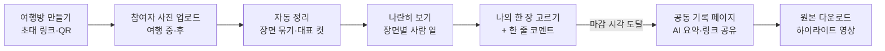
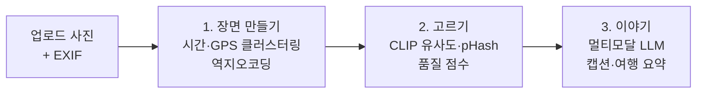

# TripPick 기획안 (초안)

> 같은 순간을 서로 어떻게 봤는지 남기는 공동 여행 기록 앱

| 항목 | 내용 |
|------|------|
| 문서 상태 | 초안 (v0.2) — 기능·데이터·리스크 중심 정리 |
| 작성일 | 2026-10-14 |
| 형태 | 모바일 앱 (React Native) + 웹 공유 페이지 |
| 기간 | 6주 (자율 프로젝트) |
| 팀 | A204, 6명 |

| 이름 | 역할 |
|------|------|
| 장수철 | 팀장, AI |
| 전성환 | 백엔드 |
| 황승기 | 백엔드, 인프라 |
| 정인경 | 프론트엔드 |
| 박세은 | 프론트엔드 |
| 윤영광 | 프론트엔드 |

## 1. 서비스 요약

단체 여행에서 각자 찍은 사진을 모아 **같은 장면을 사람별로 나란히** 보여주고, 각자 고른 한 장과 코멘트로 **공동 기록 페이지**를 만드는 앱.

- 사진 모으기·찾기는 입구일 뿐이고, 핵심은 **나란히 보기 → 각자의 한 장 → 공동 기록**이다.
- 사용자가 직접 하는 일은 사진 올리기와 나의 한 장 고르기뿐이고, 정리는 자동으로 한다.

---

## 2. 기능 구체화

### 2-1. 기능 목록

| 구분 | 기능 | 설명 | 우선순위 |
|------|------|------|----------|
| 여행방 | 방 만들기·초대 | 여행 이름, 기간 입력 후 초대 링크/코드/QR로 참여 | MVP |
| 모으기 | 공동 업로드 | 여행 기간 사진만 자동 선택해 원본 업로드, EXIF(시간·GPS·기기) 추출 | MVP |
| 정리 | 장소·시간 자동 묶기 | 같은 장소·시간대 사진을 '장면' 단위로 묶어 지도·타임라인에 표시 | MVP |
| 정리 | 비슷한 컷 접기·대표 컷 추천 | 연사·중복 컷을 묶고 가장 선명한 한 장을 대표로 | MVP |
| 핵심 | 나란히 보기 | 한 장면을 사람별 열로 나란히 표시 | MVP |
| 핵심 | 각자의 한 장 + 코멘트 | 장면마다 각자 한 장을 고르고 한 줄 코멘트 | MVP |
| 결과물 | 공동 기록 페이지 | 장면 순서대로 한 장·코멘트·AI 요약을 엮은 웹 페이지, 링크 공유 | MVP |
| 결과물 | 원본 일괄 다운로드 | 선택한 사진 원본을 zip으로 제공, 원본은 14일 보관 후 삭제 | MVP |
| 결과물 | 하이라이트 영상 | 대표 컷 + 캡션을 FFmpeg로 조립한 1분 영상 | 확장 1순위 |
| 찾기 | 자연어 검색 | "바다에서 점프"처럼 문장으로 사진 찾기 (CLIP) | 확장 2순위 |
| 찾기 | 내가 나온 사진 | 동의한 사람만 얼굴 등록 후 찾기 | 확장 3순위 |

### 2-2. 사용자 흐름

- 여행 중에는 올리기만 하고, 나란히 보기·한 장 고르기는 여행 후 1~3일 안에 한다.
- 모두 고르지 않아도 **마감 시각이 지나면 고른 사람 기준으로** 기록을 만든다.

### 2-3. 화면 구성

| ID | 화면 | 주요 구성 |
|----|------|-----------|
| S1 | 홈 (내 여행 목록) | 진행 중·지난 여행 카드, 새 여행 만들기 |
| S2 | 여행방 만들기·초대 | 이름·기간 입력, 초대 링크·QR, 참여자 목록 |
| S3 | 사진 올리기 | 여행 기간 사진 자동 선택, 업로드 진행률 |
| S4 | 여행 타임라인 | 지도 + 날짜별 장면 카드, 장면마다 참여자 아바타 |
| S5 | 장면 상세 (나란히 보기) | 사람별 열, 대표 컷, 접힌 비슷한 컷, AI 캡션 |
| S6 | 나의 한 장 고르기 | 내 컷 중 하나 선택, 한 줄 코멘트, 다른 사람 선택 현황 |
| S7 | 공동 기록 페이지 | 장면 순서의 스토리, 사람별 한 장·코멘트, AI 여행 요약, 공유 링크 |
| S8 | 다운로드·설정 | 원본 일괄 다운로드, 보관 기한 안내, 동의 관리 |

- 핵심 화면은 **S5 나란히 보기**와 **S7 공동 기록**이다.
- S7은 앱 없이 볼 수 있는 웹 페이지로 만들어 여행에 안 간 사람에게도 공유할 수 있게 한다.
- 화면별 담당은 FE 3명 기준으로 다시 나눈다.

### 2-4. AI·처리 파이프라인

장면 만들기(규칙) → 고르기(사전학습 이미지 모델) → 이야기 만들기(LLM) 3단계. 모델을 새로 학습시키지 않고 사전학습 모델을 조합한다.

| 단계 | 기능 | 방식 | 구현 |
|------|------|------|------|
| 1. 장면 만들기 | 장소·시간 묶기 | 규칙 | EXIF 시간 + GPS 거리로 클러스터링 (예: 200m 이내 · 30분 간격). GPS 없는 사진은 시간으로만 묶음 |
| 1. 장면 만들기 | 장소 이름 붙이기 | 규칙 + API | 카카오 로컬 API로 좌표 → 장소명 (역지오코딩) |
| 2. 고르기 | 비슷한 컷 접기 | 사전학습 모델 | CLIP 임베딩 코사인 유사도 + 시간 간격, pHash로 중복 제거 |
| 2. 고르기 | 대표 컷 추천 | 모델 + 규칙 | 흔들림(Laplacian 분산), 눈 감김, 구도 점수 조합 |
| 2. 고르기 | 사람별 매칭 | 규칙 + 모델 | 같은 장면 안에서 업로드한 사람별로 나누고, 열마다 대표 컷 1장 |
| 3. 이야기 | 장면 캡션 | 멀티모달 LLM | 대표 컷 + 장소명으로 한 줄 캡션 생성 |
| 3. 이야기 | 여행 요약 | LLM | 각자의 코멘트 + 장면 순서로 '우리 여행 이야기' 생성. 코멘트에 없는 사실은 쓰지 않도록 제한 |
| 3. 이야기 | 하이라이트 영상 | 조립 (생성 아님) | 대표 컷 + 캡션을 FFmpeg로 편집, BGM은 저작권 프리 음원 |
| 확장 | 자연어 검색 | 사전학습 모델 | CLIP 텍스트 임베딩으로 pgvector 검색 (한국어는 다국어 CLIP 또는 번역 후 검색) |
| 확장 | 내가 나온 사진 | 사전학습 모델 | InsightFace 얼굴 임베딩, 동의한 사람만 등록 |

**성능 측정:** 팀원 여행 사진 1~2세트에 정답(장면 묶음, 대표 컷)을 직접 달고, 아래 지표로 규칙·임계값을 조정한다.

| 지표 | 측정 방법 | 목표 (초안) |
|------|-----------|-------------|
| 장면 묶기 일치율 | 정답 라벨 대비 | 80% 이상 |
| 대표 컷 채택률 | AI 추천 컷을 그대로 '나의 한 장'으로 고른 비율 | 50% 이상 |

### 2-5. 기능 관련 미정 사항

- [ ] 하이라이트 영상을 MVP에 넣을지 (데모 임팩트 vs 약 1주 추가 공수)
- [ ] 얼굴 검색을 아예 빼고 개인정보 리스크를 없앨지
- [ ] 멀티모달 LLM을 어느 API로 쓸지 (GMS 지원 범위 확인)
- [ ] LoreMap처럼 장소에 기록을 남기는 기능과 엮을지

---

## 3. 데이터

핵심 데이터는 사용자가 올리는 사진과 EXIF라서 **공공데이터 신청 리스크가 없다.** 개발·평가용 사진만 미리 확보하면 된다.

| 데이터 | 용도 | 확보 방법 | 난이도 |
|--------|------|-----------|--------|
| 사진 원본 + EXIF (촬영 시각, GPS, 기기) | 장면 묶기, 나란히 보기 | 사용자 업로드. 개발용은 팀원 실제 여행 사진 (동의 후) | 낮음 |
| 팀 데모 여행 데이터셋 | 평가·데모 | 2주차에 팀 전원이 당일치기 여행을 가서 각자 촬영 (약 500장 목표) | 낮음 |
| 장소명 | 장면 이름 | 카카오 로컬 API 좌표 → 주소/장소 변환 | 낮음 |
| 사전학습 모델 | 임베딩, 품질 점수 | CLIP (OpenAI/다국어), OpenCV, InsightFace (확장) | 낮음 |
| 멀티모달 LLM | 캡션, 여행 요약 | 상용 API (GMS 또는 교보재) | 낮음 |
| 공개 데이터셋 (보조) | 비슷한 컷 묶기 검증 | INRIA Holidays 등 근중복 이미지 데이터셋 | 중간 |

**데모 여행 촬영 규칙**
- 같은 장소를 여러 명이 다르게 찍어야 나란히 보기가 살아나므로, 장소마다 전원이 촬영한다.
- 모든 기기의 **GPS(위치 태그)를 켜고** 촬영한다.
- 카카오톡 전송본이 아니라 **원본 파일**로 모은다.
- 데모 여행 장소와 날짜는 미정이다.

---

## 4. 리스크와 대응

| 리스크 | 영향 | 대응 |
|--------|------|------|
| 기존 서비스(구글 포토, 카카오톡 앨범 등)와 비슷하다는 평가 | 높음 | 모으기·찾기는 입구로만 두고, 나란히 보기·각자의 한 장·공동 기록을 중심으로 구현 |
| 개인정보 (위치, 얼굴) | 높음 | 위치는 여행방 내부에만, 공유 페이지는 장소명만 노출. 얼굴 임베딩은 민감정보라 별도 동의, 미동의자는 처리 안 함 |
| 6주 일정 내 AI 범위 과다 | 높음 | 얼굴 검색·자연어 검색은 확장으로. MVP는 규칙 묶기 + CLIP 유사도 + LLM 캡션까지 |
| GPS 없는 사진 (카카오톡 전송본, 위치 설정 꺼짐) | 중간 | 원본 업로드 유도, 시간 기준으로만 묶기, 장면 수동 합치기·나누기 제공 |
| 기기별 시계 오차 | 중간 | 여행방 단위로 사람별 시간 보정값 설정 (같은 장소 GPS 기준 자동 추정) |
| 사진 용량·스토리지 비용 | 중간 | S3 Presigned URL 직접 업로드, 썸네일 별도 생성, 원본 14일 후 삭제 |
| LLM이 없는 일을 지어냄 | 중간 | 입력을 장소명·코멘트로 제한, 사용자가 요약 수정 가능 |
| 참여자가 업로드를 안 함 | 중간 | 마감 알림, 업로드한 사람만 나란히 보기에 열이 생기는 구조로 참여 유도 |
